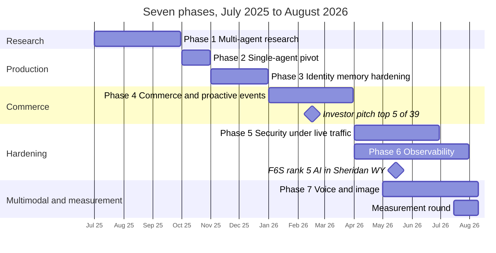
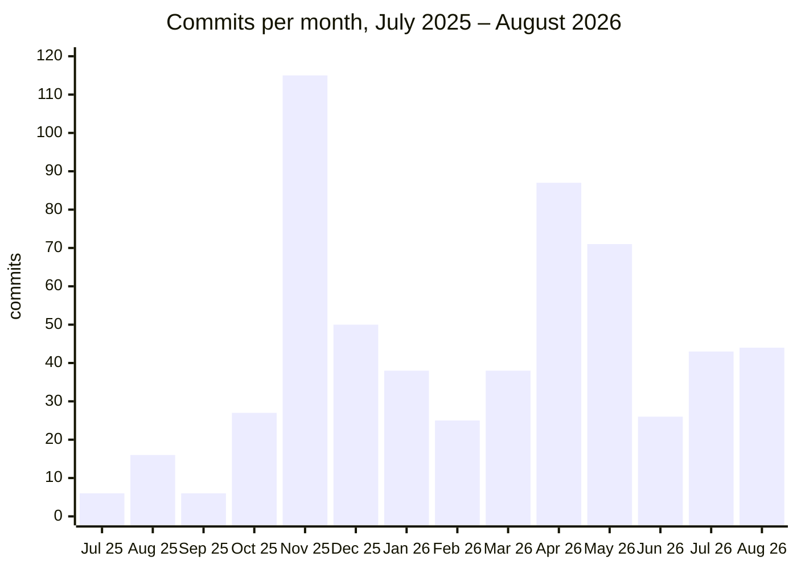
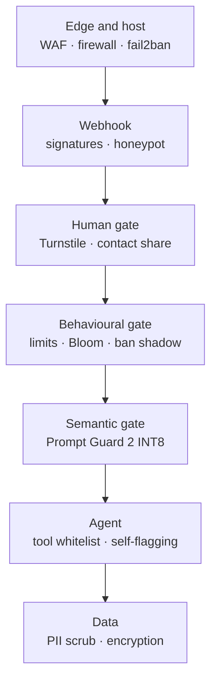

<!-- docs/01-timeline.md -->
[&larr; Back to the case study](../README.md)

# Timeline — Seven Phases of Production Agentic AI

*How the system got from a multi-agent research prototype to a transaction-capable production agent, phase by phase.*

---

## Origin & Brief

In July 2025 I was contracted as the sole AI engineer to build a conversational layer on top of an existing eSIM commerce platform. The brief was deliberately open-ended: build an AI agent infrastructure that can handle the full product lifecycle and troubleshooting in-chat, and scale without adding headcount. My proposal phased it, and the first phase was narrow by design: single-turn, one API call or one retrieval per message, on Telegram alone, with identity carried in a signed link rather than a login inside the chat. Multi-turn purchase, proactive alerts and WhatsApp were later phases. All three shipped; the signed link never did ([Login, Rebuilt Three Times](04-identity.md#login-rebuilt-three-times)).

I took a research-first path rather than reaching for a managed chatbot platform — starting with a locally-hosted multi-agent setup to validate whether agentic workflows could handle real customer conversation at all, before committing to production infrastructure. That phase produced findings that directly shaped everything after it, including the decision to throw most of it away.

By handover in August 2026, thirteen months in, the same system handled discovery, authentication, purchase, provisioning, proactive post-purchase engagement, multimodal input, and adversarial traffic — autonomously, across two channels, on one CPU box.

| Period | Phase | Outcome |
|---|---|---|
| Jul–Sep 2025 | 1 · Multi-agent research | Three-agent system validated the premise; latency and context limits identified |
| Oct 2025 | 2 · Production pivot | Collapse to a single agent on Gemini Flash and Qdrant — ~60% latency reduction |
| Nov–Dec 2025 | 3 · Identity, memory, hardening | Cross-platform identity, intent preservation, circuit breakers, CI/CD |
| Jan–Mar 2026 | 4 · Commerce | In-chat purchase, proactive notification pipeline · investor pitch, selected top 5 of 39 |
| Q2 2026 | 5 · Security | Layered defence under live attack · F6S #5 AI company in Sheridan, WY |
| Q2–Q3 2026 | 6 · Observability | Full metrics, logs, alerting as code, verified dashboards |
| Q2–Q3 2026 | 7 · Multimodal | Self-hosted speech, native vision |
| Q3 2026 | Measurement round | Measured resource model, 24-run model evaluation, prompt caching, auth verified against production |

---

## The Constraint That Shaped Everything

Most published agent architectures assume elastic cloud budget and GPU inference. This one had neither. The entire platform — agent, vector database, every ML model, observability stack — runs on a single commodity CPU box, for about $17 a month plus a few cents per conversation.

That constraint became the most productive design pressure in the project. It closed off brute force at every decision point and forced a discipline I now apply by default: **maximum capability, minimum footprint.**

In practice: every transformer in the request path quantized to INT8 and served through ONNX Runtime on CPU, and speech-to-text run through CTranslate2 at int8, rather than reaching for GPU inference. A two-tier query-embedding cache so repeat queries never touch the network. Retrieval fused server-side in the vector database rather than merged in application code. Speech models chosen by measured RTF-and-RSS trade-off rather than by reaching for the largest available.

The result is a stack where infrastructure overhead is small relative to model inference — not because the hardware is fast, but because nothing in the path is allowed to be wasteful. (Actual production timings, and where they diverge from bench measurements, are in [Performance](09-evidence.md#performance).)

I think this is the more interesting engineering problem, and the more transferable one. Anyone can make a system fast with money. Making it fast without any is where the decisions actually live.

---

## Thirteen Months in the History

The codebase's history at handover holds **592 commits** across its branches, from 21 July 2025 to 5 August 2026, every one of them under my name. By month:

The peak is November 2025, in Phase 3, when identity, memory and hardening landed together. The second is April 2026, at the start of Phase 5's security work under live attack. The last bar covers only 1–5 August.

---

## Phase 1 — Multi-Agent Research (Jul–Sep 2025)

**Hypothesis:** specialised agents, coordinating.

I started where the literature pointed, and from my prior academic project — a three-agent system (orchestrator, API agent, retrieval agent), running LLaMA 3.1 8B locally via Ollama against an in-memory vector store. It validated the core premise, that agentic workflows could handle genuinely unstructured customer conversation without collapsing.

It was also unusable in production.

**What broke:**

*Handoff latency compounded.* Every agent-to-agent transition cost an inference pass. Response times landed at 8–12 seconds. For a chat interface, that isn't slow — it's broken.

*Context windows couldn't hold the conversation.* At 128k tokens, maintaining coherent state across multi-turn troubleshooting while also carrying retrieved knowledge meant constant lossy truncation. The agent forgot things mid-conversation and users noticed.

*Locally-hosted inference was a dead end.* The quality-to-latency curve on available CPU hardware made it non-viable. A genuine research detour, worth the weeks spent to rule out definitively rather than assume.

**Finding:** multi-agent coordination is a real pattern with real uses. For a single coherent conversational domain it solved a problem I didn't have while creating one I couldn't afford.

**A parallel research excursion, alongside the multi-agent question.** In my own time, separate from what was scoped to ship, I also prototyped a more literal implementation of the Mem0 technique this system cites as inspiration — an LLM-synthesised "biography" of each user, refreshed under a distributed lock, alongside a "scratchpad" that re-derived the current conversational goal and any auth-blocked pending intents fresh on every turn. A genuinely more faithful reading of the cited research than what shipped. Retired anyway, because direct retrieval produces most of the same value as a side effect of a single search call rather than two or three extra model calls — full mechanism, and why, in [Research Notes](11-research-notes.md#ii-the-synthesised-memory-design--and-a-more-faithful-reading-of-mem0).

---

## Phase 2 — The Production Pivot (Oct 2025)

I collapsed three agents into one.

A single agent with a large context window and a rigorously designed tool layer replaced the entire coordination structure. Specialisation moved from *separate agents* into *schema-validated tools* — still specialised, no longer costing a network hop and an inference pass per invocation.

Alongside: migration to Gemini Flash for context capacity and native tool calling — 128k to 1M tokens — and, for retrieval, a migration that turned out to be one of the best calls of the project.

**Result: ~60% latency reduction.** 8–12 seconds became 3–5.

The retrieval stack moved in the same phase, from a hand-built hybrid to native hybrid search in Qdrant. That story, and why query caching came later, is in [Memory and Knowledge](03-memory.md#how-the-retrieval-stack-got-here).

This is the central lesson of the project, and I'll state it plainly: **architectural simplicity outperformed architectural sophistication.** The sophisticated design lost to the simple one. I've stopped being surprised by that.

**It happened twice.** For several months I developed two versions of the agent in parallel — a single-node "workhorse" agent and a multi-node one — iterating on both at once: improving the same prompt set, finding and fixing the same bugs, and running both through the same complex test cases and scenarios so I could watch them handle identical situations side by side. The multi-node version was a six-node graph — a dedicated context-loading node, an agent node deciding what to call, a token-injection node, the tool executor, a separate post-login handler, and a distinct synthesizer node with its own LLM call converting tool results into the final reply. Two full model calls per turn, minimum: one to decide what to do, a second, separately-configured one to write the answer. The other was the lean single-agent loop that eventually won.

It worked — and, as noted, I built it *alongside* the leaner design rather than before it, comparing the two directly on the same cases. Counter-intuitively, the multi-node version was the easier of the two to get behaving well: segregating tasks across dedicated nodes and two separately-configured LLM instances meant each piece had a narrow job and misbehaved less. Its weakness was the seam between the pieces. To get the final answer right for the user's intent, the synthesizer had to be handed the user query, the decision model's reasoning, the tool set *and* the history anyway — so most of the context was being passed across the seam regardless, creating redundancy rather than removing it, and the prompt set needed to steer that second model kept growing longer and more tangled. The result was a split-brain failure mode: the final-answer model, working from a relayed picture rather than the live one, would routinely write something subtly off from what the conversation actually needed, worst in the early stages and never fully gone even after I committed to the single-agent path. Put bluntly, the single-node prompt read like a whole person; the synthesizer, next to it, seemed dumb.

For a chatbot where latency is a first-class constraint, once you get the single-agent prompt right this is a no-brainer for both UX and efficiency — one model, one pass, the whole picture.

The single-agent version was the opposite: a mess at first, steadied only by many iterations of prompt engineering, and once steady it never looked back. The reason it wins is the reason it was hard: **one LLM gets the entire view of the environment and the problem in a single call** — the full history, the live context, the tool results, the user's actual phrasing — instead of a decision model and a synthesis model each seeing half of it. Once the prompt base matured into a stable backbone, that whole-context view produced answers that were faster, more coherent, and more personalised than the multi-node design's could be.

So this is a genuine design choice, not a verdict. Multi-node architectures are easier to keep from breaking, precisely because they segregate focus — for many problems that governance is worth the extra machinery and the seam risk. For *this* problem, a conversation where one mind needs the whole picture to answer well, the single-LLM approach simply outshone it, once the prompt work was there to hold it steady. In graph terms it collapsed to the two-node loop documented throughout this case study — an agent node and a tool node joined by a conditional router, looping until done — with synthesis folded into the same call that decides the tool calls. Same outcome, half the LLM calls per turn. The three-agent-to-one-agent collapse in Phase 1 → 2 was the visible version of this lesson; this was the quieter second version, one level down, inside the single agent itself — and the more transferable of the two.

### One agent or several

The field split in public in June 2025. Cognition's [*Don't Build Multi-Agents*](https://cognition.ai/blog/dont-build-multi-agents) argued for one thread of context, because actions carry implicit decisions and parallel agents make conflicting ones. Anthropic's [multi-agent research system](https://www.anthropic.com/engineering/multi-agent-research-system) reported a lead agent with parallel subagents beating a single agent by 90.2% on its internal research evaluation, at around fifteen times the tokens of a chat, and named the poor fit: domains where every agent needs the same context, or where agents depend on each other heavily. In April 2026 Cognition's [follow-up](https://cognition.com/blog/multi-agents-working) narrowed its own position: several agents can contribute intelligence while writes stay single-threaded.

This case study ran the experiment twice, as above, and its failure is the one Cognition describes, in the kind of domain Anthropic names as a poor fit. The multi-node version's answer model worked from a relayed picture and wrote answers subtly off. A customer conversation, on one account, with writes that move money, is the shared-context, write-heavy task that both posts place with a single agent.

---

## Phase 3 — Identity, Memory, Hardening (Nov–Dec 2025)

Two channels, one human being — and, once web login existed, a browser session too. The agent had to know they were all the same person.

How identity, login and sessions were built, and what broke on the way, is in [Identity, Login and Sessions](04-identity.md). The same phase hardened the agent itself: the rules that keep it honest are in [The Agent](02-agent.md#the-rules-that-keep-it-honest), and the reliability and coordination work is in [Running It](08-operations.md#reliability-and-coordination).

---

## Phase 4 — Commerce & Proactive Engagement (Q1 2026)

The phase where the agent stopped being support tooling and became a commerce platform.

In-chat purchase, the proactive notification pipeline, the platform rules that shaped delivery, and the test-log record of what in-chat payment got wrong and what it got right are in [Commerce and Messaging](05-commerce.md). The uncomfortable truth of this phase was that the hard part of AI commerce was distributed-systems work, not the model.

---

## Phase 5 — Security Under Live Fire (Q2 2026)

A publicly reachable agent with a free-tier offer is an attack surface. It was found and probed accordingly — automated scanners, credential stuffing, scripted account farming, prompt injection, and coordinated abuse of the promotional flow. Everything built in this phase exists because something tried it.

The result is ten defence layers from the CDN edge to the database column, with the application's own gates sitting in front of the model rather than instructions sitting inside it:

| Mechanism | What makes it interesting |
|---|---|
| **Human gate** | Every first message passes a Turnstile challenge, then Telegram users share their contact card. Link-preview crawlers are served a decoy so they can't consume single-use links, and a puzzle solved in under 1.5s is flagged as automation even when the token validates |
| **Behavioural gate** | Identity-keyed sliding windows, offence escalation to a permanent ban, and deliberate asymmetry — one localised notice a day for suspended customers, total silence for banned adversaries |
| **Cross-platform ban shadow** | A fuzzy identity fingerprint catches the same person re-registering on the other platform |
| **Semantic gate** | Three cheap fast paths, then chunked, batched classification with a strike rule that defeats dilution attacks. Voice transcripts are scanned too, because a spoken injection walks past every text guard |
| **Honeypot** | Invisible zero-width bait; a bot that echoes it is dropped with a silent 200 before the agent is ever invoked |
| **Agent-initiated flagging** | The model itself flags what patterns can't see — including injections smuggled through voice or text inside images — with real blocking power |
| **ML risk scoring** | 21 features, rebuilt around conduct, labels protected from target leakage, promotion gates, and inference that stays off until a human turns it on |
| **Data protection** | Per-entity PII confidences that retain destinations for personalisation, and one key driving both Fernet encryption and deterministic HMAC lookup hashes |

Validated adversarially: **19,164 malicious payloads absorbed at 319 RPS** while legitimate traffic held **100% success** (bench, pre-multimodal).

The infrastructure itself was reshaped by that experience. The first deployment was built for scalability in the abstract; what it actually met on going public was a security onslaught. The redesign that followed optimised hard for performance under that reality — moving to a stream-based message-processing model guarded by semaphores (the same shape as the [notification system](05-commerce.md#proactive-delivery)), and pulling essentially every operational value out into environment configuration so limits, workers and model choices could be retuned without a code change.

The net effect was a system that got *stronger* under attack rather than merely surviving it — each wave of abuse became the specification for the next layer of defence. The company's founder made the same point publicly and more memorably than I would, [on the F6S announcement](../README.md#recognition): that the constant probing amounted to a free, continuous penetration test, and that their malice was what let the platform harden. I'd only add the honest footnote that antifragile isn't free — see the rough three-month stretch described in [Identity, Login and Sessions](04-identity.md#when-a-session-expires), where a reworked auth flow stayed broken and drained real momentum. The system came out tougher; it wasn't painless.

**Every mechanism, every threshold, and the reasoning behind each is in [Security Architecture — A Deep Dive](07-security.md).**

---

## Phase 6 — Observability (Q2–Q3 2026)

You cannot operate what you cannot see.

Observability was designed in from the start: a confidence score and a reasoning string on every response, tracing of every model call and tool call, metrics, logs and dashboards, and a check that the dashboards themselves tell the truth. The full account is in [Running It](08-operations.md#observability).

---

## Phase 7 — Multimodal (Q2–Q3 2026)

The most recent work: native voice and image, **entirely self-hosted — no per-minute speech billing, no third-party voice APIs.**

This sits alongside a handful of pieces in this project I'd call genuinely novel — not because the components are exotic, but because the *combination* wasn't a thing anyone had a reference implementation for when I built it: a full voice-and-image concierge that also transacts, running on CPU inside conversational latency, for about $17 a month plus a few cents per conversation. Like the [notification system](05-commerce.md#proactive-delivery) and the [identity manager](04-identity.md#one-person-many-channels), the multimodal layer is a simple, cheap, elegant solution to a problem usually answered with expensive infrastructure — each one arrived at the same way: my own insight, a lot of reading, and iteration against a real latency and cost budget rather than a whiteboard. I'm documenting it in some depth precisely because the lean-multimodal path is under-travelled and I'd have wanted these notes myself.

How it works, what it took to make it fast, and where it stood at handover are in [Voice and Images](06-voice.md).

---

[&larr; Back to the case study](../README.md)
