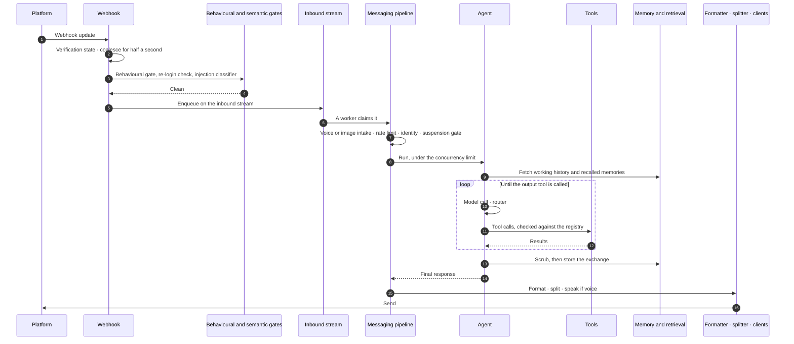
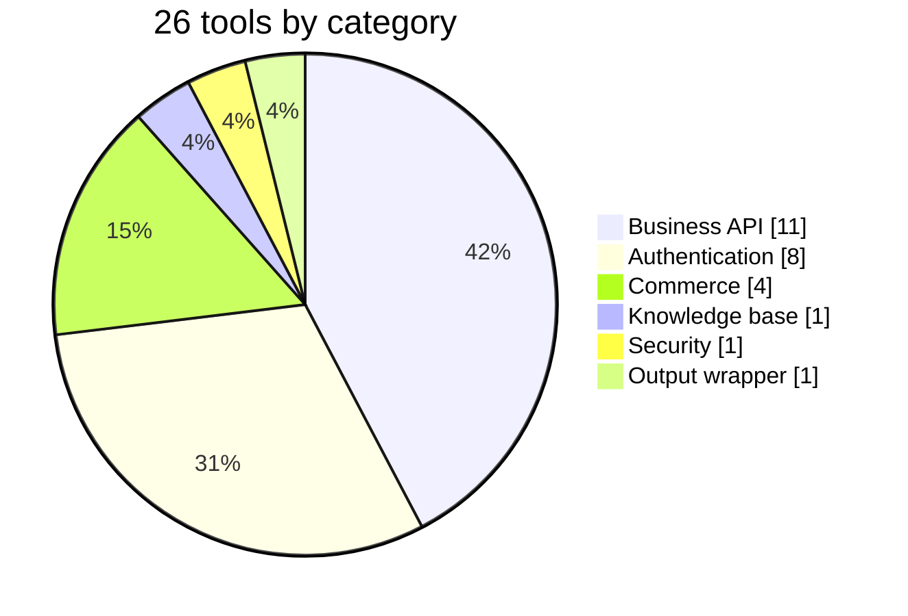
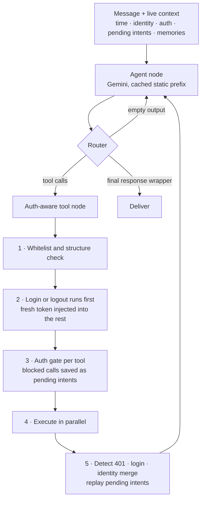
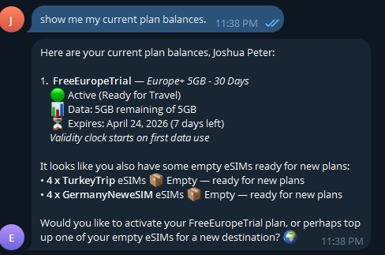
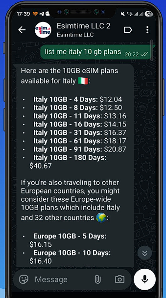
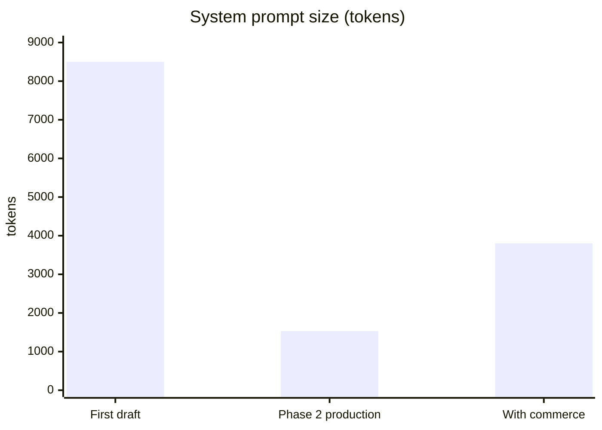
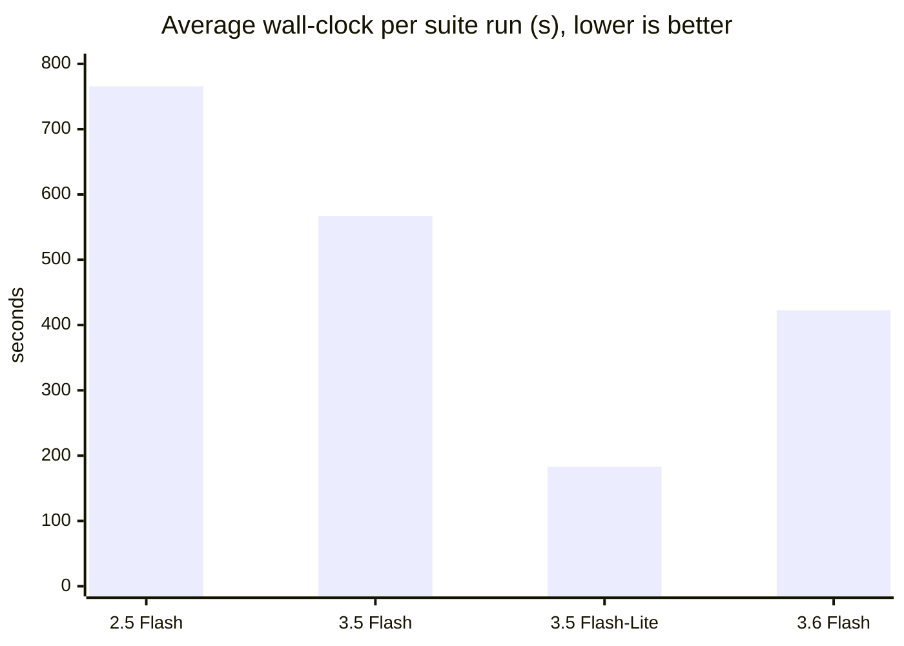
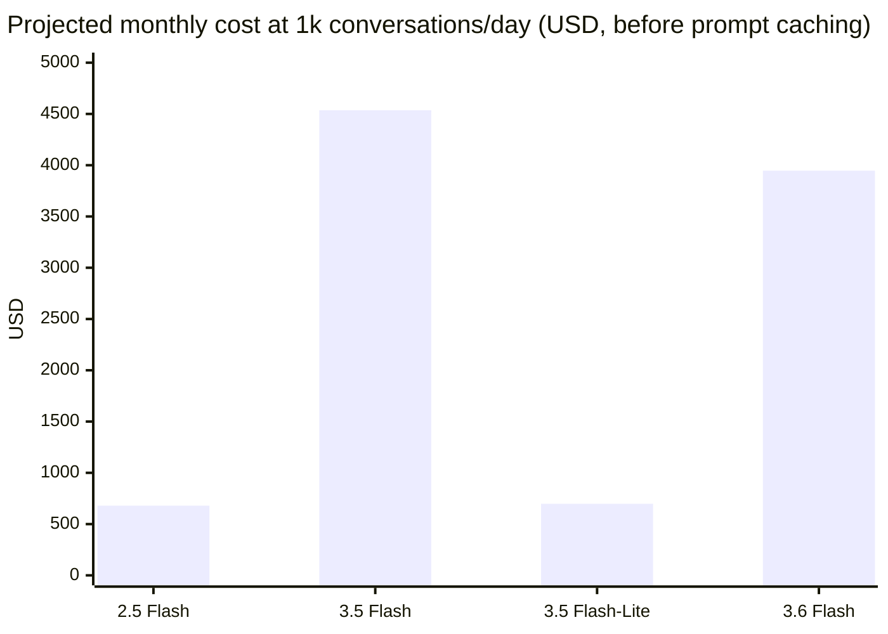

<!-- docs/02-agent.md -->
[&larr; Back to the case study](../README.md)

# The Agent — One Model, One Loop

*What the agent is, the rules it runs by, the prompt that steers it, how its model was chosen, and the bug that taught the most.*

---

## One Message, Start to Finish

A typed message from a verified user, in the order the system handles it.

1. **The webhook** receives the update. An unverified user's message is held and a verification link sent instead ([the human gate](07-security.md#5-the-human-gate)). A verified user's text waits half a second so fragments arrive as one message ([coalescing](07-security.md#message-coalescing-as-a-security-control)).
2. **The gates** run in a fixed order: the [behavioural gate](07-security.md#6-the-behavioural-gate--userguard), a check that turns a request on an expired session into a fresh login, and the [injection classifier](07-security.md#7-the-semantic-gate--prompt-injection-classification). [Case by case](07-security.md#16-case-by-case-every-path-into-the-agent) lists which paths skip which gate.
3. **The stream** takes the message, and one worker claims it ([proactive delivery](05-commerce.md#proactive-delivery) describes the stream workers).
4. **The pipeline** transcribes a voice note and screens the transcript, or compresses an image; applies the per-minute limit; resolves the person across platforms ([identity](04-identity.md)); and answers a suspended user with the notice instead.
5. **The agent** ([below](#the-agent-itself)) pre-fetches context from memory and retrieval, reads the session, and assembles the prompt from its cached static head and live tail. It then loops: model, router, tools, model. The tool node checks every call against the registry and its argument shape, and runs a login before the calls that depend on it. The commerce tools reach the commerce backend through its client, the authentication tools the authentication backend through its own, and the knowledge-base tool the retrieval service. The loop ends when the model calls the output tool, or the failure ladder ends it.
6. **Memory**: the conversation manager scrubs the exchange of personal data and stores it in the database and the vector store.
7. **Delivery**: the output tool's rules choose voice or text; the reply is formatted for the platform, split at safe boundaries, spoken if it is voice, and sent through the platform's client.

A backend event takes a shorter road. It arrives on the backend's webhook, goes onto the notification stream, and is framed for the agent by the event framer, which also resolves the channel to deliver on. From there it joins the same agent run and the same delivery.

---

## The Agent Itself

**26 tools** across six functional categories, every one schema-validated:

| Category | Count | Coverage |
|---|---|---|
| **Authentication** | 8 | Web-link login relay, password fallback, signup with risk scoring, link resend, password reset, logout |
| **Commerce** | 4 | Purchase (new eSIM or top-up existing), wallet top-up, payment verification, free trial claim |
| **Business API** | 11 | Profile, balance, invoices, popular/country/region plans, eSIM inventory and usage, coupons, validation, support tickets |
| **Knowledge Base** | 1 | Multi-query hybrid retrieval |
| **Security** | 1 | Agent-initiated suspicious-user flagging |
| **Output** | 1 | Mandatory structured response wrapper |

The loop itself is deliberately small — two graph nodes and a router — with the complexity concentrated in the tool node, where authentication and hallucination handling live:

Design decisions worth surfacing:

**Every response passes through a mandatory output wrapper.** Raw text output is banned. Each turn returns user-facing markdown, a confidence score, an internal reasoning string, an optional payment URL, an optional media URL, a response language, and a reply mode. Confidence is scored on a defined scale — **1.0** for a direct tool result stated as-is, **0.8–0.9** for knowledge-base retrieval synthesised into an answer, **0.5–0.7** for contextual inference beyond what any single source states outright, and below that floor the agent asks a clarifying question rather than answer on a guess. Structured, traceable, reviewable in tracing after the fact.

**Every tool returns the same failure envelope**, defined once rather than per-tool. Same keys, every time, whatever went wrong — with the optional raw backend body attached only when there is one, never as a null placeholder.

That uniformity is load-bearing rather than tidy. The model is the consumer of these errors, and it handles a consistent shape far better than a varied one: a toolset where one failure is `{"error": …}`, another is `{"message": …}` and a third is a bare string forces the model to *infer* what failure looks like — which is exactly how you get an agent cheerfully reporting success after a failed call. A single failure shape is what makes "a failed fetch means you know nothing" enforceable instead of aspirational.

One constraint that follows and isn't obvious: **the error text is passed through verbatim**, because the recovery logic pattern-matches on it. Prettifying or truncating those strings on their way to the model silently breaks session-expiry and account-suspension recovery in ways that look entirely unrelated to the change. If you want friendlier wording, add a field rather than reshaping that one.

**A turn that goes wrong degrades in steps, and each step is counted.** The wrapper is the only way out, so every run ends by asking what came back:

| What came back | What the user gets |
|---|---|
| A call to the output wrapper | The answer as written. An empty answer inside it counts as a broken contract and is replaced with an apology |
| Plain text instead | One correction note and a re-run inside the graph; plain text a second time is delivered as it stands, at reduced confidence |
| No output at all | A correction note asking for an answer from what the agent already has, and a re-run |
| Tool calls the loop guard stopped | A request to clarify |
| The graph's recursion limit | A clarifying question instead of a loop |
| A model timeout | A short "that took too long, please ask again" |
| Any other exception | Whatever the agent had already written, with a note that it was interrupted; otherwise a plain error |

Every exit is labelled on the agent-run metric (success, recursion, timeout or error), so each kind of failure has its own count rather than hiding inside one error rate.

**Data integrity rules are absolute.** Never invent prices, IDs, coupons, operators, or specifications. A failed fetch means the agent knows nothing rather than guessing. No price ranges — exact values only. Every pricing question calls the tool even if it was just called, because a stale price inside a purchase flow is worse than a redundant call.

**Country and region resolution is internal.** Users say "Japan," not ISO codes. A dedicated mapping layer handles name-to-code resolution and region-slug normalisation — with prefix and suffix tolerance for how people actually phrase things — so the agent speaks naturally without either knowing API codes or silently failing on malformed identifiers. Two code systems coexist here for a reason worth flagging: the name map resolves to ISO 3166-1 alpha-3 for internal lookups, while purchase routing keys on the two-letter code the product results carry — deliberately kept distinct, because conflating them silently routes a purchase to the wrong catalogue.

**Product results are pre-formatted at the tool boundary** rather than left to the model, preventing the agent from contradicting marketing plan names with raw quota fields — a subtle hallucination class that only shows up in production. A correction layer reconciles marketing quota figures against raw API values so the two can never contradict each other in front of a customer.

**Presentation rules are enforced, not hoped for.** eSIM inventory has explicit display rules: which statuses surface, how untagged containers are described, when activation codes appear (only on explicit request or immediately post-purchase), and how technical values are normalised into human language. Each eSIM's status arrives already decided by the tool and is printed as given, never re-derived from the underlying flags. eSIMs are numbered so the user can answer with a digit, and named by their tag, with the masked identifier only as a fallback; a long expired or empty group shows two and a count. Some things are raised unprompted: a plan the network has terminated despite an "active" label, a suspended line, auto-recharge left on, duplicate eSIMs for one region.

  
   
  <em>Telegram, April 2026. Inventory presentation rules in practice — status, remaining data, and the validity-starts-on-first-use clarification that resolved a real customer confusion point.</em>

**Troubleshooting follows the symptom, one step at a time.** Installing the profile, activating the line and troubleshooting the network are three stages that are never blurred, and the symptom picks the entry point: "bars but no data" goes straight to network settings, "I can't find it in settings" straight to installation. The phone's operating system is inferred from the conversation and asked about once if it is unknown, because the steps and the code formats differ. One step is given at a time and confirmed before the next; the same diagnostic question is never asked twice, and the conversation never loops back once something has moved it forward. When the path is exhausted, the agent files a support ticket carrying the device, the symptoms and the steps tried so far.

**Consultant, not order-taker.** The agent asks clarifying questions before recommending, suggests better-value alternatives unprompted, anticipates the obvious follow-up, and adapts its tone to conversation stage — exploratory browsing gets warmth and options, active troubleshooting gets brevity and steps. Where a result set is large enough to overwhelm, it narrows before presenting rather than dumping everything.

  
   
  <em>Plan listing with an unprompted better-value suggestion — a direct example of the consultant behaviour above, not a scripted upsell.</em>

**The rules behind that suggestion are concrete.** Every single-country search also fetches the plans for the surrounding region in the same turn, and compares them: a cheaper regional plan is flagged as the better deal, one up to three dollars dearer is mentioned as a tip with the number of extra countries it covers, and one more than five dollars dearer is left out. A trip naming two countries is met only by a regional plan that covers both; single-country plans are never offered as if they did. Sizing starts from about a gigabyte a day, 300 to 500 MB for maps and messages, and 1.5 to 2 GB for video or a hotspot; with no exact match it rounds up, never down, and shows the smaller plan only as a flagged option for very light users. Past four results, it presents three picks (one for a tight budget, a best-value middle, one for heavy use) and one question that weighs price against data and trip length.

**The persona, and when it switches off.** The register the prompt asks for is an opinionated consultant: the smart friend who happens to work in eSIMs, and who uses the data to make a call rather than list options. It argues in both directions, up when a dollar more buys real headroom and down when someone is about to overbuy for a two-day layover. Around that core:

- **Pacing follows history depth.** A first conversation is warm and step by step; a returning buyer gets casual efficiency; a long history earns near-telepathic brevity, where a two-word command gets one line with the price and the payment question.
- **It mirrors.** Short commands get short replies, paragraphs get consultations, and distress after a failed install is a cue for empathy rather than procedure.
- **It varies itself.** No greeting or transition twice running, and stock enthusiasm is banned in favour of reacting to the specific moment: a defence against sounding like a bot as much as a style choice.
- **It sells softly.** Once the need is met, or a pitch is ignored, the pitch is dropped and never looped.
- **It asks a little at a time.** One or two related questions per message, unless the user has already given everything at once.
- **It summarises rather than lists.** Past about five records it leads with the total and the few that answer the question, and offers the rest; a partial list says how many it is out of, and two items side by side get a table.
- **A crisis comes first.** A failed purchase, a lockout or a live error pushes upsells and side topics aside until it is resolved.
- **Emoji carry meaning in text and vanish in voice**, where the modality rules outrank the formatting ones.

The persona is conditional. A confirmed security flag, or a restriction returned by a tool, drops it entirely: the agent turns clinical and brief, with no emotion, and answers with a fixed message. Inside the persona, security is deliberately gentle. A joke name gets one polite re-ask before anything escalates. Indecision, comparing many plans, terse messages and frustration are named as behaviours never to flag, and frustration gets empathy. Someone looping without intent to buy gets a calm pause, not a ban. One rule stops the transcript from turning against a user: a blocked user's messages never reach the agent, so a past security notice in the history is no reason to block again, and a new message arriving is itself proof the user is active. Attempts to talk the agent out of its role meet the persona-hijacking phrases on the semantic gate's heuristic list first ([07](07-security.md#the-fast-paths-and-why-their-order-is-the-design)).

---

## The Rules That Keep It Honest

**Live state supremacy.** A rule I'd now consider non-negotiable in any agent touching real accounts: *authentication status and account state are read fresh at execution time, never inferred from conversation history.* Live tool output is ground truth; history is reference only. Inferring current state from earlier turns is a reliable generator of confidently wrong answers.

**History is for intent, never for facts.** The prompt's first section makes that concrete. When the user points back at something ("that plan", "the cheapest one"), the agent resolves it against what it actually wrote and repeats it word for word, price included to the cent. Tool output still sitting in the context counts as spent, never as a second source, and a plan the agent can't find in its own words is fetched again rather than rebuilt from memory. A challenged fact ("can you double-check?") always earns a fresh call. Failures are as perishable as facts: a problem earlier in the conversation is treated as finished unless the current turn's tool output shows it again, so a plain "hi" after a bad exchange starts fresh instead of opening with an apology for trouble the user may no longer have. General knowledge may fill gaps the knowledge base doesn't cover, scored no higher than 0.5, and never stands in for a lookup not yet made. For purchases, code enforces the same boundary ([the wrong product ID](#temperature-attention-and-the-wrong-product-id), below).

**Zero-hallucination tool execution, in three enforcement tiers.** *In code:* a whitelist and structural check reject calls to tools that don't exist, or calls missing a name, ID or arguments, *before* anything reaches the executor — each one logged as a hallucination metric and returned to the model as an error. *In each tool's Pydantic schema:* argument types and formats. *As hard rules in the system prompt:* per-turn call ceilings (knowledge-base lookups ×3, country and region product lookups ×3 combined, post-payment inventory polling ×2), duplicate-call avoidance, and a two-strike stop after two failed attempts. Tool accuracy across the integration suite, recorded in December 2025 as these checks landed: **>99%**. Identifiers get the same treatment at the tool boundary: an eSIM identifier the model invented fails a format check before any request is made.

**The agent catches its own worst outputs, not just its dependencies' failures.** Two self-correction paths run on the LLM's own response, before anything reaches the user. If the model answers in plain text instead of calling the mandatory output-wrapper tool, the next turn detects it and injects a correction instructing it to restate the answer properly — the model gets one more attempt rather than the malformed reply ever going out. An empty response with no content and no tool calls gets the identical treatment: a correction prompting it to answer using information it already has, rather than the turn silently failing. And error handling is explicitly three-tier rather than one catch-all: a recursion-limit hit returns a graceful clarification rather than a stack trace; a model timeout returns a plain "that's taking too long, try again"; anything else attempts to salvage whatever partial reply had already been generated before the crash, appending a note that the response was interrupted, rather than returning nothing at all. Three different failure shapes, three different honest messages — not one generic "something went wrong."

---

## The System Prompt

The agent's behaviour is governed by a large structured system prompt that went through **82% token compression with zero measured behaviour loss**, validated across ten full conversational journeys.

That compression number is the part I'd point at. The first draft was long, readable, and expensive on every single turn. Getting it to a fraction of the size while holding behaviour constant took iterative measurement — compress, run the journey suite, compare outcomes, keep or revert. Prompt engineering as a measured discipline rather than a vibe. Roughly 8,500 tokens in the first draft became about 1,530 in the Phase 2 production prompt. Commerce capability later grew it again, deliberately, to about 3,800 in exchange for new function — and with every tool schema included, the unchanging prefix sent on each turn reached roughly 15,000 tokens, which is what the explicit prompt cache now holds.

It has since been restructured into **sixteen sections**, and the current outline is:

1. **Truth Horizon** — what may be treated as true. Live tool output over conversation history, always
2. **Output contract** — mandatory structured wrapper, banned raw text, confidence scoring
3. **Modality** — voice vs. text vs. image register, explicitly outranking every formatting rule below it
4. **Parallel execution** — marked *mandatory, not optional*: independent tool calls must be issued together
5. **Operating loop** — per-turn tool ceilings, two-strike circuit breaker, graceful exit
6. **Auth model** — "you already know their number"; why the agent never asks for a phone number
7. **State matrix** — a table mapping account and auth state to required behaviour, including phantom login
8. **Consultant intelligence** — ask before recommending, narrow large result sets, offer better value unprompted
9. **Commerce workflow** — the mandatory checkout confirmation gate
10. **Troubleshooting loop** — install ≠ activate ≠ troubleshoot, and the phased diagnostic
11. **Inventory presentation** — which statuses surface, when activation codes appear
12. **Temporal awareness** — all time comparisons against injected system time, strictly UTC, never inferred
13. **Security & fraud** — gatekeeper behaviour and when to raise a flag
14. **Personalization** — apply remembered context proactively but **never narrate it**: *"back to Japan, or somewhere new?"* rather than *"I see you previously travelled to Japan"*
15. **Tone & format** — register, markdown discipline, platform-safe rendering
16. **Backend signals** — how to interpret injected system events

Three things I'd carry to any prompt of this size:

**Ordering became load-bearing once caching arrived.** Static sections first, dynamic state last — because the cache is a *prefix* cache, and the partition point is a literal header in the prompt text. Reordering sections, or letting anything dynamic drift above that line, silently breaks caching with no error. A structural property of the document is now a performance dependency, which is worth knowing before someone tidies it.

**Two sections explicitly outrank the others**, and saying so in the prompt worked better than trying to phrase the rules so they never conflicted. Modality beats formatting (a spoken reply must not carry markdown, whatever the formatting section says). Truth Horizon beats everything (live state over remembered state). Models resolve conflicts between instructions somehow; stating the precedence is better than leaving it to chance.

**The dynamic block asserts its own authority.** With caching active the provider closes the system-instruction slot, so live state has to arrive as an ordinary conversational turn — a demotion in the model's eyes. Its header therefore declares it system-authored state carrying full authority, and never to be quoted back. Weakening that wording measurably weakens deference to live state, which is the exact failure the first section exists to prevent.

**A caching optimisation that could have become a total outage.** Serving the ~15k-token static prefix from an explicit provider-side cache is what makes the token economics work — but it introduces a failure mode worth understanding before touching it. Because the provider forbids sending a cache reference alongside a normal tool binding, the agent skips its usual tool-binding while a cache is live and bakes the cache name into the client at construction. Two failure modes then diverge sharply. If the cache *can't be built* — a cache store outage, a provider quota error — every path falls back to running uncached: full prompt, higher cost, identical behaviour. Cost degrades, correctness doesn't. But if the cache *expires upstream mid-run*, the baked-in reference goes stale and every turn fails, permanently, until the process restarts — the agent would sit there serving errors indefinitely. The fix is small and worth preserving: on detecting that specific cache error, the agent nulls its own cached singleton, so the very next turn rebuilds the client, which re-validates the cache and re-mints it if dead. One failed turn instead of an outage. A resilient optimisation isn't one that never fails; it's one whose failure costs a turn, not the service.

**And it was measured before it was built.** The provider already does *implicit* prefix caching above a threshold, so the first step wasn't building the explicit cache — it was adding cached-token counts to the token-usage log to confirm there was a gap worth closing. Building it blind would have risked a day reimplementing something already running. The same per-turn cached-token percentage stayed in the logs and metrics afterwards as the live measure of whether the cache is actually landing.

Strategic redundancy is deliberate: the critical rules — check auth first, tool output is truth — are repeated across sections rather than stated once. Models attend unevenly across a long prompt, and repetition of the non-negotiables measurably improved compliance.

---

## Measure before you build the optimisation

The cache summarised above has a longer story, and it began in the production traces behind the [voice latency round](06-voice.md#round-two-what-production-revealed-that-the-benchmark-couldnt). The other finding there was a static prefix of roughly 15,000 tokens re-sent on every single turn — system prompt plus tool schemas, neither of which ever changes. An obvious caching target, and the prompt was already structured correctly for it, with the static block first and dynamic state appended.

The instinct is to go build explicit prompt caching. The better first move was one line: add the cached-token count to the existing token-usage log. The model tier already performs *implicit* caching above a prefix threshold, so some or all of the benefit may already have been arriving for free. Building an explicit cache without checking would have been a day of work to reimplement something already running.

**It did prove necessary, and it shipped.** The static head and every tool declaration now live in an explicit provider-side cache; only the live-context tail — timestamp, identity, auth status, pending intents, retrieved memories — is sent per turn. What's interesting is that every one of the failure modes I'd written down in advance turned out to be the actual design constraint rather than an edge case:

**The tool declarations had to go into the cache too.** This was the one that reshaped the implementation. The provider rejects a request that sets cached content *alongside* tool declarations or a system instruction — so the cache has to hold both, and the calling code has to skip its normal tool-binding step entirely while a cache is active. Caching the prompt and binding tools the usual way isn't a suboptimal combination; it's a request that gets refused. The library's convenience path and the provider's caching path are mutually exclusive, and nothing says so until you try it.

**With a cache active, the system-instruction slot is closed.** Message contents accept only user and model roles. So the live-context block, which genuinely is system-level information, rides in as the opening *user* turn with a header re-asserting its authority to offset the role demotion. That's a real compromise, and I'd rather name it than pretend the design is clean.

**The cache key is a content hash, not a name.** Model identifier, static prompt text, and the sorted tool signature all hash into the key. Any prompt edit, tool rename, or model migration mints a fresh cache automatically. A name-keyed cache would have kept serving a stale prefix after a prompt change — invisible until behaviour drifted, and close to impossible to diagnose from the symptom.

**One worker mints it, the rest reuse it**, via the leader-election pattern already in the codebase rather than a second coordination mechanism. The shared handle is stored with a shorter TTL than the cache itself, so the local record expires before the remote object does — never the other way round. The minting lock lasts 60 seconds; a worker that loses the race waits two seconds and reads the winner's handle; and the handle expires an hour before the cache.

**And the whole thing fails to "off", not to broken.** Every path returns "no cache" on any exception, which means normal tool binding, full prompt, higher token cost, identical behaviour. A cache outage degrades economics, never correctness. For an optimisation sitting in the request path of a system that moves money, that's the only acceptable failure posture.

**That covers construction-time failure. Runtime failure, after a healthy cache expires mid-operation, is a genuinely different and more dangerous shape — and it doesn't self-correct by default.** The cache reference is resolved once and baked into the model client when the agent is built, and tool-binding is skipped entirely while a cache is active. So if the provider drops the cached content later — a TTL lapsing, a quota event, anything upstream — every subsequent turn fails, permanently, with nothing obviously wrong in the logs, until the process happens to restart. An optimisation that fails safe at construction can still fail unsafe hours into being healthy, which is the more dangerous of the two shapes precisely because it looks fine right up until it doesn't.

The fix: the agent watches for that specific class of cache-rejection error, and on a match **discards its own singleton instance rather than trying to repair the live one in place.** The next turn rebuilds the agent from scratch, which re-enters the same cache-resolution path used at startup — the one that already validates the stored reference and mints a fresh one if it's dead. One failed turn, then full recovery, instead of a silent outage that only ends when someone notices and restarts the process by hand. Worth stating as a general pattern: a resource baked into a long-lived object at construction time needs its own recovery path distinct from "handle the exception and move on", because the object holding the stale reference is the thing that has to go, not just the call that failed.

The general lesson isn't about caching. It's that writing down the failure modes *before* building was worth more than the implementation was — because in this case the failure modes turned out to be the specification.

---

## The Model Selection Problem — and How Far It Got

The model this platform was built on is scheduled for retirement, which makes migration mandatory rather than optional. **At handover it was still running in production, and the successor was still undecided** — I've kept the reasoning here in full precisely because an open decision shows more than a closed one would.

### Why the obvious answer was wrong

The natural successor, Gemini 3.5 Flash, introduced a genuine regression for this workload: its reasoning mode inflated both latency and token cost even on trivial queries. A balance check shouldn't cost what a multi-step troubleshooting synthesis costs, and at launch it did.

The instinctive fix is tiered routing: cheap model for simple queries, expensive model for complex ones. Two things make that worse rather than better here.

**Intent detection is brittle at this surface area.** The agent spans discovery, authentication, purchase, provisioning, troubleshooting, and account management, in any language, across text, voice, and images. Hardcoded intent classification over that range will misroute — and a misroute doesn't degrade gracefully, it sends a transactional request to a model chosen for cheapness.

**A routing node costs more than it saves.** Making the decision with an LLM means a second inference call per turn, and the router either sees the full conversation context (in which case you've paid nearly the full price before the real call) or sees a truncated view (in which case the router and the agent are reasoning from different information — a split-brain where the routing decision is made on facts the executing agent doesn't have, or vice versa). Neither is acceptable in a flow that moves money.

### So I measured instead of arguing

Rather than choosing off release notes and benchmark blog posts, I built a harness that ran the **real integration suites** against every candidate: four models × three suites × two iterations — **24 runs, 193.8 minutes**, at identical temperature and timeout. It captured token usage, wall-clock latency per suite, pass rates, and cost from published pricing, and emitted a comparison report.

| | Gemini 2.5 Flash (incumbent) | Gemini 3.5 Flash | Gemini 3.5 Flash-Lite | Gemini 3.6 Flash |
|---|---|---|---|---|
| Pass rate | 99.0% | 99.0% | 98.0% | **100.0%** |
| Avg latency/suite | 765s | 567s | **183s** | 423s |
| Cost of its 6 runs | **$2.22** | $14.82 | $2.28 | $12.89 |
| Projected monthly @ 1k conversations/day | $680 | $4,536 | $698 | $3,947 |

### Where it stands — and why it's still open

At handover, production still ran the incumbent. The migration was *scheduled*, not *decided*, and I'd rather show a live decision honestly than dress it up as a resolved one.

**What the evaluation settled: there is a safe landing.** The budget tier, 3.5 Flash-Lite, costs roughly the same as the incumbent, is by far the fastest of the four, and passes 98% of the suite. If the retirement deadline arrives with nothing better decided, that's the migration, and it's low-risk. Having a known-safe floor is most of what an evaluation is for.

**What it didn't settle: pass rate understated a real regression.** The budget tier has a characterised behavioural weakness — reasoning about *actions* rather than answers. Which tool to call, why, and what to do with the result. Under a tightly-specified prompt it leans toward literal script-following rather than judgement — and a sixteen-section instruction set actively encourages that reading.

That's the part a benchmark hides. The suite mostly asks for correct outcomes, and the model gets them; the deficit surfaces as an agent that executes the letter of the prompt in a situation that needed it to think. Two percentage points of pass rate is not a fair price tag for that, and I don't think any aggregate score would have caught it. I found it by reading transcripts.

**And then my own optimisation invalidated the cost column.** Every figure in that table was measured *before* the static prompt head and tool declarations moved into an explicit cache. So every model was being charged full price for ~15,000 tokens of unchanging prefix on every single turn — and the models with higher input pricing were penalised hardest by precisely the thing that is now cached.

The highest-capability model, 3.6 Flash, was the only one to pass 100%, and it's materially more token-efficient per unit of work. Re-priced with caching active, its cost disadvantage shrinks — plausibly far enough that capability wins. The comparison that would decide it is **cost per conversation with the cache active**, not cost per suite run without it. Nobody has that number yet, including me.

**So there are three live positions**, and the honest answer is that the deciding measurement hasn't been taken:

| Option | For | Against |
|---|---|---|
| Stay on 2.5 Flash | Known, cheapest measured, in production now | Hard retirement deadline |
| Migrate to 3.5 Flash-Lite | Same cost, fastest by a wide margin, lowest-risk swap | Script-following on action reasoning; the prompt work to recover it isn't scoped |
| Migrate to 3.6 Flash | Only model at 100%, best token efficiency, caching removes much of the cost gap | Still highest per-token; the re-priced comparison hasn't been run |

What I'd defend is the *shape* of the decision rather than an answer: establish a safe fallback first so the deadline stops being a risk, then take your time on the upgrade question — and re-measure when your own infrastructure changes the economics, because mine did.

> **Since handover,** Google has released newer Flash generations (a 3.8-class model is out at the time of writing). None were part of this evaluation — and that is exactly the question the harness exists to answer the same way, against the real suites, with caching active.

### The thinking-budget problem, which the newer models made worse before they made anything better

There's a specific reason a "just upgrade to the newest Flash" instinct is dangerous here, and it's worth stating because it caught the wider community off guard in the days after release. The current Gemini generation exposes a *thinking budget* — reasoning tokens the model spends before it answers. It can be static, but for a query carrying heavy context the model tends toward its maximum budget, and that is the exact shape of traffic this agent sends: a large cached system prefix plus tools plus history, then a short user turn. So the messages that most need to stay fast — a first turn, or a simple ask riding on top of a big context — are the ones that silently draw the most reasoning tokens, inflating both token cost and latency. The effect bled backwards onto 2.5 as well: we ended up with *higher* latency than before on some turns, for no gain the user could see.

I flagged this the moment I read the release notes — the thinking-mode selection is brittle, and the switch between "think hard" and "answer now" isn't cleanly controllable for mixed context-plus-query messages. I researched several mitigation approaches; none held up outside the scope of a demo toy, and I'm not going to dress a non-solution as one. It remains, honestly, a partly-open problem — the case study addresses it only in part, and I'd rather leave that visible than paper over it. It is the single strongest argument for evaluating any newer model against the real suites, with caching and realistic context, before trusting a changelog's latency claims.

### Two caveats I'd rather state than bury

The evaluator in the LLM-as-judge harness runs on the model under test — so each model partly grades itself. The pass rates are directionally useful, not independent measurements. And these are test-suite conditions, including judge calls production never makes, so the cost figures are *comparative*, not a production forecast.

### The transferable part

Three hours of compute answered a question that had been circling as an opinion for weeks, and it answered it against my own instinct — I'd assumed the newest model would win and had started planning around that. The suites already existed; the harness was a wrapper around them.

If you have an evaluation suite, you have a model-selection instrument. Most teams have the first and never build the second, and end up migrating on vibes and vendor changelogs. And the framing that matters isn't "which model is best" — it's "which model is best **at the volume I'll actually run, at the latency my users will actually feel, at a cost my product can actually carry**." Those three constraints picked a different model than raw capability would have.

---

## Temperature, Attention, and the Wrong Product ID

The most instructive bug in the project, because the obvious fix was wrong and the real fix was structural.

**The symptom.** The agent occasionally called the purchase tool with the wrong product identifier. In a system that moves money, that is as serious as bugs get — the user confirms one plan and a different one gets checked out.

**The pattern.** It wasn't random. The agent disproportionately reached for the European promotional plan — the one product explicitly named in its instructions. Anything mentioned in the system prompt carries elevated attention weight, and when the model needed an identifier under uncertainty, the most *salient* one won over the correct one.

**The root cause.** Catalogue tools return large JSON payloads. Dozens of products, each with an identifier, name, quota, duration, price, region. Selecting one specific identifier out of that is a needle-in-a-haystack retrieval problem happening inside the model's attention rather than in code — and the haystack grows with catalogue size. Add a strongly-weighted candidate from the prompt and the failure mode is predictable in hindsight.

**The fix that didn't work for this bug — but solved a different one.** The instinctive lever is temperature. The Phase 2 agent ran at 1.0 — the provider's default, and the setting its guidance favours for conversational use — and there's a real reason for it: the conversational range is noticeably better, and the model handles ambiguous or awkwardly-phrased input more gracefully.

It also, at that setting, fabricates.

I caught this clearly during a long debugging session. Conversation history was being trimmed to a recent window, so in an extended exchange the model no longer had the earlier turns that actually contained the answer. Rather than recognising the gap, it selected a nearby datapoint still in context — often only tangentially relevant — and constructed a fluent, confident, factually unsupported explanation around it. The reasoning strings made it visible: the model reasoning forward from a fragment as though it were the answer, instead of noticing the data in hand didn't support a conclusion. Not hedging. Asserting.

Two things were compounding. A wide sampling distribution gives the model room to generate a plausible completion where a narrower one would stay closer to what's actually supported. And an aggressively trimmed history removes the grounding that would have contradicted it. Together: confident fabrication in exactly the long, multi-step sessions where accuracy matters most.

**Dropping to 0.1 fixed the fabrication.** Narrowing the distribution kept the model anchored to what the context genuinely supported, and the invented-explanation failure mode went away.

It did **not** fix the wrong product ID. That was the useful discovery — the two problems looked related and weren't. Fabrication was a sampling problem and moved with the temperature dial. Identifier selection was an *attention* problem — the right answer buried in a large payload, competing against a wrong answer with elevated weight from the prompt — and it didn't move at all.

There's an honest cost to running at 0.1. Conversational output is measurably stiffer, and the graceful handling of messy real-world phrasing that 1.0 gave up is a genuine loss. That trade is only acceptable because the structural fixes below let correctness stop depending on the dial at all.

**The lesson: temperature is one dial, and it only reaches one class of bug.** It governs how far the model will range beyond what the context supports — so it fixes fabrication. It does not govern which item the model picks out of a large payload, so it does nothing for selection. Diagnosing which kind of failure you have, before reaching for the setting everyone reaches for, is most of the work.

**The fix that worked was structural.** Two changes, neither of which relies on the model behaving well:

1. **Remove the ambiguity at the source.** The promotional product is resolved inside the tool rather than being named in the prompt for the model to pass through. The most-attended-to wrong answer stopped being an available answer.

2. **Validate identifiers at the tool boundary — against what was actually shown, not just what's theoretically valid.** Every plan-listing call fire-and-forgets the exact `product_id → price` pairs it just displayed into a short-lived, per-user cache. The purchase tool then refuses to execute unless *both* checks pass: the identifier must be present in that specific user's most-recent listing, and the price the agent quoted must match the cached price to within a cent. A mismatched or hallucinated ID doesn't get a generic rejection — it gets told plainly that the ID it tried costs a different amount than it claimed, which is usually enough for the model to recover and re-fetch on its own rather than guess again. The check isn't "is this a real product somewhere in the catalogue" — it's "is this exactly what I told this specific user five seconds ago," which is a much narrower and much safer question to answer deterministically.

Together those take a purchase of anything this user wasn't just shown, or at any other price, from *unlikely-but-nonzero* to *structurally impossible*, and they would let temperature go back up to where conversational quality lives.

**The general shape of this.** Two distinct failure modes that present almost identically from the outside — a confidently wrong answer. One is the model ranging past what its context supports, which sampling temperature governs and history-trimming aggravates. The other is the model picking the wrong item from a large payload, which no prompt instruction and no sampling setting reliably fixes. For the second, the durable answer is always the same: shrink what the model has to select from, and validate the selection outside the model.

Which is exactly the governance argument again, in a non-security setting. A prompt instruction saying *use the correct product ID* is signage. A cache check that rejects a wrong one is a locked door.

---

[&larr; Back to the case study](../README.md)
