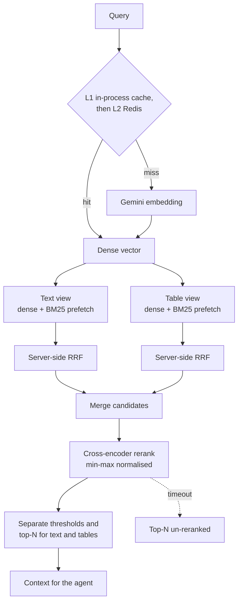

<!-- docs/03-memory.md -->
[&larr; Back to the case study](../README.md)

# Memory and Knowledge

*What the agent remembers about a user, what it knows about the domain, how it finds the right passage fast on a CPU, and where that sits in the field.*

---

## How the Retrieval Stack Got Here

The retrieval stack has its own story, because I worked on it from the very first day and kept refining it to the end. It began as a hand-built hybrid — BM25 with reciprocal-rank fusion and a cross-encoder reranker — on top of Chroma. That validated the approach but left me maintaining a sparse index, its serialisation, and its cross-worker synchronisation by hand. Swapping the vector store to **Qdrant**, chosen because it was natively async and could compute hybrid search server-side, collapsed all of that machinery into the database: sparse and dense vectors, IDF weighting and RRF fusion all became native, and an entire class of multi-worker consistency bug disappeared. It's one of the cleanest retrieval designs I know of running today, and the simplification was the whole point rather than a side effect.

The knowledge base itself came from the company's own material — troubleshooting guides, installation steps, operator lists, plan catalogues — converted to Markdown and put through many rounds of ingestion, chunking and tuning, with the embedding model, the reranker and the sparse method all swapped as better options appeared. The full present-day design is in [System Architecture](#retrieval-architecture).

One late refinement had an unlikely trigger: in an interview, an engineer insisted TF-IDF was the state of the art for retrieval. It isn't — BM25 superseded it for search decades ago, fixing exactly its document-length and term-saturation weaknesses — but the exchange sent me back into the literature, and that reading is what led me to drop a separately-run SPLADE step in favour of Qdrant's own native BM25-plus-RRF as the v2 embedders landed. A wrong claim from someone else, checked properly, improved the system.

Embedding and query-vector caching came later, and for a reason worth recording: attackers ran high-volume "mill" traffic specifically to drive up token cost, and caching the embedding work blunted it. That is a recurring theme of this project — several defensive features were shaped by live abuse rather than anticipated in a design doc (see [Phase 5](01-timeline.md#phase-5--security-under-live-fire-q2-2026)).

---

## Retrieval Architecture

Three memory tiers — and the part worth stating, because it's usually glossed over, is that they reach the model by **three different mechanisms**:

| Tier | What it holds | How it reaches the model |
|---|---|---|
| **Working** | The last 15 messages of this conversation | **Pushed by the framework** — graph checkpointer state, trimmed per turn |
| **Episodic** | This user's past conversations, vector-stored and per-user filtered | **Pre-fetched** into the prompt every turn |
| **Semantic** | A twelve-document knowledge base — compatibility, installation, plan management, troubleshooting, policy, coverage, technical specs, operators, device edge cases | **Pulled by the model**, on demand, via a retrieval tool |

**The knowledge base is deliberately not pre-fetched**, and that's the design decision I'd defend hardest here. Retrieving on every turn would pay the full pipeline cost — including 150–350ms of cross-encoder reranking — on the majority of turns that never needed it: a balance check, a greeting, a purchase confirmation. It would also pad the context with documents irrelevant to the question, which degrades answers rather than improving them.

Letting the model decide costs an extra round-trip on the turns that genuinely need knowledge, and nothing on the ones that don't. The trade is real — the model sometimes *should* have looked something up and didn't — which is why the system prompt carries explicit retrieval-strategy guidance rather than leaving the judgement unaided. "Retrieve everything, always" is the reflex; it's usually the wrong one once retrieval isn't free.

Pre-fetching is fail-soft throughout: episodic retrieval and pending-intent lookup run concurrently, either can fail to empty, and a total failure degrades to working memory alone rather than failing the turn. Each recalled memory is re-assembled as a full exchange, the user's message with the reply the agent gave, so recall carries what the agent said and not only what it was asked.

**Trimming the working tier is not a simple slice.** The window counts messages, not turns, and one turn that calls three tools adds five or more. Cutting a message list at an arbitrary point can separate a tool call from its result, and Gemini rejects a history whose calls and results don't pair up, failing the whole turn with `INVALID_ARGUMENT`. So the reducer that trims the window does three things after the slice:

1. **Orphan guard:** a tool result whose call fell outside the window is dropped.
2. **Leading-boundary cascade:** leading tool results, and a leading model message with calls still open, are popped until the window starts on a clean turn.
3. **Never empty:** if nothing survives, it falls back to the last two messages. A slightly malformed history beats none.

Before each model call the agent node also pairs every tool call with a result, inserting a placeholder result that marks the call as skipped for any call left without one. It looks like over-engineering until the first production failure from a conversation that hit the window mid-tool-call, and a smaller window hits that boundary more often: the cut from 20 messages to 15 for latency ([09](09-evidence.md#measured-on-production-7-day-rolling-averages)) made this code matter more, not less.

  
   
  <em>The production number, 30 June 2026, 01:37–01:46 (WhatsApp lines 1647–1666). Knowledge-base retrieval in practice, including a question genuinely outside the product's own catalogue — answered correctly rather than deflected.</em>

### Native hybrid search

Retrieval is **native server-side hybrid search inside Qdrant** — not a separate keyword index merged in application code. Tabular knowledge — spreadsheets and CSVs — is serialised to Markdown tables for semantic chunking, with a small schema-summary chunk per sheet listing its columns and an automatic per-file fallback to row-by-row chunking if serialisation fails. Each point stores two named vectors: a 3,072-dimension Gemini dense embedding and a server-computed, IDF-weighted BM25 sparse vector. A query fires both branches against the same collection and the database fuses them server-side with reciprocal rank fusion.

That choice matters operationally more than it sounds. There is no in-application sparse index, no pickle serialisation, and nothing to keep synchronised across workers — an entire class of multi-worker consistency bug simply doesn't exist. Text and table documents are queried as separate filtered views in parallel and merged, because they behave differently under retrieval and deserve different candidate budgets.

Multi-query retrieval generalises this: when the agent expands one question into several sub-queries, they're deduplicated, short ones dropped, prefetch limits scaled with query count to keep the candidate pool proportional, and the final rerank targets the *original* user query rather than any single expansion. The agent writes those sub-queries itself, three to five per question, and the tool's description teaches it two styles: dense keywords for facts such as operators and coverage, a natural-language question for procedures and policy, the country always named, and the angle varied across the set.

**The query-vector cache is namespaced by embedding model.** Changing the model invalidates every cached vector automatically instead of silently serving vectors from the wrong embedding space — a bug that would present as "retrieval got worse" with no error anywhere. The shared Redis write is fire-and-forget, so a slow cache can never add latency to a query that has already computed its vector.

### Reranking, and why min-max not sigmoid

A cross-encoder reranker (mixedbread's `mxbai-rerank-xsmall-v1`) runs over the fused candidates, quantized to INT8 through ONNX Runtime on CPU, lazy-loaded once per worker under a lock. It was chosen over the more common ms-marco MiniLM cross-encoder after evaluation. ONNX Runtime releases Python's global interpreter lock while it runs, so inference handed to a worker thread runs in parallel with the event loop rather than stalling it.

The scoring detail is my favourite small discovery in the project. Cross-encoder logits for tabular content — pipes, dashes, numeric columns — cluster deeply negative regardless of actual semantic relevance. Under sigmoid normalisation they all flatten toward zero, making a separate relevance threshold for tables meaningless. Min-max normalisation instead maps the current batch's best score to 1.0 and worst to 0.0, preserving relative ordering, which allows genuinely independent thresholds and top-N caps for text versus tabular content.

The budgets, at handover:

| | Text | Tables |
|---|---|---|
| Candidates fused from the hybrid search | 30 | 15 |
| Kept after reranking | 6 | 3 |
| Minimum normalised score to be kept | 0.25 | 0.05 |

Oversized sections are split into 1,200-character chunks with 150 characters of overlap. Recalled memories are reranked too, but only when the query is at least 15 characters long.

On reranker timeout the pipeline returns top-N un-reranked candidates rather than failing — degraded relevance beats no answer. The timeouts are nested on purpose: the vector store's own client timeout sits below the timeout wrapped around each call, so a slow query comes back as a clean error rather than being cancelled mid-request.

### Caching and indexing

**Query embeddings are cached, not documents** — a two-tier design. An in-process LRU with TTL serves repeat and burst queries in microseconds with zero network I/O, including under deliberate flood patterns. Behind it, a Redis tier shared across all workers, so a miss in one worker's local cache can still hit. Episodic retrieval adds two more fast paths: a flag so users with no stored history skip the vector database entirely, and a 60-second full-result cache absorbing repeat calls within a session.

**Markdown is chunked structurally**, split along its own heading hierarchy with the heading breadcrumb prepended into the chunk body — so section headings, the primary retrieval anchor for section-specific questions, are embedded into both vectors of every chunk. Only oversized sections get a second recursive split. Links found in a section travel with its chunks as metadata, which is how the agent can [send a visual guide](06-voice.md#replies-in-the-right-mode) rather than describe a screen.

**Index initialisation is multi-worker safe** through three layers: a content hash over every source file's path, mtime, and size — size included specifically because bind mounts can drop mtime events; a *hash-scoped* completion flag rather than a static one, so changing any source file automatically invalidates it and re-triggers indexing; and leader election so exactly one worker rebuilds while the others poll, with a fallback check that surfaces an explicit error rather than hanging silently. The leader's lock is a ten-minute lease, so a leader that crashes mid-build cannot wedge the others forever, and a build that fails leaves its error in the lock's place for a minute, where the waiting workers read it.

---

## In the Field's Terms

### Fusing ranks, or scores

**Reciprocal rank fusion** ([Cormack et al., 2009](https://plg.uwaterloo.ca/~gvcormac/cormacksigir09-rrf.pdf)) fuses positions, not scores. Each list contributes 1 / (60 + rank) for every document in it. A document ranked first by BM25 and third by the dense search scores 1/61 + 1/63 = 0.03227; one ranked second by both scores 1/62 + 1/62 = 0.03226. Because only ranks enter, scores on incomparable scales never need normalising, and the one constant is usually left at 60 rather than tuned. That is why [10](10-reflections.md#references--influences) calls it robust, and why the vector store can fuse server-side ([above](#native-hybrid-search)).

[Bruch et al. (2022)](https://arxiv.org/abs/2210.11934) tested that robustness. A convex combination of normalised scores, one weight tuned on a small labelled set, beat RRF both in and out of domain, and RRF proved more sensitive to its constant than earlier studies had suggested. Both findings stand together: RRF needs no labels, and a tuned combination wins when there are labelled queries to tune it on.

### Memory

[CoALA (Sumers et al., 2023)](https://arxiv.org/abs/2309.02427) names four kinds of agent memory, and the system's tiers fall into them ([above](#retrieval-architecture)). **Working** memory is the last 15 messages, held by the checkpointer. **Episodic** memory is this user's past exchanges, stored as vectors and retrieved per user. **Semantic** memory is the knowledge base, which the model pulls through a tool. **Procedural** memory is the prompt and the code of the tools.

[Mem0 (Chhikara et al., 2025)](https://arxiv.org/abs/2504.19413) goes further: it extracts and consolidates salient facts with a model rather than storing exchanges. Production stores scrubbed exchanges and retrieves them. The prototype in [11](11-research-notes.md#ii-the-synthesised-memory-design--and-a-more-faithful-reading-of-mem0) built the consolidating version and was set aside; 08 calls production "inspired by, structurally diverged from" its source.

What a stored memory can do once it is recalled, as an injection that outlives its turn, is told in [07 §16](07-security.md#memory-an-injection-that-outlives-its-turn).

---

[&larr; Back to the case study](../README.md) · [Next: Identity, Login and Sessions &rarr;](04-identity.md)
