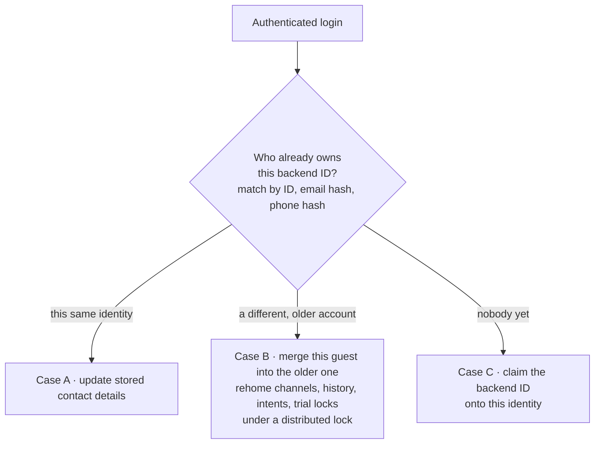
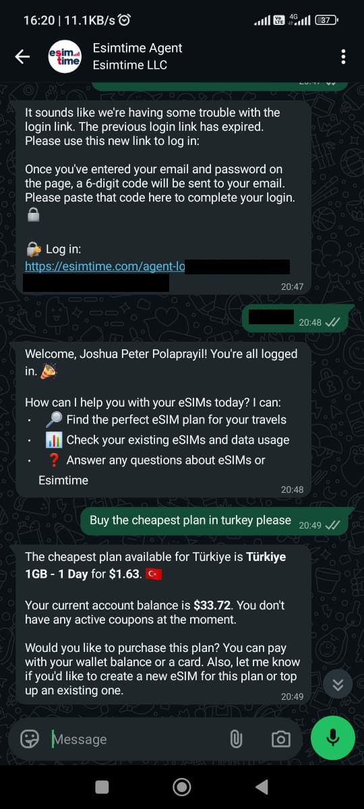
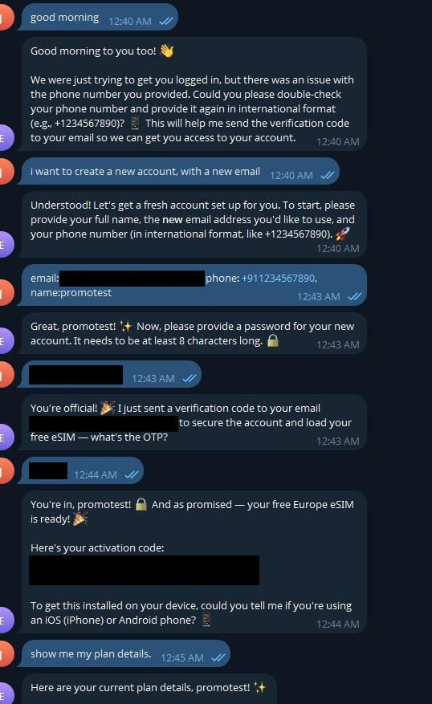
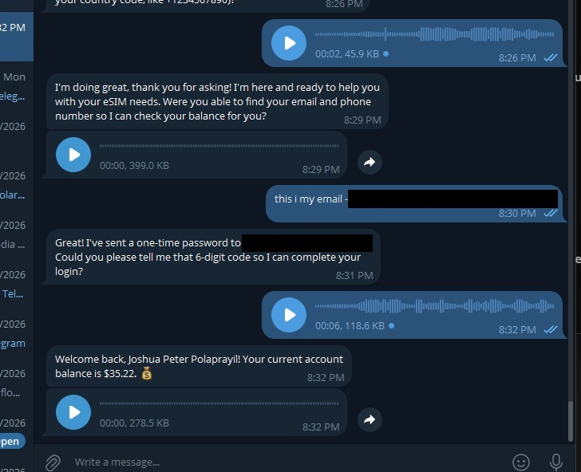
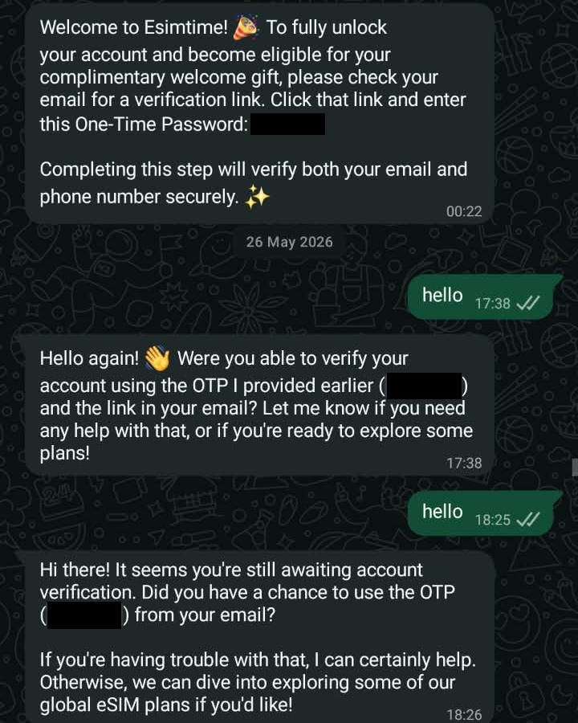
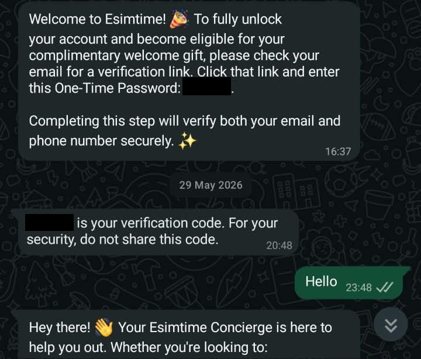

<!-- docs/04-identity.md -->
[&larr; Back to the case study](../README.md)

# Identity, Login and Sessions

*One person across two platforms and a browser, a request that survives a login, a session that knows when to stop trusting itself, and the incident that changed what "tested" means.*

---

## One Person, Many Channels

**Cross-platform identity resolution.** A unified identity layer links platform accounts to a single internal user identity, so context, history, and authentication state follow the person rather than the channel. Log in on Telegram, continue on WhatsApp.

The hard part isn't the happy path — it's that the same human arrives first as an anonymous guest, on two platforms, sometimes from several devices, and the moment they log in, all of it has to collapse onto one account without ever creating a duplicate or losing history. Resolution happens by three keys tried in order — backend account ID, then email hash, then phone hash — and lands in one of three cases:

The merge case is the one that earns its complexity. When a guest identity turns out to be someone who already has an account, everything owned by the throwaway — contact channels, conversation history, pending intents, trial locks — is rehomed onto the older account under a per-pair lock, and the guest is retired. **Identity creation is itself lock-guarded**, with a deliberate backstop: if two concurrent first-contact webhooks race past the lock, the database's own uniqueness constraint catches it, and the loser reads back the winner's row rather than surfacing an error. The lock is the fast path; the constraint is the thing that's actually load-bearing. A cache keyed on the hashed identifier — never the raw phone or email — front-runs the lookup, and every cache hit is re-checked against the database before it's trusted, so a stale entry that outlived a cleanup can't resurrect a deleted account. Because identity is modelled as one internal user with many contact channels rather than one-account-per-platform, the same design absorbs new channels almost for free: the web login relay, and any future surface, attach as just another channel on the same user, carrying the same history and entitlements.

---

## Phantom Login

**Intent preservation — "phantom login."** My favourite piece of the system, because it's invisible when it works. The naive flow: user asks for their balance → agent requires login → user authenticates → agent says *"You're logged in! What would you like to do?"* That's a UX failure wearing politeness as a disguise.

Instead: the original request is queued as a pending intent, the authentication state change is detected on the next turn, and the queued request executes automatically. The user asks once and gets an answer.

Making that clean required the tool executor to be authentication-aware — detect login calls within a batch, execute them first, refresh session state, inject fresh credentials into the remaining calls, complete the whole set in the same turn.

The friction-free side of this landed with real users in a way the engineering rarely does. In an early design the login was fully passwordless — an OTP dropped straight into the chat and let you in — and the CEO once relayed a customer who had phoned in specifically to say thank you, not for anything clever underneath, but simply because she hadn't had to remember another password. It's a useful reminder that the most advanced-feeling thing to an end user is often the absence of friction, not the presence of sophistication. The irony worth owning: the flow the platform actually settled on is *less* frictionless than that — the current relay sends the user to a web form to enter email and password, which then triggers an email OTP they paste back into the chat. It's more steps than the version that earned the thank-you call, a reminder that security, backend constraints and product direction don't always pull the same way as pure UX, and that the elegant early version isn't always the one that ships.

---

## When a Session Expires

**Session expiry mid-conversation runs the same machinery in reverse, as a three-tier ladder.** First, try to renew silently: where the session carries a refresh token, spend it *before* tearing anything down, rewrite the failed tool result into "the token was renewed, just call it again", and the user never learns anything happened. Failing that — and this is the common case, since in the later design the backend issued a long-lived 90-day access token and its refresh-token behaviour was inconsistent (removed at one point, reintroduced before I left) — fall back to a mechanism I added that *auto-initiates* the login flow whenever the user's identifying details are already on file, so re-authentication starts itself rather than waiting to be asked. Whichever tier fires, the session is invalidated cleanly — including the session-check debounce cache, so nothing later in the same turn reads stale auth state — before the re-authentication message is composed.

One adjacent pain point was worth solving with plain scripting rather than architecture. During development I sometimes had to drop and rebuild a database, which would have forced every existing user to log in again — a real irritation for the CEO, who was often the one testing, and for the handful of other users on it. So I wrote small scripts that captured and restored user credentials across a rebuild, so returning users stayed logged in. It mattered more than it sounds: there was a genuine rough patch after the live attacks and the F6S recognition, when a reworked authentication flow stayed broken for about three months and took much of the steam and outside interest out of the project even as it kept being developed and improved.

The lesson I'd draw from that stretch is about momentum, not auth. When a product earns a wave of interest, capitalise on it and stay agile — don't let a large speculative rework stall the very momentum you just won. Changes, tests, feedback, and design choices should be grounded in practicalities and agreed by everyone involved before the platform is rebuilt around them; the strongest solution is usually the elegant one that a few minor adaptations of the existing design can deliver, not the total rework that has to justify itself from scratch. You want the product to take off, not crash and burn while a redesign proves a point.

The ordering in the ladder's last step is the subtle part, and I got it wrong first time. **Open the new login relay *before* generating the user-facing message**, not after. Otherwise the agent says *"I'll send you a login link"* and then has to produce one that doesn't exist yet. Resolve the fact, then let the model describe it — never the reverse.

The inverse principle mattered just as much: the agent is *led by* the API response, so it should be handed as much of that response as possible — especially on errors. A tool that fails with a specific message about a wrong parameter or a bad type lets the model self-correct on the next turn; an error that surfaces enough detail lets it choose a different UX path, recover, or adapt the journey rather than dead-end. I made a point of giving the LLM maximum information exactly where most systems hide it — in failures and raw responses — because that is what makes the model nuanced instead of brittle, and the answers personalised instead of canned. Put plainly: the API messages and responses returned to the agent have to be informative *for the agent*, and getting that right is a real game-changer for the UX and the overall experience.

Throughout, the original failed request stays queued as a pending intent, so whichever rung of the ladder the user comes back on, their request executes automatically.

The links themselves are short-lived: a pending login lasts 15 minutes and a signup link 30, and asking for a fresh signup link invalidates the one before it. So when a link has expired, the agent issues a new one and says it has, rather than sending the user back to a link that no longer works.

  
   
  <em>The production number, 30 August 2026, 20:47–20:49 (WhatsApp lines 1757–1771). The relay in practice — an expired link is handled by issuing a fresh one, not by leaving the user stuck. Link token and code boxed. The $33.72 is the balance the development bot reported after its 2 August purchase, in <a href="05-commerce.md#from-the-test-log-the-money-and-the-words">Commerce and Messaging</a>.</em>

---

## Login, Rebuilt Three Times

**For context, an earlier design.** Authentication was rebuilt three times across the engagement — credentials-in-chat, then OTP-in-chat, then the browser-based relay — and each redesign meant rebuilding the agent-side integration from scratch, often adapting to a backend-side change discovered by hitting it in production rather than by advance notice. That churn is itself the argument for the defensive posture the rest of this case study takes: version the observed contract, verify against the wire, and keep the agent's own layer resilient to an upstream that moves. Before the relay, which reached my test log in late July 2026, the agent asked for email, phone, and (briefly) a password directly in the chat thread — functional, and exactly the trust problem the [case study below](#case-study-the-verification-code-the-agent-repeated) shows: what the model can see, it can say. Shown here with a fabricated test identity, end to end through to a real LPA activation code, purely to illustrate what the current relay replaced:

  
   
  <em>Superseded design, kept for contrast — not the current flow. Test identity throughout; its email, password, login code and activation code are boxed.</em>

  
   
  <em>18 July 2026, 20:26–20:32 (#4646–4654). Same superseded design, over voice; email and phone boxed, and the voice note that speaks the code is not published. The credentials-in-chat step is exactly what the relay above exists to remove.</em>

---

## Interrupted Messages

**Interrupted messages have to survive, with their modality intact.** When a user is stopped mid-request — by a human-verification challenge, a contact-share prompt, an expired session — whatever they were trying to say is held and replayed afterwards. Two details took production to get right:

*Hold the message, not its text.* A voice note interrupted by a gate is stored as a voice reference and replayed as one. Flattening it to a transcript would silently downgrade the modality of everything a gate interrupts, and the user experiences that as the assistant ignoring the fact they spoke.

*And a re-authentication notice must fire once per window, not once per message.* The outcome of "can this user be re-linked?" is cached for several minutes so repeated messages don't mint fresh login links. But that cache means the *dispatch* path stays hot too — so without a separate once-per-window guard, every subsequent message gets consumed by the same re-auth reply. The user types, gets "please log in", types again, gets it again, and never reaches the agent. Removing that guard looks safe, because the cached operation is cheap; it produces an unbreakable loop. Caching a *decision* and gating an *action* on it are two different problems.

Both windows are ten minutes. The decision itself always comes back definite, as one of three answers: a fresh login link is ready; the relay is unavailable, so ask for the password; or there is nothing on file to work with. And if the re-authentication notice can't be queued at all, the message is not consumed: it carries on down the normal path instead of disappearing. Both routes in, the relay and the password fallback, end in the same post-login checks, so a suspended account is turned away identically whichever way it came; two copies of that check are how two paths drift apart.

---

## How Long a Session Lasts

**Session lifetime — a two-clock model.** Sessions run on a 90-day rolling inactivity window, but the expiry ceiling is recomputed on every message as the *earlier* of the new inactivity horizon and the upstream access token's own expiry claim. A frequent user stays authenticated indefinitely; a session can never outlive a revoked token. Whichever clock runs out first wins. A genuinely expired token soft-invalidates and triggers background re-authentication rather than surfacing an error, and a short in-process debounce cache prevents redundant session lookups during multi-tool turns — particularly during priority-authentication turns where a login and its dependent tools all execute together.

**A session also ends whenever the user says so.** Phone numbers change hands and phones are lent, so a request to log out, or to hand the chat to someone else, is honoured every time: never argued with, confirmed in one line, and followed by no further action on that account.

---

## Case study: the verification code the agent repeated

On 23 May 2026 the production agent's welcome message carried a one-time password in its text. Three days later I said hello, and the agent answered:

> **Esimtime Agent** · WhatsApp, 26 May 2026, 17:38 — Hello again! 👋 Were you able to verify your account using the OTP I provided earlier (`[code removed]`) and the link in your email? Let me know if you need any help with that, or if you're ready to explore some plans!

  
   
  <em>The production number in the WhatsApp app: the code delivered in the welcome text on 23 May at 00:22 (line 1025), then quoted back on 26 May at 17:38 and 18:26 (lines 1039 and 1041). The code is boxed in all three places; the hash of the unredacted original is in <code>SHA256SUMS</code>.</em>

It was the same code, character for character, and the agent quoted it again at 18:26. Nothing had malfunctioned in the usual sense: the model was being helpful with what was in its context, and the code was in its context because the message that delivered it had gone through the conversation. **What the model can see, it can say** — in a reply, a trace or a memory summary. Asking it not to is a prompt rule, and a prompt rule is not a control.

The fix moved the code out of the model's mouth. From 29 May each code arrives as a message of its own, from the same number but not from the model:

> **Esimtime Agent** · WhatsApp, 29 May 2026, 20:48 — *`[code removed]`* is your verification code. For your security, do not share this code.

That is WhatsApp's authentication template: fixed wording that Meta approves and the model never composes, sent through the [notification path](05-commerce.md#proactive-delivery) rather than the agent loop. The agent only asks the user to send the code back, and from then on the production log shows it asking for codes, never quoting them.

  
   
  <em>The production number in the WhatsApp app: on 28 May at 16:37 the welcome text still carries the code (line 1143); on 29 May at 20:48 it arrives in the authentication template instead (line 1146), and the reply to my next message, at 23:48, doesn't quote it (lines 1147–1148). Codes boxed; the hash of the unredacted original is in <code>SHA256SUMS</code>.</em>

The stricter version was never built. In the final login relay the user still pastes an emailed code back into the chat ([above](#when-a-session-expires)); it is scrubbed before logs and long-term memory ([§12](07-security.md#12-data-protection)), but it sits in the context of the turn that verifies it. The next step is to take the code on the relay's own web form, out of band, so that it never reaches the model. MCP's URL-mode elicitation ([SEP-1036](https://modelcontextprotocol.io/community/seps/1036-url-mode-elicitation-for-secure-out-of-band-intera)) standardises exactly this for agent tooling: credentials go to a URL, never through the client.

---

## The Incident That Redefined "Tested"

The most uncomfortable thing I learned this year, and the one I'd most want another engineer to take away.

**What happened.** A branch shipped that locked verified customers out of login entirely. Not a subtle degradation — the primary authentication path, broken, in production, for real paying users.

**What makes it worth writing down** is that the test suite was green. Every unit test passed. They passed *because* they asserted the broken behaviour: the tests had been written alongside the code, from the same misunderstanding of what an upstream endpoint actually meant, and they encoded that misunderstanding faithfully.

The specific misunderstanding is almost too neat. An endpoint named to suggest it answered *"does this user exist"* in fact answered *"is this number verified"* — and a perfectly ordinary customer state returned a value the code read as "no account here". The tests mocked the endpoint returning exactly what the developer believed it returned. Mock and implementation agreed completely. Neither had ever met the real backend.

**The rule that came out of it**, which now governs all authentication work here:

> A path counts as verified only when it has been driven end to end against the real backend **and the resulting account state re-read afterwards.**

Not "the test passes". Not "the response was 200". *Go and look at what the account actually is now.* A 201 tells you the request was accepted; re-reading the record tells you whether the thing you wanted actually happened.

**What that produced in practice.** Every authentication path got enumerated, with an explicit verified/unverified marker and, where relevant, a recorded before-and-after account state. Seventeen paths were settled that way by handover, up from five. Several of the findings could not have come from any other method:

- **Logging in performs the phone-verification move** — a side effect nobody had documented, and the reason a whole separate flow turned out to be redundant.
- **A confirmation ID is returned even for an address that doesn't exist**, so its presence proves nothing about whether a code was sent — a false signal any reasonable implementation would trust.
- **One upstream endpoint wasn't behaving as documented at the time** — it rejected valid, freshly issued codes on every attempt (reproduced with three separate request IDs, the last within 75 seconds of issue) while returning success on the request that should have sent them. That combination is what made it take a day to isolate rather than an hour.

That last one produced the decision I'm most pleased with: rather than building a workaround, **the entire flow was deleted**. Logging in already did the job. A broken dependency and a redundant feature turned out to be the same problem, and the fix was removal. With it gone, the password-reset chain became the only self-service account-recovery route left, which raised the stakes on that chain considerably. The prompt's rule for that chain: a reset that fails on the server's side has burnt its session, so it is never retried with the same handle; a fresh code is requested, and after a second failure the agent stops retrying, says the reset is down for now, and offers password login to anyone who still knows their password.

**The transferable version.** Mocks encode your beliefs about a system. If the belief is wrong, the mock is wrong, the test is wrong, and the suite's greenness is actively misleading — worse than no tests, because it manufactures confidence. Mocks are for testing *your* logic. They cannot validate your understanding of someone else's system. Only contact with the real thing does that, and only if you look at the state afterwards rather than the status code.

I could have been writing tests for years; yet this is what finally made me articulate the difference between *tested* and *verified*.

### The upstream contract, as actually observed

Enumerating those paths turned up a set of upstream behaviours that no documentation stated and that each cost real debugging time. They're recorded here because they're the kind of thing a person taking over the integration would otherwise rediscover the hard way — and because most of them are general hazards of building against someone else's auth API, not quirks of this one.

| Observed behaviour | Why it bites | The rule it forced |
|---|---|---|
| An endpoint named to imply *"does this account exist"* actually answered *"is this number phone-verified"* | A perfectly normal `false` for a real customer reads as "no account" and locks them out — the exact bug that reached production | Treat that check as advisory only; it must never gate login, and it soft-fails to unknown on an upstream outage |
| The login link is a path segment; the signup link is a query parameter | Building one like the other yields a URL that looks right and doesn't work | The two links are constructed differently, and the difference isn't documented upstream |
| The documented login response carries only an identifier; the link itself arrives in an extra field the documentation doesn't mention | Code that reads that field directly is one dropped field away from failing every login | Build the link from the identifier whenever the field is missing |
| The user record carries far more than documented: balance, coupons, sign-up details and more | A strict schema rejects the record outright; a loose one silently drops fields that have no column of their own | Read tolerantly: take what is needed, keep the durable extras in a profile, and leave out any extra that wasn't sent, so a later merge can't overwrite a stored value with a blank |
| Five wrong passwords invalidate the whole login handle; five wrong OTP entries destroy the session | A blind retry loop burns the user's remaining attempts against a dead handle | On exhaustion the only recovery is a fresh login start, never a retry |
| Signing up onto a number that already has an account returns a conflict | Retrying the signup orphans the customer's existing eSIMs behind a duplicate account | On conflict, offer login instead — this is the duplicate-account trap |
| A token refresh re-reads verification state from the database before signing | A token minted seconds before verification would otherwise stay "unverified" for its whole life | Matters most at first login and at the 90-day session boundary |
| Logout clears and blacklists our side; the upstream doesn't revoke on its side | "Logged out" is only half true, and assuming otherwise leaves a working token in the wild | Treated as a known asymmetry, mitigated by our own revocation layer |
| One of the password-reset endpoints went missing from the upstream API mid-integration | A flow that worked yesterday returns a 404 today, with nothing in our code changed | Version the observed contract, and treat upstream endpoints as capable of disappearing without notice |
| A purchase endpoint's documented schema used snake_case (`customer_id`) while the deployed backend required camelCase (`customerId`) | The call validates against the docs and fails against the server, and the two never agree until you diff a real request | Trust the wire, not the spec: when documentation and behaviour diverge, the running server is the source of truth |
| Backend error bodies were reduced to a bare `400 Bad Request` during one debugging window | The single most useful signal for root-causing — the server's own description of what it rejected — disappears exactly when it's needed most | Preserve upstream error detail through your own layers; a generic 400 turns a five-minute fix into a five-hour one |

The through-line: **an auth API's method names encode its authors' mental model, not yours.** Verify what each one actually does to account state, once, by observation — then write the rule down where the next person will find it.

### Testing against someone else's system

[*Mocks Aren't Stubs*](https://martinfowler.com/articles/mocksArentStubs.html) separates behaviour verification, checking that the expected calls happened, from state verification, checking what the world looks like afterwards. The lockout in [04](#the-incident-that-redefined-tested) passed behaviour verification against a mock that encoded a misreading of the upstream API. Its rule, drive the path against the real backend and re-read the account, is state verification against the real thing.

The field's usual tool for keeping mocks honest is the **consumer-driven contract** ([Robinson, 2006](https://martinfowler.com/articles/consumerDrivenContracts.html)): the consumer's expectations become tests the provider runs. That takes the provider's cooperation. Here the provider was an API outside this codebase, and the answer above was observation: seventeen paths driven against it and re-read, with what they showed recorded as [the observed contract](#the-upstream-contract-as-actually-observed).

---

[&larr; Back to the case study](../README.md)
