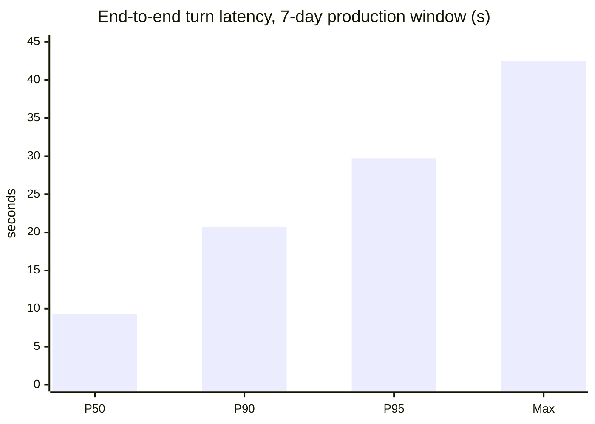
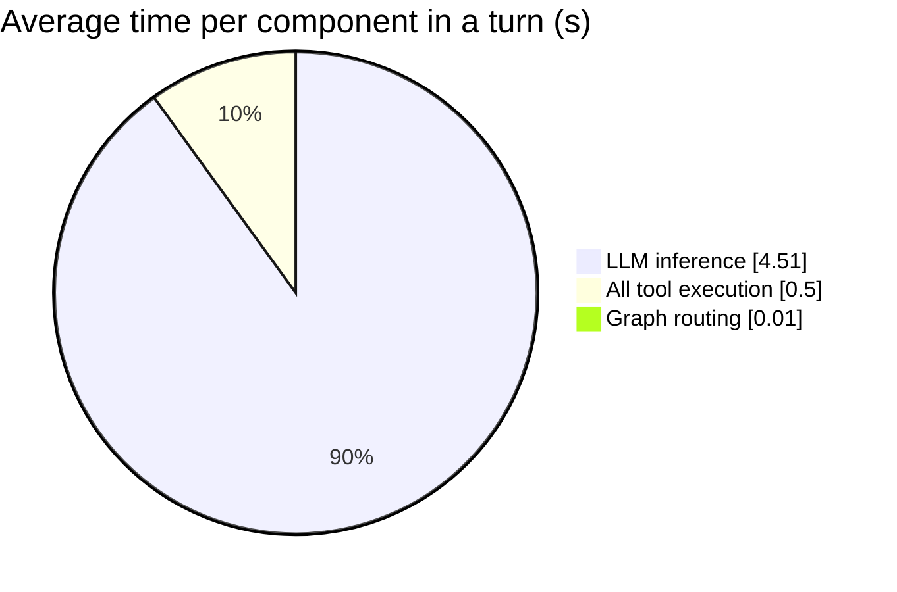

[&larr; Back to the case study](../README.md)

# Performance and Economics

*Measured latency across the request path, and what it costs to run and develop: about $17 a month, plus a few cents per conversation.*

---

## Performance

### A note on provenance

Numbers in engineering write-ups are usually presented without saying where they came from. That makes them useless. So, explicitly:

**Benchmark figures below were measured on a development machine with GPU disabled**, forcing the same CPU-only code path production executes. They are single-component measurements in isolation: directionally honest about *relative* cost, and not production-equivalent. Resist the temptation to bridge them to production with an assumed hardware factor — I tried that, and it was actively misleading. The two sets answer different questions and neither converts into the other.

**The load test predates the multimodal work.** It was run against a lighter stack, before the speech models were added to each worker.

**Memory figures transfer between machines. Latency figures do not.** RSS is architecture-independent; wall-clock is not. Everything below is labelled accordingly.

Production end-to-end times remain **higher** than the bench figures, for reasons the sections after this one work through in detail — that gap is the point of separating them, not an inconsistency to explain away.

### Measured on production (7-day rolling averages)

| Path | Observed |
|---|---|
| End-to-end turn | **P50 9.3s** · P90 20.7s · P95 29.7s · max 42.5s |
| Voice round-trip (8 traces) | **P50 7.7s** · max 28.9s |
| Image turn (7 traces) | P50 10.2s · max 15.6s |
| Conversation depth | avg 10.7 messages/thread · P50 8 · P90 30 |

Voice and image figures come from small samples — 8 and 7 traces in the window — and are reported as indicative medians, not as distributions.

Where the time actually goes, per component:

| Component | Average |
|---|---|
| LLM inference | **4.51s** |
| All tool execution in a turn, combined | 0.50s |
| Agent framework routing | 0.01s |

And per tool, averaged across the same window:

| Tool | Average |
|---|---|
| Create support ticket | 3.11s |
| Forgot password | 1.74s |
| Password login | 0.46s |
| Login initiation | 0.34s |
| eSIM usage and status | 0.28s |
| Reset password | 0.16s |
| Region products | 0.11s |
| Complete login | 0.10s |

The slowest tools are the ones that wait on upstream email and ticketing systems; the catalogue and inventory tools the agent calls most are sub-300ms.

Three readings drive current work:

**The model dominates and the framework is free.** Ten milliseconds of graph routing across an entire turn means orchestration overhead isn't worth optimising, and half a second of combined tool execution isn't the problem either. Latency here *is* LLM latency. That's worth knowing before anyone spends a week tuning an agent framework.

**Output tokens dominate more than input tokens.** An inventory call returning twenty items adds several thousand input tokens, but the expensive part is that the model then *generates* a formatted summary of all of it — and generation is what costs wall-clock. So the leverage is in trimming what tools return before the model sees it, not in shrinking the prompt. This is the highest-value optimisation still outstanding and it is not done.

**Deep sessions were the entire tail.** The history window was cut specifically to stop long debugging sessions dragging enormous payloads into every subsequent turn, which is what the P90 was made of. The fix was a config change found by reading traces, not an architectural one — the history limit went from 20 turns to 15. The P90 above was measured before that change took effect, and wasn't re-measured before handover.

For contrast, the same paths before the voice optimisation round ran at 24–28s end to end with transcription alone costing 11–14s. The [round-two section](02-platform.md#round-two-what-production-revealed-that-the-benchmark-couldnt) covers what changed.

### Measured on bench (CPU-only, GPU disabled)

| Metric | Value |
|---|---|
| Webhook ingest (load test, 20 concurrent users) | median 5ms · p95 9ms · p99 14ms · 100% delivery |
| Injection classification (INT8, 2 threads) | p50 23.8ms · p95 32.2ms |
| Hardware | CPU-only, 8 cores |

Tool-call accuracy is measured separately, across the integration suite: **>99%**.

**Stage-level costs** — bench, indicative only:

| Stage | Typical |
|---|---|
| Cache hit | 2–5ms |
| Relational query | 20–50ms |
| Vector search | 50–100ms |
| Sparse retrieval | 30–80ms |
| RRF fusion | 10–20ms |
| Injection classification | ~24ms |
| Cross-encoder rerank (CPU) | 150–350ms |
| External API | 100–500ms |

### Adversarial load test (bench, pre-multimodal)

Sixty seconds of mixed traffic against the webhook endpoint: **30 concurrent attackers** sending payloads designed to trigger the CPU-bound injection classifier, alongside legitimate full-pipeline conversations running LLM inference and retrieval.

| Traffic | Success | RPS | Avg | p95 |
|---|---|---|---|---|
| Legitimate (full pipeline) | **100%** | 0.23 | 95ms | 391ms |
| Malicious (guard-blocked) | **100%** (19,164) | **319.40** | 84ms | 123ms |

**The finding that mattered:** the quantized injection classifier sustained **over 319 malicious evaluations per second at p95 under 125ms** on eight CPU cores — while the legitimate message queue held **100% success throughout the attack**. The guard layer absorbs sustained attack volume without measurably degrading real users, which is the point of putting it inline rather than out of band.

Memory held around 3 GB during the sustained attack.

The same test validated thread-contention tuning: worker count at half the core count leaves headroom for background inference threads rather than having event loops and ONNX threads fight for the same cores.

**Caveat, stated plainly:** this ran on the bench host, and before the speech models were resident in every worker. The guard layer's *relative* resilience is the durable finding — that it absorbs sustained attack volume without degrading real users. The absolute RPS figure belongs to that host and that stack, and shouldn't be quoted as a production capacity number. It needs re-running against the current stack.

The reranker and the model dominate. Everything else was optimised until it stopped mattering.

---

## Economics

The fixed cost is one server and a domain; the rest is free, self-hosted, or billed per use. The table gives public list prices, not the company's invoices; what was actually paid follows it. Stripe's fee on each card payment is a cost of the sale, not of running the system, and is left out.

| Line | What ran | At handover (Aug 2026) | Now (Nov 2026) |
|---|---|---|---|
| Server | Contabo cloud VPS, 8 vCPU · 24 GB RAM, EU region | €14.00 a month (about $16) | €14.00 (about $15) |
| Domain | `.com` through Cloudflare, which sells domains at cost | $10.46 a year | $11.17 a year: the registry's wholesale price rose 7% on 1 Nov 2026 |
| LLM | Gemini 2.5 Flash | Free tier: $0 within its rate limits. Paid tier, on prepaid credit, for overflow and explicit caching: $0.30 per 1M input tokens · $2.50 per 1M output | Same, free tier included. From 1 Dec 2026 Google retires 2.5 Flash and routes its calls to 3.5 Flash-Lite at the same rate; 3.6 and 3.8 Flash list at $0.75 · $3.75, rising to $1.50 · $7.50 on 1 Jan 2027 |
| Embeddings | Gemini Embedding 2 | $0.20 per 1M tokens | Same |
| WhatsApp | Twilio | $0.005 per message, in or out, plus Meta's fee on template messages | Same Twilio fee. Since 1 Oct 2026 Meta also charges for free-form replies beyond 1,000 a month per number |
| Telegram | Bot API | $0 | $0 |
| Edge | Cloudflare: WAF rules, Bot Fight Mode, one rate-limiting rule, Turnstile, Origin CA | $0: all on the free plan | $0 |
| CI/CD | GitHub Actions · GHCR | $0 within the plan's included minutes, then $0.006 a Linux minute; image storage free | Same |
| Secret scanning | GitGuardian | $0: the free plan, up to 25 developers | $0 |
| Tracing | LangSmith | $0 up to 5,000 traces a month; Plus is $39 a seat | Same |
| Development | The same stack on my own machine, behind a tunnel, with a Telegram development bot | $0: the tunnel's free plan | $0 |
| Speech · guards · reranker · vector DB · cache · database · metrics and logs | Self-hosted on the server | $0 | $0 |
| **Fixed, on the free tiers** | | **about $17 a month** | **about $16** |

Dollar figures use the ECB reference rate on 19 August and 17 November 2026; the euro price did not move. The server first answered on a free DuckDNS subdomain, which went down from time to time. The domain replaced it, and in May 2026, during the attacks, went behind Cloudflare, whose free plan carries the edge protections above.

**What was actually paid.** Four lines: the server, the domain, Twilio and Gemini. At the traffic it served, Gemini's free tier carried the system almost every month; paid-tier credit was topped up only in the rare months when heavy prompt-testing runs, or [attack traffic built to drive up token costs](01-timeline.md#phase-5--security-under-live-fire-q2-2026), outgrew it. Twilio's prepaid balance was topped up twice, on heavy testing days. Everything else ran on free plans or open source.

**Per conversation.** The [model evaluation](03-models.md#so-i-measured-instead-of-arguing) projected $680 a month for 2.5 Flash at 1,000 conversations a day: about **2.3¢ a conversation** at the paid rate, before prompt caching. With caching, which only the paid tier offers, the ~15k-token static prefix is billed at a tenth of the input rate, plus storage by the hour; the cost per conversation with the cache active [was never measured](03-models.md#where-it-stands--and-why-its-still-open). Images are billed as input tokens. Voice adds nothing, because speech is transcribed and synthesised on the server. On WhatsApp the channel can cost more than the model: at $0.005 a message, a ten-message exchange is 5¢ in Twilio fees. On Telegram it is free. Development traffic is priced the same way: at the paid rate, the whole 2.5 Flash leg of the evaluation, six runs of the integration suites, came to $2.22.

**Against the alternatives**, at list prices on 18 November 2026. The fixed cost first:

| Alternative | Monthly |
|---|---|
| **This system: the server and the domain** | **about $16** |
| The same 8 vCPUs on AWS (m7i.2xlarge, 32 GiB, on demand, us-east-1), the instance alone | $294 |
| One full-time customer service representative at the US median wage | $3,731 |
| Round-the-clock cover, one person at a time (4.2 full-time staff) | about $15,700 |

The AWS row buys the same vCPU count, not the same performance per core, and managed Postgres, Redis, vector search and storage would come on top. The wage rows are pay alone (BLS, May 2025: $44,770 a year), before employer costs.

Then the model, at the token counts the evaluation measured on 2.5 Flash (64,640 input and 1,313 output per conversation), before caching:

| Model, input · output per 1M tokens | Per conversation | Per month at 1,000 a day |
|---|---|---|
| **Gemini 2.5 Flash, paid tier: $0.30 · $2.50** | **2.3¢** | **$680** |
| Claude Sonnet 5.5 or GPT-6.2 Sol: $2 · $10 | 14.2¢ | $4,272 |
| Claude Opus 5.5: $4 · $20 | 28.5¢ | $8,545 |
| GPT-6.2 Astra: $8 · $40 | 57¢ | $17,089 |

Each provider's tokenizer counts the same text differently, and a stronger model may need fewer turns, so the last three rows are indicative; the [evaluation](03-models.md#so-i-measured-instead-of-arguing) has the measured Gemini alternatives. The fixed cost is about 6% of the bare AWS instance and about 0.1% of round-the-clock human cover; the model is the line that grows with traffic. The self-hosted speech stack matters here too: per-minute STT and TTS billing would have been the single fastest-growing line item as voice adoption increased, and it's $0.

The engineering point underneath the economics: none of this required exotic optimisation. It required refusing to reach for a managed service every time something got slightly hard, and being willing to quantize, cache, and measure instead.

---

[&larr; Back to the case study](../README.md)
