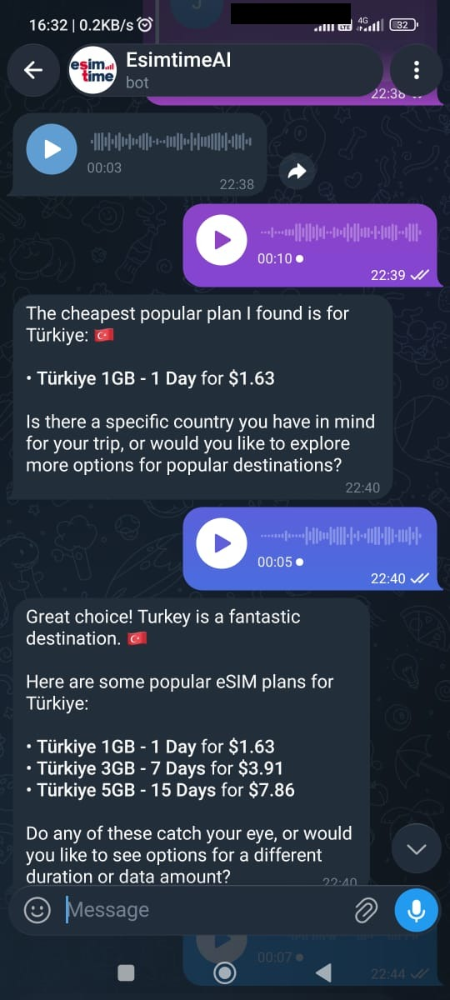
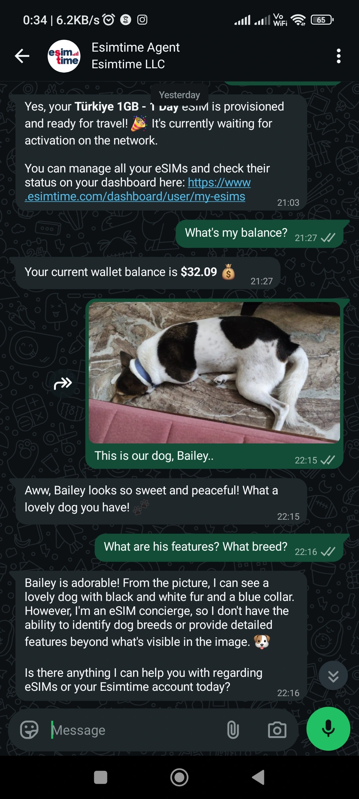
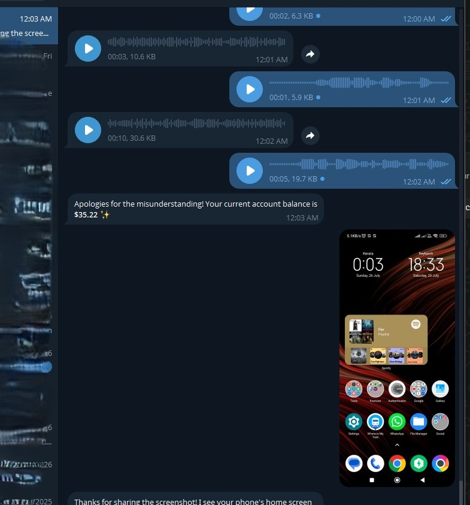
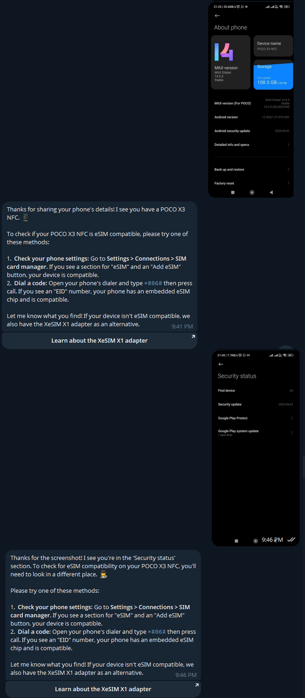
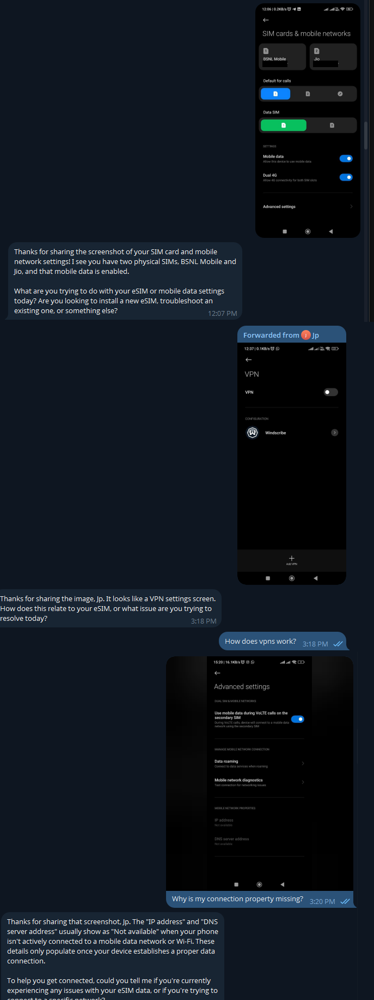
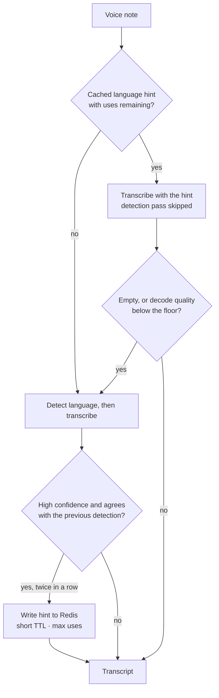
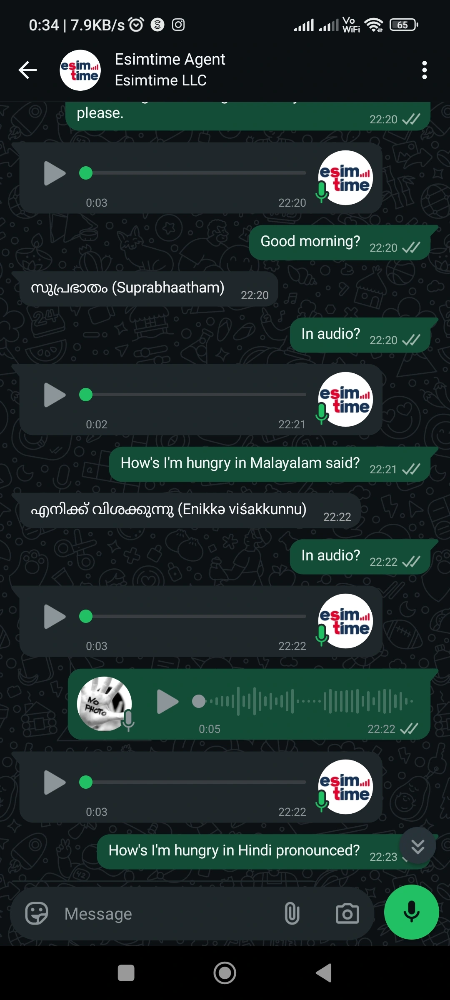

<!-- docs/06-voice.md -->
[&larr; Back to the case study](../README.md)

# Voice and Images

*Speech in and speech out on a CPU, images read by the model itself, replies in the register the user spoke in, and what the test log heard on the way.*

---

## Speech to Text

**Speech-to-text** runs faster-whisper directly on raw audio from both platforms, which deliver ogg/opus natively so nothing needs transcoding inbound. Model size was chosen by measurement rather than default — benchmarked at INT8 on CPU:

| Model | Latency (20.7s clip) | RTF | RSS/worker | Note |
|---|---|---|---|---|
| base | 1.85s | 0.09 | 230 MB | weaker non-English accuracy |
| **small** | **5.56s** | **0.27** | **470 MB** | **chosen — holds 32-language coverage** |
| large-v3-turbo | — | — | 1,873 MB | infeasible at four workers |

Oversized and overlong clips are rejected before decode rather than after paying for transcription. The caps are two minutes and 8 MB of audio.

**And an unintelligible clip short-circuits before the model runs at all** — no agent turn spent on an empty transcript. The reply comes back **as a voice note, in the detected language**, because answering a spoken message with text reads as *"I didn't hear you"* rather than *"I couldn't make that out"*, which is the wrong signal when the problem is audio quality. It's also counted separately from successful transcriptions, so a regression in the audio pipeline — a broken transcoder, a bad model swap, a platform-side codec change — shows up on a dashboard instead of as users quietly abandoning voice. Silent, noise-only and over-length fixtures exist specifically to exercise that path rather than assume it.

That path misfired before it was right, and the test log has both sides. On 20 July a clear six-second question came back as *"I received your voice note, but I wasn't able to transcribe it"*; by 2 August the same kind of question was answered in voice:

https://github.com/user-attachments/assets/655d366d-702a-4b7e-8dcb-f4cccab28b5c

<em>20 July, then 2 August: all four clips in order, unedited. Originals: <a href="https://cdn.jsdelivr.net/gh/JoshPola96/enterprise-ai-agent-architecture-esim@40124bf1de749be8224c53c3eef61322bdc9fd42/docs/test-log/audio/tg-4683.ogg">tg-4683.ogg</a>, <a href="https://cdn.jsdelivr.net/gh/JoshPola96/enterprise-ai-agent-architecture-esim@40124bf1de749be8224c53c3eef61322bdc9fd42/docs/test-log/audio/tg-4684.wav">tg-4684.wav</a>, <a href="https://cdn.jsdelivr.net/gh/JoshPola96/enterprise-ai-agent-architecture-esim@40124bf1de749be8224c53c3eef61322bdc9fd42/docs/test-log/audio/tg-5012.ogg">tg-5012.ogg</a>, <a href="https://cdn.jsdelivr.net/gh/JoshPola96/enterprise-ai-agent-architecture-esim@40124bf1de749be8224c53c3eef61322bdc9fd42/docs/test-log/audio/tg-5013.ogg">tg-5013.ogg</a>. The words that end the first reply, which Whisper hears as "Beaking head", are most likely 🗣️ read aloud by its Unicode name, "speaking head" — the emoji bug shown further down. Sound on: the player starts muted.</em>

Failure modes deserve the same modality thought as success paths, and they rarely get it. Voice-activity filtering trims dead air; decoding is tuned for latency over polish; a low-confidence language detection triggers a re-decode forcing English rather than trusting a bad guess. Decoding is greedy, with a beam of one.

  
   
  <em>Browsing by voice — spoken questions, a spoken reply, and structured pricing dropping into text, which is the voice-downgrade rule doing its job. A phone number at the top is boxed.</em>

---

## Text to Speech

**Text-to-speech** uses Piper with a per-language voice map covering 32 languages, lazy-loaded and LRU-cached per worker, transcoded to OGG/Opus so replies arrive as native voice-note bubbles rather than file attachments. The export dates that change: up to 20 July (#4684) the bot's voice notes are 22 kHz WAV files, and from 23 July (#4707) they are OGG/Opus. Voices are memory-mapped at roughly 0.2 MB RSS each, which is why the cache could be doubled for free. Missing voices degrade through a fallback chain and log a warning instead of failing the reply.

---

## Images

**Image understanding** uses Gemini Flash's native multimodal input — no separate vision pipeline. Bounds on file size and pixel count come from explicit memory math: a naive RGB decode costs roughly three bytes per pixel, so an uncapped decode from a small compressed file can balloon to hundreds of megabytes, multiplied across workers. The cap accepts any real phone photo while bounding the decode, and thumbnails immediately afterward so no visible quality is lost. In numbers: an image is accepted up to 5 MB and 12 megapixels, because an uncapped 50-megapixel decode from a 5 MB file would spike to about 150 MB in a single worker, and every accepted image is thumbnailed to 1,024 pixels on its longer side.

  
   
  <em>The production number, 30 August 2026, 21:03–22:16 (WhatsApp lines 1781–1792). Native image understanding on the happy path — correct on what's visible, honest about what isn't its job, and a clean redirect back to the actual product. The $32.09 is the 20:49 balance of $33.72, shown in <a href="04-identity.md#when-a-session-expires">Identity, Login and Sessions</a>, less the $1.63 plan bought from the wallet at 20:50.</em>

  
   
  <em>26 July 2026, 00:00–00:03 (#4867–4874). A second example, deliberately unrelated to eSIMs, sent in the middle of a voice conversation — the modalities mix freely within one thread. The agent's voice note at 00:01, the one marked 00:03, is the "Sparkles" clip <a href="#replies-in-the-right-mode">below</a> (#4868), and the typed reply at 00:03 ends in the same ✨.</em>

---

## Replies in the Right Mode

**Mode-aware responses.** Transcribed voice is tagged distinctly from typed text before reaching the model, so the system prompt can switch the agent into a spoken register — no markdown, no bullets, no emoji — and route the reply out through synthesis instead of text. The agent can also **return media**: image URLs and documents travel in a dedicated structured field, every one regex-validated as a plain public link before use, so local file paths can never leak into a chat reply. In practice a user can send a screenshot of their settings screen and be walked through it, and the agent can send back a visual guide or document link rather than describing a screen in words. Whether a reply can be spoken is decided in code, by the output tool, not left to the model: it goes out as text when it carries a link or media, runs past 600 characters, contains something that cannot be read aloud, or lists two or more items.

  
  
   
  <em>The development bot in the Telegram app. Left, 20 July: the About-phone screen, answered at 21:41 on its fourth send, the first three having gone unanswered (#4675–#4679), then the Security-status screen and the redirect (#4681–#4682). Right: 21 July, the SIM settings read back, phone numbers boxed (#4698–#4699); 23 July, a VPN screen and why IP and DNS show "Not available" (#4733–#4738).</em>

The test log shows why the no-emoji rule matters. On 26 July the balance came back in voice as *"Your current account balance is $35.22 Sparkles"*, and on 29 July the production number said the same on WhatsApp. "Sparkles" is how the speech engine pronounces ✨: Piper turns text into phonemes with espeak-ng, and espeak-ng speaks a symbol it has no pronunciation for by its name. Running espeak-ng itself on ✨ offline gives exactly that word. It wasn't the first: four minutes earlier, on 25 July, a spoken greeting had ended with 🌍 as *"Globe showing Europe Africa"* (#4864). By 3 August the same answer was clean:

https://github.com/user-attachments/assets/b35e122a-bc56-4eac-8132-d8da71cdfaf4

<em>26 July (Telegram), 29 July (WhatsApp, production), then 3 August (Telegram): the three clips, unedited. Originals: <a href="https://cdn.jsdelivr.net/gh/JoshPola96/enterprise-ai-agent-architecture-esim@40124bf1de749be8224c53c3eef61322bdc9fd42/docs/test-log/audio/tg-4868.ogg">tg-4868.ogg</a>, <a href="https://cdn.jsdelivr.net/gh/JoshPola96/enterprise-ai-agent-architecture-esim@40124bf1de749be8224c53c3eef61322bdc9fd42/docs/test-log/audio/wa-1687.opus">wa-1687.opus</a>, <a href="https://cdn.jsdelivr.net/gh/JoshPola96/enterprise-ai-agent-architecture-esim@40124bf1de749be8224c53c3eef61322bdc9fd42/docs/test-log/audio/tg-5028.ogg">tg-5028.ogg</a>. Sound on: the player starts muted.</em>

Both models are lazy-loaded once per worker, run on an isolated thread pool with a concurrency semaphore so a burst of voice messages can't starve text requests, and are baked into the image at build time rather than pulled at runtime — for reasons [the memory-ceiling section](08-operations.md#operating-under-a-memory-ceiling) explains at some cost.

**Status:** deployed to production. The first release ran voice round-trips well over target; the measurement round covered in [the next section](#round-two-what-production-revealed-that-the-benchmark-couldnt) brought the median from 24–28s down to **7.7s** (across the 8 voice traces in the 7-day production window). Public validation at scale is still ongoing — transcription quality varies across the language set, and synthesized output formatting is still being refined.

---

## Round two: what production revealed that the benchmark couldn't

Getting the speech models into production first meant surviving a [boot loop](08-operations.md#the-boot-loop), told with the measured memory model that ended it in Running It. The fix held. Production booted all four workers cleanly, loaded the speech model from the baked image with no runtime download, and ran without restarts, OOM kills, or worker recycles. The boot loop was genuinely gone.

Then production logs surfaced three things no benchmark had shown.

**The benchmark had measured the wrong thing, not the wrong machine.** Voice round-trips were landing at 24–28 seconds against a component benchmark that implied far less. My first instinct was to blame the hardware — *prod is just slower than my laptop* — and I spent a while reasoning from an assumed slowdown factor. That was the wrong model of the problem, and it sent me looking in the wrong place.

The component benchmark had timed one model decoding one clip in isolation. Production traces measured the *whole pipeline* under real conditions: download, decode, a padded encoder window, language detection, transcription, agent turn, synthesis, delivery. The gap wasn't a hardware multiplier — it was everything the benchmark had left out, and two specific pieces of waste inside it. Component numbers do not compose into end-to-end numbers, and a single fudge factor will never bridge them.

**Transcription cost is flat regardless of clip length.** A 1.5-second voice note cost roughly the same as a 5.2-second one — around 11–14 seconds either way. The reason is that the encoder always processes a padded 30-second window whatever the actual audio duration. So the intuition "short clips are cheap" is simply false, and any optimisation premised on it is wasted effort. Transcription accounted for about 45% of every voice round-trip.

**And the system was paying that encoder pass twice.** Once for language detection, once to actually transcribe. Nobody designed that; it's what you get from calling a convenience API without reading what it does underneath. Roughly half the transcription cost was a duplicated pass.

Three fixes followed, in ascending order of care required:

**Raise the per-transcription thread count.** This reversed my own earlier conservative call. I'd capped threads low out of a theoretical concern about contention between event loops and inference threads. Production showed the contention risk was hypothetical and the latency cost was real — a per-worker concurrency cap of one transcription already bounds the worst case, and the upstream model's rate limit means simultaneous voice traffic is rare. Measured cost beat theoretical risk.

**Disable timestamp generation.** The transcription path only ever joins segment text and never reads timestamps, so generating timestamp tokens in the decoder was pure waste. Free improvement, zero behavioural change — the kind of thing you only find by reading what your own code actually consumes.

**Cache the detected language per user to skip the detection pass.** This is the one that needed real care, because getting it wrong means transcribing someone's speech in the wrong language — a far worse failure than being slow. The design degrades to *current behaviour*, never to a wrong result:

- The hint is written only on a high-confidence detection, and only after **two consecutive agreeing detections**. A single fluke can never lock a user into a language.
- It's stored in the shared cache rather than per-worker memory, because messages round-robin across workers — a local cache would be wrong most of the time.
- **The guardrail that makes it safe:** if a hinted transcription comes back empty, or its decode-quality score falls below a floor, it immediately re-runs with detection enabled and discards the hint. A mismatch costs one extra pass. It cannot silently produce a wrong-language transcript.
- **A max-uses backstop** forces a real detection every few notes regardless, so someone who switches language mid-conversation is always picked up rather than carried on a stale hint until the TTL expires. The expiry is a floor on staleness, not the only defence against it.
- Short TTL, and a single setting that disables the whole mechanism. The hint lives fifteen minutes.

**Outcome.** The target was roughly 12 seconds of transcription down to 3–6. Production traces then showed a **voice round-trip median of 7.7 seconds** (8 voice traces in the 7-day window — a small sample, reported as such) against the 24–28 seconds these logs originally surfaced — a little over 3× — with synthesis at 1–3s and the duplicate encoder pass gone entirely. The tail is still long (worst observed ~29s), because a genuinely long clip on slow silicon is still a genuinely long clip; the median is what moved.

Worth being precise about *why* it moved, because it wasn't clever: one duplicated pass removed, one unused decoder feature disabled, one over-conservative thread cap reversed. No new model, no new hardware, no architectural change. The entire win came from reading what the code actually did and what the logs actually said. The most expensive stage in the pipeline was paying for work nobody had asked for, and it stayed that way until someone looked.

---

## At Handover

**Multimodal is deployed but not yet validated at public scale.** Voice and image were the last thing I built: a first working version, on open-source speech models and the language model's own image input so that it was simple to stand up, which I described at the time as under development and not yet thoroughly tested. I left the work at that stage. Transcription quality varies across the language set, and synthesized output formatting was still being refined. It works, and the latency is acceptable; it isn't proven under real volume.

**Voice latency is fixed at the median, not at the tail.** The round-trip median went from 24–28s to **7.7s** after the optimisation round, but the worst observed case is still ~29s — a long clip on slow silicon is still a long clip, and nothing in the fix set changes that. If a user sends a two-minute voice note, they wait.

**Voice quality in lower-resource languages is a separate, compounding problem from the latency work above — and it's worse than I'd characterised it while I still held access.** Two independent things are going on. First, the speech model size (`small`) was deliberately chosen as the RAM/latency sweet spot across all 32 supported languages rather than the largest available — an accepted tradeoff going in, and it means recognition and synthesis quality on lower-resource languages were never going to match English. Second — heard in my own test log on 3 August, though its cause was pinned down only after handover: a structural bug where the agent appends an English transliteration in brackets next to non-English text, and the speech engine's language detection locks onto that bracketed fragment — so the *entire* reply gets synthesised as English, phonetically slurring the actual language into nonsense. Malayalam and Hindi are not usable at all, but German hit the identical bug when tested, which confirms it isn't specific to lower-resource languages — the first problem degrades quality, the second one breaks output entirely, for any language that isn't English. A multilingual voice test suite exists in the repository; it was never part of the CI-run subset, which is very likely why this shipped uncaught. My first read, from that last test session, was a one-line prompt fix that stops the bracketed gloss at the source; it was never tried, and I left it for whoever picks this up next.

https://github.com/user-attachments/assets/6ae06224-7371-4a93-8732-92a088cb597d

<em>3 August 2026, the symptom before the diagnosis. Asked to say it in Hindi, the agent answered in an English voice reading Hindi, which Whisper hears as English nonsense. Minutes later, after two clips of mine in Malayalam that neither the agent nor offline Whisper could transcribe, its "sorry, I couldn't understand" reply came through in a Hindi voice. The Hindi voice itself worked; what failed was choosing it for the Hindi reply. The three clips are unedited; originals: <a href="https://cdn.jsdelivr.net/gh/JoshPola96/enterprise-ai-agent-architecture-esim@40124bf1de749be8224c53c3eef61322bdc9fd42/docs/test-log/audio/tg-5034.ogg">tg-5034.ogg</a>, <a href="https://cdn.jsdelivr.net/gh/JoshPola96/enterprise-ai-agent-architecture-esim@40124bf1de749be8224c53c3eef61322bdc9fd42/docs/test-log/audio/tg-5035.ogg">tg-5035.ogg</a>, <a href="https://cdn.jsdelivr.net/gh/JoshPola96/enterprise-ai-agent-architecture-esim@40124bf1de749be8224c53c3eef61322bdc9fd42/docs/test-log/audio/tg-5040.ogg">tg-5040.ogg</a>. Sound on: the player starts muted.</em>

  
   
  <em>The production number, 30 August 2026, 22:20–22:23 (WhatsApp lines 1799–1811). The bracketed gloss visible in text — this is what the speech engine's language detector latches onto, synthesising the entire reply as English regardless of the actual target language.</em>

https://github.com/user-attachments/assets/26fed592-2bb1-41a0-8331-981879a99378

<em>The voice notes behind that screenshot, 22:21–22:24 (lines 1805–1816). The English voice reads the transliteration, and when asked for my balance in Malayalam it also spells out the transliteration's accented letters by Unicode code point: "letter 1E37" is ḷ, "A macron" is ā. It is the same mechanism that turned ✨ into "Sparkles" in <a href="#replies-in-the-right-mode">Phase 7</a>: espeak-ng, which Piper uses to produce phonemes, names what it cannot pronounce, and running it offline on those letters gives the same words. Unedited; originals: <a href="https://cdn.jsdelivr.net/gh/JoshPola96/enterprise-ai-agent-architecture-esim@40124bf1de749be8224c53c3eef61322bdc9fd42/docs/test-log/audio/wa-1808.opus">wa-1808.opus</a>, <a href="https://cdn.jsdelivr.net/gh/JoshPola96/enterprise-ai-agent-architecture-esim@40124bf1de749be8224c53c3eef61322bdc9fd42/docs/test-log/audio/wa-1816.opus">wa-1816.opus</a>. Sound on: the player starts muted.</em>

---

[&larr; Back to the case study](../README.md)
