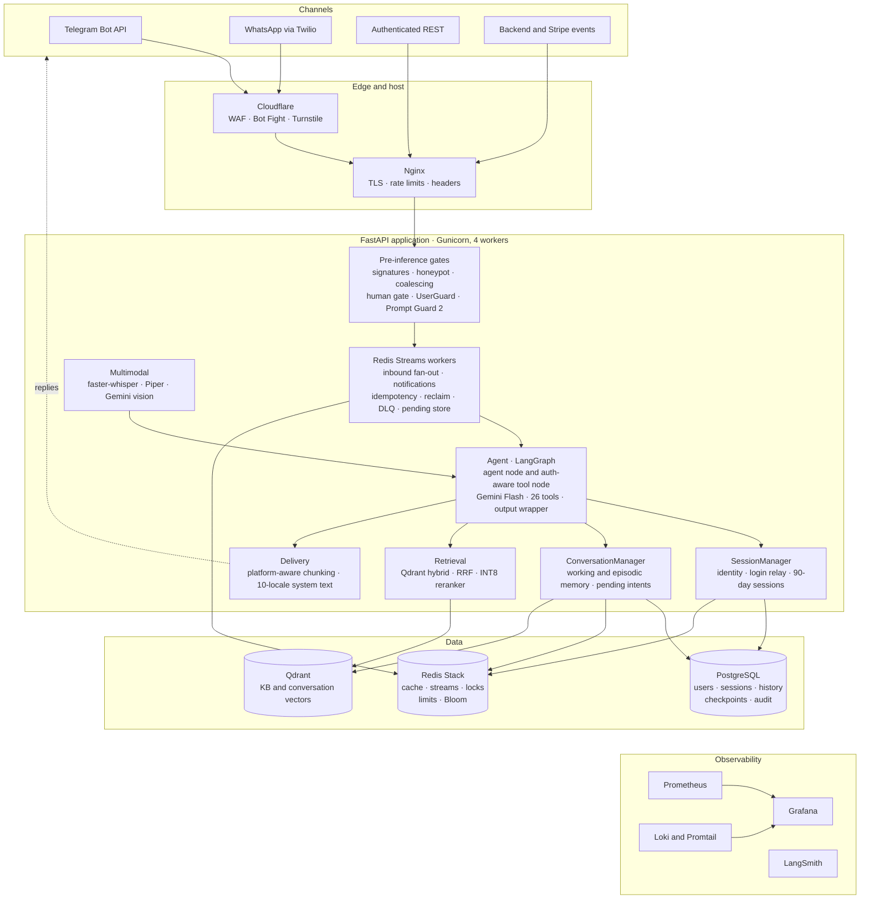
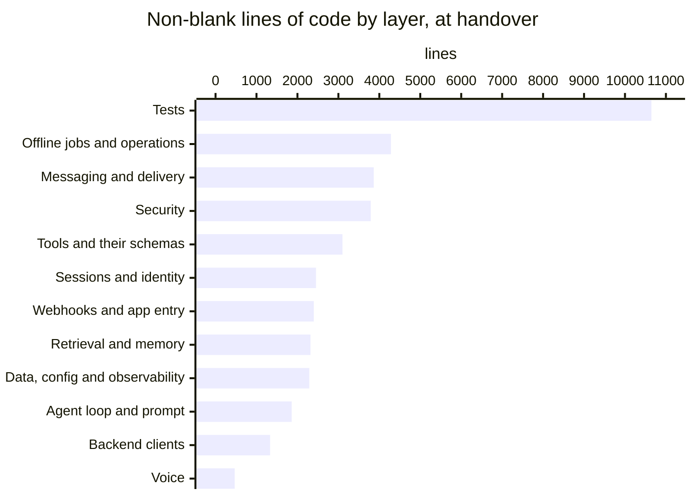
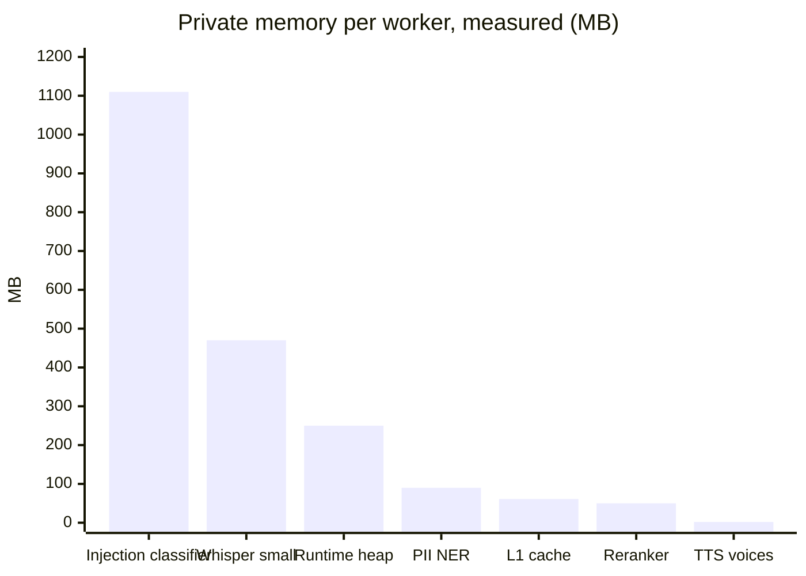
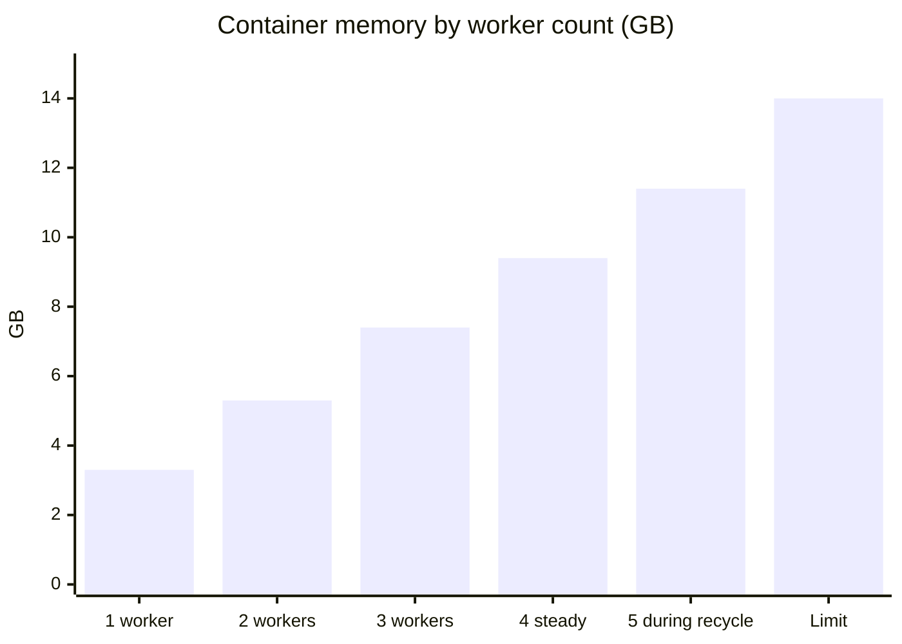
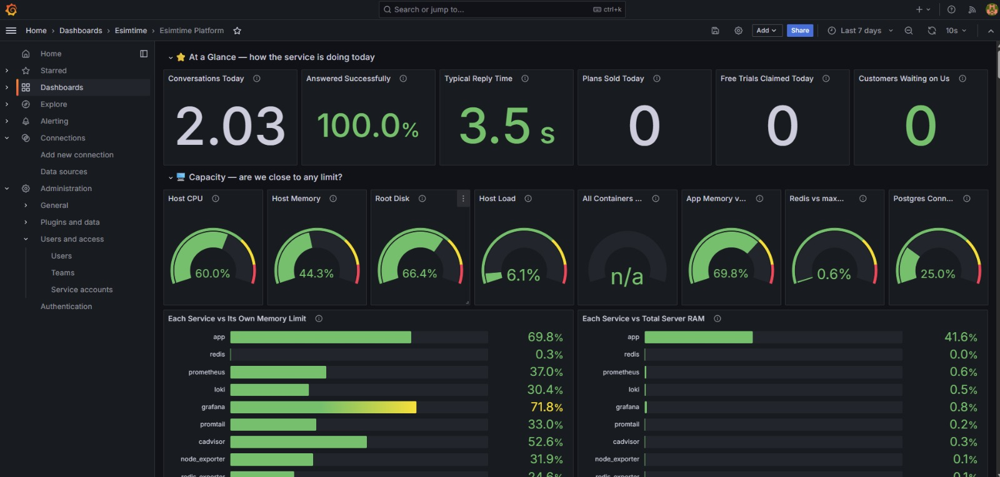
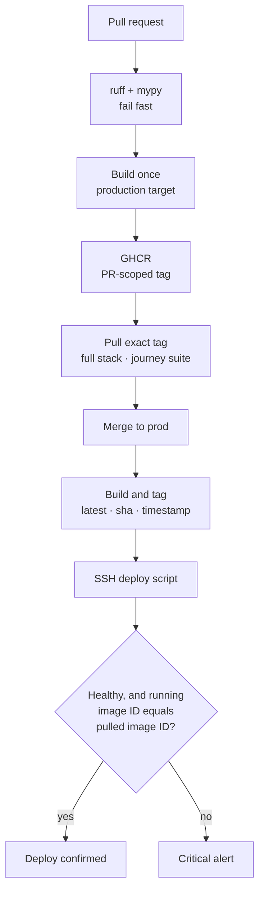

<!-- docs/08-operations.md -->
[&larr; Back to the case study](../README.md)

# Running It

*The processes and stores, the stack and why each piece was chosen, what the code is made of, the memory ceiling everything had to fit under, the data layer, how the system was watched, and how it was shipped.*

---

## System Architecture



All services containerised on an internal bridge network. No container port is publicly exposed; all external traffic enters through Nginx exclusively.

Two named components carry most of the session and memory work: **`SessionManager`** owns identity linking, the OTP flow, PII encryption, and the 90-day rolling session window; **`ConversationManager`** owns working memory (Redis), episodic memory (Qdrant), the pending-intent queue, and the circuit breakers around external calls. Splitting "who is this person and are they logged in" from "what has this conversation covered" into two components with distinct responsibilities kept each one small enough to reason about independently, rather than one object accumulating both concerns over time.

What's actually in each store, beyond the one-line summary: **PostgreSQL** holds users and sessions, conversation history, the audit log, LangGraph's own checkpoints, and billing IDs. **Redis** holds the identity cache, working memory, rate-limit counters, the notification stream, pending intents, distributed locks, and the dead-letter queue. **Qdrant** holds knowledge-base vectors, conversation memories, and serves the hybrid search described in [Memory and Knowledge](03-memory.md#native-hybrid-search).

Every server process runs the same three things: the webhooks, the two stream workers, and the agent behind a concurrency limit. That is why a single image can scale by adding processes, and why the heavy models are loaded once and shared rather than once per process. Each process allows two agent runs at a time, and four processes run, so eight at once. A turn holds a model call, a database connection and retrieval work together, so a burst beyond that waits in line instead of thrashing the process; on shutdown the process takes back every slot, waiting up to 20 seconds, so turns already running finish instead of being cut off mid-tool-call.

---

## Technology Stack

| Layer | Technology |
|---|---|
| **Language** | Python 3.12 |
| **Framework** | FastAPI (async) · Gunicorn + Uvicorn, four workers |
| **Agent** | LangGraph · LangChain Core + Community |
| **LLM** | Gemini 2.5 Flash at temperature 0.1 — successor evaluated over 24 runs, migration [still open at handover](02-agent.md#the-model-selection-problem--and-how-far-it-got) |
| **Embeddings** | Gemini embeddings, 3,072 dimensions, two-tier query-vector cache |
| **Vector** | Qdrant 1.18 — native hybrid, dense + BM25 sparse, server-side RRF |
| **Reranker** | `mxbai-rerank-xsmall-v1` cross-encoder, INT8 ONNX, CPU |
| **Relational** | PostgreSQL 18 (UUIDv7 keys) · SQLAlchemy 2 async · Alembic |
| **Cache / Streams** | Redis Stack — locks, consumer groups, sliding windows, RedisBloom |
| **Security ML** | Llama Prompt Guard 2 86M (INT8 ONNX) · `wikineural` multilingual NER (INT8 ONNX) + Presidio · XGBoost risk classifier exported to ONNX |
| **Speech** | faster-whisper `small` (CTranslate2 int8) · Piper TTS with a 32-language voice map — self-hosted |
| **Vision** | Gemini Flash native multimodal |
| **Crypto** | Fernet at rest · domain-separated HMAC-SHA256 lookup hashes |
| **Edge** | Cloudflare WAF · Bot Fight · Turnstile · Origin CA |
| **Host** | Nginx · UFW + nftables · fail2ban · AppArmor · non-root containers with all capabilities dropped |
| **CI/CD** | GitHub Actions · GHCR · SSH deploy with image-hash verification |
| **Observability** | Prometheus · Grafana · Loki + Promtail · cAdvisor · LangSmith |
| **Testing** | Pytest · LLM-as-judge evaluation · Locust |
| **Channels / Payments** | Telegram Bot API · Twilio WhatsApp · Stripe |

---

## Size, Measured One Way

**Method.** Non-blank lines of Python and shell, counted by one script over the source tree at handover. Comments and docstrings count; blank lines do not. Excluded: the archive of superseded research code, model weights, configuration and environment files, caches and virtual environments. Every line count here comes from that one count, and the layers sum to its total, **38,808 lines**.

Not counted, because they are content or configuration rather than code: the twelve knowledge-base documents, the dashboards and alert rules, the monitoring configuration, the Dockerfile and the Compose files.



| Layer | Lines | Share |
|---|---|---|
| Tests | 10,646 | 27.4% |
| Offline jobs and operations | 4,284 | 11.0% |
| Messaging and delivery | 3,864 | 10.0% |
| Security | 3,791 | 9.8% |
| Tools and their schemas | 3,100 | 8.0% |
| Sessions and identity | 2,454 | 6.3% |
| Webhooks and app entry | 2,399 | 6.2% |
| Retrieval and memory | 2,319 | 6.0% |
| Data, config and observability | 2,290 | 5.9% |
| Agent loop and prompt | 1,861 | 4.8% |
| Backend clients | 1,332 | 3.4% |
| Voice | 468 | 1.2% |
| **Total** | **38,808** | **100%** |

Four readings:

- **The agent is under 5% of the code.** The file that holds the graph, the prompt and the run loop is 1,861 lines of 38,808. Add every tool, the retrieval and the memory, and the model-facing code is still under a fifth: 7,280 lines, 18.8%. The rest is what lets a model talk to strangers about their money: messaging, security, sessions, identity, operations. [Sculley et al. (2015)](https://proceedings.neurips.cc/paper/2015/file/86df7dcfd896fcaf2674f757a2463eba-Paper.pdf) drew this shape for machine-learning systems, a small box of model code inside a large surrounding infrastructure, and it holds for an agent.
- **Security is twice the size of the agent loop** (3,791 lines against 1,861), before counting the security tests.
- **Tests are 27% of the code.** Integration tests are more than three times the unit tests, because the risk lives in conversations, not in functions.
- **Operations is the second-largest layer.** Jobs, drivers, backups and deploys come to 4,284 lines: the work of running the system is a codebase of its own.

### A small box in a large system

[Sculley et al. (2015)](https://proceedings.neurips.cc/paper/2015/file/86df7dcfd896fcaf2674f757a2463eba-Paper.pdf) drew a production ML system as a small box of model code inside a large infrastructure. Measured one way, the agent loop here is under 5% of the code, and tests, security and operations each outweigh it ([above](#size-measured-one-way)).

---

## Operating Under a Memory Ceiling

Adding speech models to a box already carrying three quantized classifiers is where the constraint stopped being philosophical.

### The boot loop

After the multimodal deploy, production entered a startup loop — workers spawning, dying, re-forking, never becoming healthy. Two independent root causes, and the second is the more interesting failure.

**Cause one:** the largest speech model measured at 1,873 MB RSS *per worker* against 470 MB for the chosen size. Four workers multiplied that straight through the memory ceiling at boot.

**Cause two, the subtle one:** the model size was configured as a runtime environment variable but never wired through as a *build* argument — so the image only ever baked the smaller model. Every worker therefore tried to pull well over a gigabyte of weights from the model hub during application startup.

That alone would have been a slow boot. What made it an **infinite** loop is that the ASGI worker emits no heartbeat until startup completes — so a worker downloading weights is, to the supervisor, indistinguishable from a hung one. The timeout reaped each worker mid-download, the master re-forked it, the replacement began the same download from scratch, and it never got far enough to cache anything. A configuration mismatch presenting as an infrastructure failure.

The trap inside the trap: the instinctive fix is to *shorten* the timeout to fail faster, which makes it strictly worse. And raising it wouldn't have fixed it either — it would have papered over a runtime that disagreed with its own image. Worth recognising the shape: when a supervisor can't distinguish "working slowly" from "hung", every timeout value is wrong and the real fix is elsewhere.

The fix was structural rather than a tuning change: wire model selection through the build pipeline so image and runtime cannot disagree, and hard-fail the build if any declared model can't be fetched — so a mismatch surfaces at build time, loudly, rather than at 3am as a boot loop.

### The measured memory model

I replaced estimates with direct measurement inside the running production image, on the actual CPU code path:

```
Container total = SHARED (pre-fork, COW)  +  N_workers × PRIVATE

SHARED — loaded once by the master under preload,
         charged to the cgroup once ......................  1,260 MB

PRIVATE — allocated per worker at startup, never shared:
  Injection classifier   (INT8 ONNX) ...................  1,110 MB
  Speech-to-text         (INT8, incl. decode) ..........    470 MB
  PII NER                (INT8 ONNX) ...................     90 MB
  Reranker               (INT8 ONNX) ...................     50 MB
  L1 query-vector cache ................................     61 MB
  TTS voices             (mmap, page-cache shared) .....     ~2 MB
  Runtime heap / COW dirtying / buffers ................   ~250 MB
                                                        ───────────
  PRIVATE per worker ................................... ≈2,033 MB

  4 workers steady ..... 1,260 + 4 × 2,033 =  9.4 GB
  +1 recycling ......... 1,260 + 5 × 2,033 = 11.4 GB  ← sizing target
```





Sizing to the *recycle peak* rather than the steady state, with headroom above it, is the difference between a stable deploy and one that dies during a rolling restart. The application container's limit is 14 GB, about 23% above the 11.4 GB recycle peak, with swap disabled.

### Measuring instead of assuming

Two investigations worth keeping as examples of the discipline:

**The 1.1 GB question.** The injection classifier's footprint looked like it might be ONNX Runtime's memory arena rather than genuine weights. Disabling the arena changed resident memory by **zero** and cost **+12% latency** — proving the memory was real FP32 embedding weights surviving dynamic quantization, and that the "optimisation" was a pure loss. A five-minute experiment that prevented a wrong architectural conclusion.

**Worker topology.** Eight workers thrashed the available cores; four with bounded per-worker thread counts held. The deciding argument wasn't CPU at all — the upstream LLM's rate limit is the real throughput ceiling, so additional workers buy nothing but memory pressure. The right worker count was set by the *external* bottleneck, not the local one.

Everything above is re-measured whenever the model set changes. Estimates are what produced the boot loop.

---

## Reliability and Coordination

**Reliability.** Circuit breakers on every external dependency — three consecutive failures open the circuit, recovery timeouts differ by dependency criticality (15 seconds for the cache, 30 for retrieval), and a single success in half-open state closes it again. Background health checks run continuously. A shared retry decorator wraps all outbound third-party calls with exponential backoff and jitter, deliberately SDK-agnostic: it matches on error *shape* (rate-limit, quota, timeout, 5xx) rather than library-specific exception types, so one policy covers the LLM SDK, the HTTP client, and both messaging platforms uniformly.

**Multi-worker coordination.** Redis distributed locking for operations that must happen exactly once across workers: webhook registration, scheduled tasks, leader-elected singletons.

### Back-off and circuit breakers

Both answer a failing dependency, and they are easy to conflate. A **circuit breaker** ([Nygard, *Release It!*](https://pragprog.com/titles/mnee2/release-it-second-edition/); [Fowler, 2014](https://martinfowler.com/bliki/CircuitBreaker.html)) keeps shared state about a dependency: after enough failures it opens, every caller fails fast, and a trial call in the half-open state decides whether it closes. **Back-off with jitter** ([Brooker, 2015](https://aws.amazon.com/blogs/architecture/exponential-backoff-and-jitter/)) is per call: wait longer after each failure, by a randomised amount, so callers don't retry in lockstep.

The system has both, and a third thing beside them. Breakers guard the external dependencies: three consecutive failures open one, recovery waits 15 seconds for the cache and 30 for retrieval, and one success in the half-open state closes it. A shared retry decorator backs off with jitter, matching errors by shape rather than by library ([above](#reliability-and-coordination)). And on a rate limit or a timeout, a stream worker holds that one message for 30 seconds, unacknowledged, while the rest of the stream moves on ([05](05-commerce.md#proactive-delivery)). That last is back-off for a single message. Nothing is shared between messages, so it is not a breaker.

### Locks for efficiency, locks for correctness

[Kleppmann (2016)](https://martin.kleppmann.com/2016/02/08/how-to-do-distributed-locking.html) divides distributed locks by what a failure costs. A lock that saves duplicate work costs only that work when it fails. A lock that protects correctness cannot be trusted alone, because a paused holder can outlive its lease, so the protected resource has to reject a stale writer itself: his fencing tokens.

The system lands on the same division in its own words. Identity creation takes a lock, and "the lock is the fast path; the constraint is the thing that's actually load-bearing" ([04](04-identity.md#one-person-many-channels)): the database's uniqueness constraint is the resource refusing the second write. Leader election for the prompt cache is an efficiency lock, where failure means the same work done twice. And the pending store needs no lock at all: the delete is the claim, and the worker that loses it finds nothing to send.

---

## Data Layer Notes

**Time-ordered primary keys.** All primary keys use UUIDv7 rather than random UUIDv4 — a custom implementation encoding the millisecond timestamp in the high 48 bits. The implementation is custom because standard-library support for UUIDv7, as specified in [RFC 9562](https://www.rfc-editor.org/rfc/rfc9562), arrived only in Python 3.14, after this project's Python 3.12.

The reason is index behaviour under write load. Random UUIDs insert at arbitrary positions in a B-tree, causing page splits and index fragmentation on high-write tables. Time-ordered UUIDs are monotonically increasing, so new rows always append at the right edge of the index. On the conversation history table — by far the highest-volume table in the system — that eliminates fragmentation entirely, improves buffer cache locality because recent records cluster together, and gives natural creation-time sort ordering useful for pagination and audit queries.

No application-layer change was required; they remain standard UUIDs to every consumer. A small implementation detail that removes a whole class of database performance problem.

**The encrypted-column / hash-twin pattern.** Every PII column is stored as non-deterministic ciphertext, which makes it useless for indexed lookup by design. Each such column has a deterministic HMAC twin that *is* indexed. The rule enforced throughout the codebase: never query the encrypted column, always query its hash twin. Querying the ciphertext directly isn't a performance mistake — it's a correctness bug, because it can never match. Encoding that as a schema convention rather than a code-review habit is what makes it hold.

**Schema as contract.** The denormalised risk-feature table is the machine learning model's feature contract — the training script's expected column set must match it exactly. Treating a table definition as a versioned interface between the database and a model is a small discipline that prevents a whole class of silent training/serving skew.

**Lifecycle jobs.** Data that accumulates without bound eventually becomes an outage. Background tasks handle it in phases: abandoned login attempts that never completed verification are deleted; sessions past expiry are soft-invalidated, then hard-deleted once genuinely stale; revoked tokens are purged after their expiry window; conversation history can be batch-deleted beyond its retention horizon in bounded chunks so cleanup never takes a long lock — a job deliberately left disabled at handover, to retain full history for context-window evaluation.

Sessions and guest accounts are cleaned up on their own schedule:

| Job | What it removes |
|---|---|
| **Session cleanup, phase 1** | Abandoned logins — a code was sent, never completed, and has expired |
| **Session cleanup, phase 2** | Soft-deactivates sessions more than 24 hours past expiry |
| **Session cleanup, phase 3** | Hard-deletes sessions inactive for more than seven days |
| **Ghost-account cleanup** | Contact channels of guests who never authenticated and went idle for 72 hours, then any guest user left with no channels, so half-finished registrations don't accumulate as orphans |

**And a caution I'd hand to anyone writing a destructive background job.** The ghost-account cleanup requires *four independent predicates* to agree that an owner never authenticated, and that redundancy is not defensive over-engineering. There is an obvious one-column shortcut — a "natively verified" flag that looks exactly like the right filter. It is set only by one platform's contact-share flow, which means every user on the *other* channel is permanently false on it. A cleanup keyed on that single column deletes real, authenticated, paying customers, and does so quietly, on a schedule, at night.

The general rule: a `DELETE` that runs unattended deserves a predicate you have justified column by column, and every column deserves the question *"is this ever false for a legitimate record?"* Read-path bugs show you a wrong answer. Delete-path bugs show you nothing at all.

**Three-destination persistence.** Every interaction persists to three places for three reasons: the relational store synchronously as source of truth, cache invalidation and vector indexing fired as background tasks so neither adds latency to the user-facing response — with PII scrubbed before anything reaches long-term memory. Those background tasks, and the ones in sessions, the abuse guard and retrieval, go through one small helper that holds a strong reference until each finishes: the event loop [keeps only a weak reference](https://docs.python.org/3/library/asyncio-task.html#asyncio.create_task) to a running task, so a bare one can be garbage-collected mid-execution and vanish without an error.

**The ordering between the three is deliberate, not incidental.** The vector write is only ever spawned once the relational write has confirmed success — never in parallel with it. Firing both at once would shave a few milliseconds, but it would also let the two silently diverge the moment either one failed alone. Gating the second on the first's success means the vector store can never hold a conversation the relational store doesn't also have, which keeps the relational store an unambiguous source of truth and means any future backfill from it is complete by construction rather than by luck.

**Schema migrations** are versioned and run automatically on deploy, including the billing-identity additions that Phase 4 commerce required.

One migration pattern worth passing on. **Squashing a migration history only fixes the fresh-install path** — databases that already exist still carry whatever the old incremental history left them with, and the two silently diverge from that point on. Here the divergence was ten indexes: some literal duplicates under old autogenerated names, others redundant because a composite index that the models still declare *leads on the same column*. All ten cost write throughput and served no read.

The fix was a reconciliation migration that drops them with `IF EXISTS` — a genuine cleanup on an old database, an exact no-op on one built from the squashed baseline. Same revision, both worlds converge, nobody has to know which kind of database they're holding.

Redundant indexes are worth watching for generally, because nothing *breaks*: reads stay correct and only writes pay, so it never surfaces as a bug. Whenever you add a composite index, check whether it just made a single-column index on its leading column dead weight.

**Channel-agnostic by construction.** Beyond the two messaging webhooks, the platform exposes an authenticated REST endpoint that reuses the entire agent stack — identity resolution, memory, tools, delivery — with no duplicated logic. Adding a third channel is an adapter, not a rewrite. It returns the same structured payload the agent produces internally, including the confidence score.

---

## Observability

Observability was designed in from the start rather than retrofitted: **every agent response carries a confidence score and an internal reasoning string** (never user-visible) through a mandatory structured output wrapper, and LangSmith tracing was wired up from day one — so every LLM call, tool invocation, and decision path is replayable.

That matters more than conventional logging for agent systems. When a conversation goes wrong, the question is rarely "did the code throw" — it's *"why did the agent choose that."* Decision replay makes that answerable rather than speculative. The same stack also serves product analytics and business metrics.

The full stack: **Prometheus** for metrics across application, containers, and host; **Grafana** for operational, business, and administrative dashboards; **Loki + Promtail** for centralised log aggregation; **LangSmith** for LLM tracing and token accounting; structured JSON logging with rotation throughout.

**Health checks that catch silent death, not just crashes.** The health endpoint reports per-dependency status — database, checkpointer, vector store, session cache, and both stream workers — and the workers are the interesting case. A stream worker's failure mode isn't a crash: the process stays alive, the container reports healthy, HTTP keeps answering, and notifications simply stop being delivered. Nothing else in the stack would notice, possibly for hours.

So each worker stamps a heartbeat every loop tick, and a running worker that hasn't ticked within a threshold is reported as **deadlocked** and fails overall health. The threshold is sixty seconds. A *stopped* worker deliberately doesn't, because that's the expected state during graceful shutdown and a container on its way down shouldn't flap the endpoint.

**The checkpointer has its own probe for a similar reason.** The agent's conversation state is stored through its own connection pool, separate from the rest of the database access. A dead pool fails every agent turn while the database probe stays green, and that gap once let a database restart go unnoticed for 14 hours.

The related distinction I'd keep: `503` and `500` mean different things here. 503 is *"I looked and something is wrong"* — with the failing dependency named in the body. 500 is *"I could not look"*. Collapsing those two into one status is a small thing that costs real time during an incident.

Plus purpose-built retrieval telemetry: every retrieval or rerank stage returning nothing increments a zero-hit counter and fires a non-blocking background write of the offending query (truncated, PII-scrubbed) to a dedicated table. Knowledge gaps surface as data rather than as user complaints — and the write is deliberately off the critical path, so a slow database can never add latency to a chat response that already came up empty. One catch made "came up empty" harder to detect than it sounds. The reranker's scores are min-max normalised, so the best document in any result set scores 1.0 however irrelevant it is, and a relative threshold can never empty a result. A gap is therefore judged against an absolute floor on the reranker's own raw score (0.10): a result set whose best document clears the relative threshold but not that floor is recorded as a gap, and the answer is left unchanged.

### The dashboards were lying, and I only found out by asking them

The operator dashboard reads top-down for a non-technical audience — service health, then capacity, customers, abuse, assistant quality, knowledge gaps, channel mix, revenue funnel, infrastructure, the monitoring stack's own health, and live logs. 111 panels in eleven rows. It looked excellent.

Then I wrote a script that executed **every panel's real query** through the visualisation layer's own query API — exactly the path the browser takes — rather than parsing the dashboard definition.

**48 of 61 query targets returned nothing.**

Not broken-looking. Not erroring. Rendering a clean, confident empty chart, which is visually indistinguishable from *"this metric is zero right now"*. A dashboard that parses is not a dashboard that works, and reviewing the JSON only ever proves the former.

Two tools now exist so it can't recur, and they're meant to be run as a pair:

- **A traffic simulator** that drives realistic load through the *live* pipeline — genuine platform webhooks at the running app, so guards, coalescing, stream workers, the agent, its tools, retrieval and both speech models all execute exactly as they do for a real user, and every metric lands in the time-series database the ordinary way. Nothing downstream is faked; outbound replies are captured by the same API stub the end-to-end driver uses.
- **A panel verifier** that then runs every query and reports what came back empty — deliberately separating *legitimately* empty (a counter with open-ended labels genuinely has no series until the first real event, and several of those being empty is good news) from *genuinely misconfigured*. Without that split the report is a wall of warnings nobody reads.

Run the simulator, then the verifier. Anything still empty is unwired, not idle.

**And one small trick that removed a whole category of false alarm.** A labelled counter doesn't exist in the metrics store until it's first incremented — so a panel asking about, say, refused video uploads renders "No data" until someone actually sends a video. That is visually identical to a panel whose query is wrong. On a fresh deploy, half the dashboard looks broken and isn't.

The fix is to **touch every label combination at startup**, creating each series at zero without recording an event. Idle panels then read `0`, which is a fact, rather than "No data", which is ambiguous between *nothing happened* and *nobody wired this up*. It costs nothing and it's the difference between a dashboard people trust and one they learn to squint at.

The corollary is a rule for adding metrics: a new label value has to be registered in that startup block too, or its panel stays unverifiable until the event happens to occur in production.

Alerting is provisioned as code alongside the dashboards — availability, agent error rate, delivery loss to the dead-letter queue, voice transcription failure, stale analytics, and host and cache memory ceilings. The eight thresholds are plain: more than a tenth of agent runs failing for ten minutes; any message parked after its last retry; more than 50 notifications held for a quarter of an hour; more than 35% of voice notes producing no usable text; analytics more than two days old; host memory above 90%; and Redis above 85% of its cap, because sessions, rate-limit counters and buffered messages live there and eviction would lose them. One honest gap remains: routing still uses the default contact point, so the rules evaluate and go red in the UI but nobody is paged yet. It's a small change and it isn't done, which is exactly the kind of thing a limitations section exists to say out loud.

<p align="center">
  
  <br/>
  <em>The dashboard after the fix — reading top-down for a non-technical audience, service health first, then every capacity limit. Idle counters read zero rather than "No data", which is the label pre-seeding described above at work.</em>
</p>

### Metrics that exist before the event

Prometheus's own guidance is to [initialise known label values to zero](https://prometheus.io/docs/practices/instrumentation/#avoid-missing-metrics), because a labelled series does not exist until its first event, and a panel over it reads "No data". That is the start-up touch described [above](#the-dashboards-were-lying-and-i-only-found-out-by-asking-them). The same guidance warns against enumerating unbounded labels just to get zeros; 01's rule is to seed only the values registered in the start-up block, and to register every new one there.

---

## Delivery Pipeline & Operations



**CI as a fail-fast quality gate.** Every pull request runs lint and static type checking first — if style or types are wrong, nothing else runs. Then the Docker image is built **once** — with the same model build arguments production uses — and pushed to the registry under a pull-request-scoped tag. The integration job pulls *that exact tag*, through a CI-specific compose override that forbids rebuilding, so the image under test is provably the image that was built. It spins up the full stack — relational database, cache, vector store — and runs the core journey suite against a live container rather than mocks. Aggressive disk cleanup runs on both sides to keep CI runners from exhausting storage.

**CD on branch promotion.** Merging to the production branch builds an optimised production image target, tags it with `latest`, a commit SHA, and a timestamp, and pushes to the container registry. The deploy script is then transferred and executed on the server over SSH.

**The deploy script's best idea: hash verification.** After pulling the new image and restarting containers, it doesn't just check that something is running — it compares the SHA of the *running container* against the SHA of the *pulled image*. If they don't match, the deployment silently didn't take effect, and it raises a critical alert rather than reporting success. Health verification loops for a bounded window before declaring the deploy good.

**Honest note on downtime.** This is a full container restart, not a rolling upgrade — the old container stops and the new one starts. Graceful shutdown handles in-flight requests, so nothing is dropped mid-conversation, but there is a brief window where the service is restarting. A load balancer with rolling restarts would eliminate it entirely; at current scale that complexity isn't justified, and I'd rather state the actual behaviour than claim a zero-downtime property the architecture doesn't have.

**Automated backups.** A four-script system installs a daily cron job automatically on production start and removes it on shutdown. Relational backups use compressed custom-format dumps supporting selective restore; vector store backups go through the snapshot API and are copied out of the container. Retention is configurable, all operations are logged, restores require explicit confirmation before any destructive action, and there's a dry-run mode for verification without writing files.

**Scheduled jobs, and the window nothing serialises.**

| Schedule (UTC) | Job |
|---|---|
| Hourly | LLM-as-judge scoring of unreviewed production conversations |
| 02:00 | Refresh the security feature table, **then** retrain — in that order, because training on a stale table is worse than not training |
| 02:30 | Relational and vector-store backup |
| 03:00 | Analytics aggregation, watched by a staleness alert because its failure is invisible: every business panel keeps rendering, just with old numbers |

Three jobs land inside one hour, installed by two independent scripts that don't know about each other. Training time grows with the feature table, so the realistic failure is training still running when the backup starts — both contending for the same database on a box already near its memory budget. The rule written down for whoever runs it next: if backups start creeping up, move the training job, not the backup. A late model is harmless; a failed backup isn't.

**Housekeeping as code.** A weekly maintenance GitHub Actions workflow prunes old build artifacts, untagged images, and stale run logs — keeping a bounded set of recent production images. Small, but it's the difference between infrastructure that runs for a year and infrastructure that fills a disk in month three.

**Traps the runbook warns about, because each one cost time.**

- **The application never connects as the database superuser.** It runs as a dedicated service role, which an initialisation script grants exactly what it needs on its schema. That includes default privileges, so tables a later migration creates are covered without re-running anything; without them, the failure would surface one deploy *after* the schema change that caused it. And the database image runs initialisation scripts only against an empty data volume. Editing the script on a running stack does nothing, which is almost always why a fresh migration fails on a permission error.
- **Preloading moves work to the fork.** The ML stack loads once in the server's master process and is shared by every worker forked from it, which is what fits it inside [the memory budget](#the-measured-memory-model). Three hooks keep that correct. Before any worker forks, the master wipes the metric files earlier workers left, or dead workers' counters linger in the totals. Each new worker re-initialises logging, because the ASGI server's own log configuration otherwise wins the race and silently replaces the structured logging. And a worker that exits is marked dead in the multiprocess metrics registry at once. Network clients go the other way: they are created inside each worker after the fork, because a gRPC client inherited across a fork panics and takes the worker down with exit code 22.
- **In development, one volume line protects the voices.** The source tree is bind-mounted over the application so that an edit reloads the worker, and that mount also hides the voices baked into the image behind the host's near-empty folder. Every spoken reply would then fall through the missing-voice chain to whatever it found. An anonymous volume masks that one path back to the image's copy, so if voice sounds wrong in development but not in production, that line is the first suspect. The build is strict from the other side: the image fails to build if any configured voice is incomplete.
- **Test accounts survive a schema rebuild.** A save-and-restore pair dumps and reloads only the user, authentication and channel rows. The schema can be wiped and rebuilt in development without losing the verified accounts the journey suites depend on, and recreating one by hand spends real one-time-code quota.
- **Every setting is written down, and four deliberately bypass the settings class.** Each field the application reads has an explicit entry in the example environment file, so nothing is discoverable only by reading code; a one-line set difference between the two checks it. The four exceptions are the training promotion gates, read straight from the environment by the offline training job, which has no business importing application settings. The consequence, stated in the runbook: the settings class is not a complete index of configuration. To audit what can be tuned, read the environment file.
- **A stale type stub invents errors.** The Redis client ships its own type information, and under [PEP 561](https://peps.python.org/pep-0561/)'s resolution order a separately installed stub package takes precedence over it. The stub, pinned four major versions behind the library, produced 36 type errors that did not exist. No stub package is installed for it now, and the gate's own tools are pinned.

---

[&larr; Back to the case study](../README.md)
