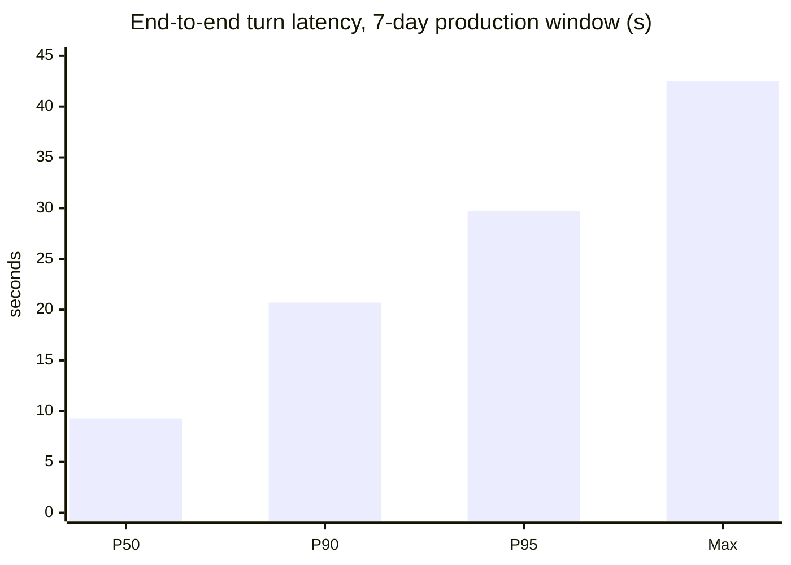
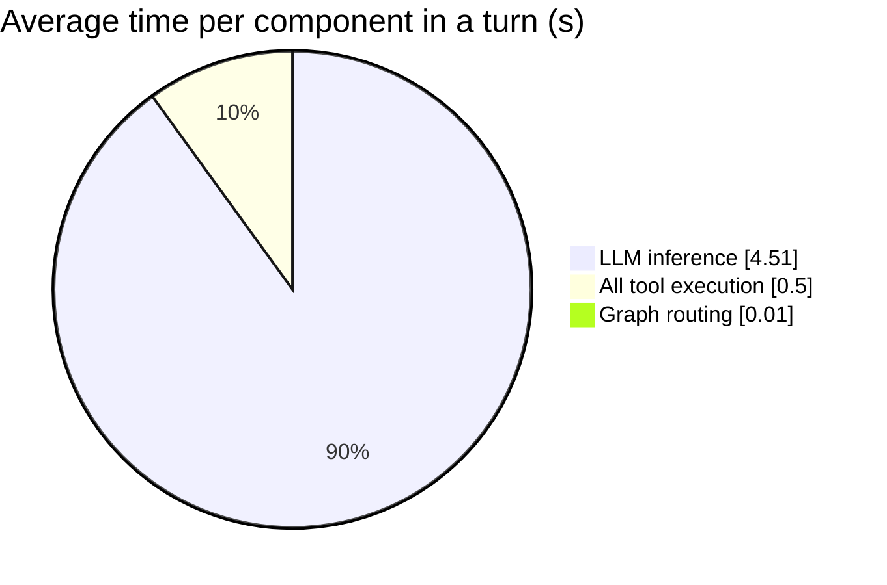

<!-- docs/09-evidence.md -->
[&larr; Back to the case study](../README.md)

# Evaluation, Performance and Cost

*How the agent was evaluated and tested, what it measured in production and on the bench, what it costs to run, and what the numbers can and cannot carry.*

---

## Evaluation & MLOps Tooling

A set of supervised offline jobs handles everything too expensive, too privacy-sensitive, or too subjective to run inline. **None of them auto-apply their output** — they feed dashboards and human review, never unsupervised production change. That constraint is deliberate: an automated loop that rewrites its own behaviour is exactly the ungoverned path the governance section argues against.

**LLM-as-judge conversation evaluation.** A scheduled job pulls unreviewed production conversations and scores each on intent clarity, response accuracy, tool selection, and grounding quality — storing structured feedback alongside concrete prompt and tool-docstring improvement suggestions for human review. The evaluator surfaces where behaviour degraded, a human decides what changes.

**Analytics aggregation.** A periodic job batch-decrypts contact data *just long enough* to aggregate it into domain and region distributions — never persisting the decrypted value — and extracts a per-user behavioural feature row: account shape, reach across devices and platforms, message volume, conversational rhythm (duplicate ratio, inter-message timing, reply ratio), and recency. Each feature is clipped to an explicit bound so one absurd value can't dominate a tree split. Those rows serve double duty: security dashboards, and the labelled training set for the risk classifier.

**The feature set was rebuilt once, for a reason worth stating.** The original columns described *account shape* — does it have an email, how old is it, how many platforms. Those say what an account **is**, never how it **behaves**, and on every one of them a patient abuser is indistinguishable from a quiet customer. A model trained on shape alone can only learn account hygiene, which isn't the thing being detected.

The replacement records **conduct**, all derivable from data already stored: distinct active days, messages per active day, peak messages in an hour, median gap between messages, duplicate-message ratio, average message length, how many accounts share a device signature, and the ratio of assistant replies to user turns. Cadence, burstiness, repetition, device co-occupancy — the shapes that actually separate scripted abuse from a person.

The general form: **if your features describe the entity rather than its behaviour, your classifier is a proxy for demographics.** That's a fairness problem as much as an accuracy one, and it's easy to ship because shape columns are the ones already sitting in your users table.

**And the features deliberately exclude the columns the label is computed from.** The label is derived by rule — banned, then score thresholds, then flagged, then clean — and the risk score, flag and ban columns that feed that rule are all withheld from the feature set.

That exclusion is the whole design. Include them and the model learns `label = f(risk_score)`: a near-perfect F1, a clean pass through the promotion gate, and a classifier that has learned *nothing about behaviour* — it would just be restating the rule that generated its own labels, useless on any user that rule hadn't already judged. The classifier exists to catch what the deterministic rules miss, which is only possible if it's denied their inputs.

Target leakage is worth naming explicitly because it doesn't look like a bug. It looks like your model got better, and every metric agrees. **A sudden dramatic F1 improvement after a schema change is a leak until proven otherwise.**

**Human labels survive retraining.** Rows carry a label *source*, and the nightly upsert preserves a manually-assigned label rather than overwriting it with the automated one. Without that, the scheduled job would quietly revert exactly the human judgements the review process exists to capture — an automation silently undoing its own supervision.

**Offline model training, with promotion gates.** The risk classifier trains on a schedule, with oversampling for class imbalance, a cross-validated F1 report, and export to ONNX including a sanity-checked inference pass and a metadata sidecar recording feature order and label mapping.

The part I'd defend hardest is what it refuses to do. Training **writes a model only when it clears every gate** — minimum row count, minimum class count, minimum examples per class, and a held-out macro-F1 floor. Below any of them it declines to promote and leaves the existing model in place, because a model trained on twelve rows is not an improvement over the one you already trust.

And the scheduled retrain **never enables inference**. Turning the classifier on remains a human decision made after reading the classification report. That's a deliberate seam: an automated loop that decides for itself when to start blocking users is exactly the ungoverned path the governance section argues against, and it would be about four lines of code to build by accident.

**Backfill with defence in depth.** A rerunnable job re-indexes historical conversations into the vector store, re-scrubbing every message through the PII pipeline on the way in — even content already scrubbed once gets a second pass before embedding.

**Trace profiling.** Two LangSmith utilities: one pulls the complete call sequence for a single conversation thread into clean JSON, used when investigating one user's reported issue; the other walks entire trace trees across a time window and produces node-level aggregates — call count, latency, token usage, and cost per graph node, plus slowest and most expensive traces. That second one is how sleep-based delivery bottlenecks were found and how worker and thread counts were right-sized. Cost-per-node visibility changes which optimisations you bother with.

---

## Testing Strategy

**Conversations are tested, not strings.** Integration tests use an LLM as evaluator rather than brittle assertions. Each test feeds the conversation history, the latest user message, the agent's response, *and the agent's own internal reasoning* into an evaluation prompt that judges whether the response was constructive, checks for critical flaws — hallucination, contradiction, loops — and verifies the markdown is platform-safe. It returns a structured pass/fail with reasoning.

The evaluator deliberately defaults to pass unless it finds a critical error. That liberal bias is the design: strict evaluation fails on harmless stylistic variation and trains you to ignore the suite. Tolerant of rephrasing, intolerant of real breakage, is what makes it worth running.

Coverage spans ten core user journeys across **49 LLM-judged scenarios** in three suites, plus edge cases, multi-tool chains, stress and loop-guard scenarios, the full authentication lifecycle, memory and context anchoring, and a dedicated long-horizon test validating the 90-day session lifecycle. The ten are new-customer discovery, a returning user checking in, a deal hunter, interactive troubleshooting, a rapid support ticket, login deferred until it is needed, the full login flow, password recovery, password fallback login, and session termination.

Security components get their own regression suites, and these run against **real weights and live infrastructure, not mocks**:

- The injection classifier suite loads actual quantized ONNX weights and runs inference against benign support messages, direct injection, roleplay jailbreaks, a truncation-attack payload, long benign text as a false-positive check, and a non-English injection for multilingual coverage — asserting both correctness *and* that fast-bypass paths stay under five milliseconds.
- The abuse-gate suite stands up against live Redis with real Bloom filters and exercises normal flow, burst limits, command flooding, repeat-message evasion via whitespace and punctuation normalisation, blacklist instant-drops, admin ban and unban, oversized payload rejection, OTP fast-exit, honeypot triggers, and system-tag spoof sanitisation.
- The honeypot suite documents and verifies the exact bait architecture end to end, including that an echo triggers a silent webhook-layer drop rather than a bot-facing rejection.
- The stream-worker suite covers three layers: pure logic, Redis-only stream mechanics including retry counters and dead-lettering, and full database-plus-Redis-plus-agent integration with end-to-end event injection.
- The voice suite runs generated fixture clips through transcription and synthesis per language, testing detection confidence, the low-confidence retry path, and the missing-voice fallback chain.

Plus a Locust harness for load and adversarial testing — which produced the attack-simulation results below.

### The test layers at a glance

| Layer | What it covers | Runs against |
|---|---|---|
| **Unit and contract** | 159 tests — prompt vs toolset, training vs inference, client vs backend wire format, scrubber scores vs thresholds | Inside the container, no network |
| **Security regression** | Injection classifier, behavioural gate, honeypot, stream workers, voice pipeline | Real ONNX weights, live Redis and Bloom filters |
| **Journey integration** | 49 LLM-judged scenarios, identity merge, history anchoring, 90-day session lifecycle | Live stack, real LLM, real backend sandbox |
| **End-to-end driver** | Genuine platform webhooks through every stage of the pipeline | Running app plus an in-network platform API stub |
| **Load and adversarial** | Locust scenarios and the attack simulation | Bench host |
| **Model selection** | 4 models × 3 suites × 2 iterations | The real integration suites |

### Contract tests, for the drift nothing else catches

A separate category, added after a class of bug that no amount of journey testing would have found: interfaces where two sides can silently disagree and *nothing at runtime notices*.

- **Prompt versus toolset.** The system prompt names tools and describes what they return. Rename one without updating the prompt and the model calls something that no longer exists — silent in code review, fatal in production. A test builds the real prompt and the real tool registry and fails when they've diverged, including when the prompt still documents a *retired* flow. The removed phone-change tools and the old blanket welcome-gift entitlement are the retired flows it keeps out.
- **Training versus inference.** The risk model's training script selects feature columns into a dataframe; the inference wrapper rebuilds that vector *positionally*. Reorder or insert a column and the model receives a shuffled vector and keeps returning confident, wrong labels — forever, with no error anywhere. A test locks the column order, clip bounds, and label map. This is textbook training/serving skew, and the only thing that catches it is asserting the contract explicitly.
- **Scores versus thresholds.** The PII scrubber's recognizer confidences and its per-entity filter thresholds are one contract written in two places. A test parses both and fails if any recognizer can't clear its own threshold — the seam that once let four recognizers match and be silently discarded.
- **Client versus backend.** Auth endpoint tests drive the real request path through a mocked HTTP transport, asserting the request line, headers, query parameters and body exactly as the backend would receive them — no network, no OTP quota burned, but the wire format genuinely checked.

The common shape: these aren't testing behaviour, they're testing *agreement*. Wherever two components share an implicit contract that neither validates, that contract will eventually break, and it will break quietly.

### End-to-end, with nothing mocked

The last boundary is the pipeline itself. A driver posts genuine platform webhooks at the running application, so everything executes for real — gates, guards, message coalescing, the stream worker, the agent, its tools, retrieval, speech-to-text and text-to-speech.

Replies are captured by **standing in for the platform's own API**: a stub runs inside the container network, answers the client-initialisation calls so the messaging client comes up normally, records every outbound send verbatim, and serves file downloads so inbound voice notes and images arrive as real bytes over real HTTP.

Three details that took getting wrong to learn:

**Reading the database instead would not have worked.** Conversation rows are written *after* PII scrubbing, which redacts location and organisation entities — so country and plan names come back as `<LOCATION>` and the assertion you wanted to make is already gone. The stub sees the unredacted payload, including interactive buttons.

**The stub has to run as a container, not a host process.** The host and the containers aren't on the same network in every environment — some setups put them in separate VMs, where a listener on the bridge gateway is simply unreachable from inside a container. This cost real debugging time before it was understood.

**Assertions are language-independent, and identities are disposable.** Scenarios assert on structural outcomes such as the login URL, never on English keywords, so a correct reply in Turkish or Arabic doesn't read as a failure. Each run gets a fresh identity, because a fixed test identity accumulates conversation history and abuse-guard strikes across runs until it starts failing for reasons that have nothing to do with the code — the security layer doing exactly its job against the test suite.

**It stops where a human has to take over.** Email inboxes and verification links are genuinely out of reach. Those steps assert the *structural* outcome — link minted, pending state surfaced — rather than faking a pass. A test that pretends to cover something it can't reach is worse than a test that admits the boundary.

> **And a cautionary note I keep deliberately.** The conversation half of this driver once reported nine failures. Every single one was the harness's own: a stubbed endpoint returning the wrong response shape so the client never initialised; request bodies parsed as JSON when the library posts form-encoded, so delivered replies read as empty and therefore as timeouts; a hardcoded gateway address valid only on one developer's setup; a restart path that silently left the app on its old configuration; and a killed run still holding the port, so a second run bound alongside it and replies landed in the dead one's capture list.
>
> **A test harness is production code.** When yours reports a failure, confirm the failure is in the product before you go looking for it there.

### The suites, by what they cover

The tests come to 10,646 lines: integration 8,180, unit 2,359, load 107, counted the same way as the rest of the code ([Running It](08-operations.md#size-measured-one-way)). Largest first:

| Suite | Layer | Lines | What it covers |
|---|---|---|---|
| Journey suites, three sets | Integration | 2,341 | The journey suites: 49 scenarios, 16, 21 and 12 per set, run against the live stack and graded by the model as judge |
| Backend-event path | Integration | 925 | The backend-event path in three stages: framing and error-shape logic with no services; the stream's round trip, retry count and dead-lettering on Redis; then delivery through the agent with the database |
| Identity and authentication | Integration | 909 | Identity and authentication: guest accounts on each platform, logins across devices and apps, session expiry and logout, merges, and concurrent first contacts |
| Session lifecycle | Integration | 776 | The 90-day session lifecycle, end to end |
| History anchoring | Integration | 705 | What the agent trusts when history and live state disagree: phantom login, a stale price, an authentication state that flipped, a contradictory history, recovery after a session timeout; and whether it carries a conversation correctly: a destination switched mid-conversation (France to Japan), a constraint set early on (unlimited plans only) that has to persist, installing kept distinct from activating, a request that already names the country and the data answered without asking again, and a fresh price fetched when the user asks again |
| Stream worker | Integration | 703 | The stream worker, in the same three stages |
| Model selection | Integration | 698 | The [model-selection harness](02-agent.md#so-i-measured-instead-of-arguing): four models through the three journey suites, twice |
| Security regression | Integration | 681 | Security regression, 25 checks: the honeypot's arming, single use, re-arming and detection at the webhook, through to the behavioural gate's blacklist |
| Login-relay decisions | Unit | 617 | Decisions around the login relay: which re-authentication path a user gets, and what they are told |
| Authentication client | Unit | 518 | The authentication client, every call driven through its real call path over a mocked HTTP transport |
| Behavioural gate | Unit | 393 | The behavioural gate: bursts, command floods, repeat evasion, the payload cap, spoofed system tags, the honeypot trigger |
| Public surface | Integration | 368 | The public surface: security headers, webhook authentication on both platforms, rate limits, input sanitisation, and the rate-limit reply a user sees |
| Retrieval in isolation | Unit | 289 | Retrieval on its own: determinism, multi-query expansion, tables, troubleshooting steps, recall from memory |
| Prompt and toolset contract | Unit | 242 | The [contract](#contract-tests-for-the-drift-nothing-else-catches) between the system prompt and the registered tools |
| Injection classifier | Unit | 216 | The injection classifier on its real weights: benign and hostile text, role-play jailbreaks, truncation attacks, injection in other languages, the fast paths |
| Load and attack | Load | 107 | Locust: new-user browsing, returning users, troubleshooting and a security probe, weighted 4 : 2 : 1 : 1 |
| Risk-model feature contract | Unit | 76 | The feature-column contract between risk-model training and inference |
| Multilingual voice | Integration | 74 | Voice across languages: transcription, and the reply spoken in the language it was written in. Not in the CI-run subset ([10](10-reflections.md#known-limitations)) |
| Unit isolation | Unit | 8 | Keeps the unit tests off the database and the cache |

---

## Performance

### A note on provenance

Numbers in engineering write-ups are usually presented without saying where they came from. That makes them useless. So, explicitly:

**Benchmark figures below were measured on a development machine with GPU disabled**, forcing the same CPU-only code path production executes. They are single-component measurements in isolation: directionally honest about *relative* cost, and not production-equivalent. Resist the temptation to bridge them to production with an assumed hardware factor — I tried that, and it was actively misleading. The two sets answer different questions and neither converts into the other.

**The load test predates the multimodal work.** It was run against a lighter stack, before the speech models were added to each worker.

**Memory figures transfer between machines. Latency figures do not.** RSS is architecture-independent; wall-clock is not. Everything below is labelled accordingly.

Production end-to-end times remain **higher** than the bench figures, for reasons the sections after this one work through in detail — that gap is the point of separating them, not an inconsistency to explain away.

### Measured on production (7-day rolling averages)

| Path | Observed |
|---|---|
| End-to-end turn | **P50 9.3s** · P90 20.7s · P95 29.7s · max 42.5s |
| Voice round-trip (8 traces) | **P50 7.7s** · max 28.9s |
| Image turn (7 traces) | P50 10.2s · max 15.6s |
| Conversation depth | avg 10.7 messages/thread · P50 8 · P90 30 |

Voice and image figures come from small samples — 8 and 7 traces in the window — and are reported as indicative medians, not as distributions.

Where the time actually goes, per component:

| Component | Average |
|---|---|
| LLM inference | **4.51s** |
| All tool execution in a turn, combined | 0.50s |
| Agent framework routing | 0.01s |

And per tool, averaged across the same window:

| Tool | Average |
|---|---|
| Create support ticket | 3.11s |
| Forgot password | 1.74s |
| Password login | 0.46s |
| Login initiation | 0.34s |
| eSIM usage and status | 0.28s |
| Reset password | 0.16s |
| Region products | 0.11s |
| Complete login | 0.10s |

The slowest tools are the ones that wait on upstream email and ticketing systems; the catalogue and inventory tools the agent calls most are sub-300ms.

Three readings drive current work:

**The model dominates and the framework is free.** Ten milliseconds of graph routing across an entire turn means orchestration overhead isn't worth optimising, and half a second of combined tool execution isn't the problem either. Latency here *is* LLM latency. That's worth knowing before anyone spends a week tuning an agent framework.

**Output tokens dominate more than input tokens.** An inventory call returning twenty items adds several thousand input tokens, but the expensive part is that the model then *generates* a formatted summary of all of it — and generation is what costs wall-clock. So the leverage is in trimming what tools return before the model sees it, not in shrinking the prompt. This is the highest-value optimisation still outstanding and it is not done.

**Deep sessions were the entire tail.** The history window was cut specifically to stop long debugging sessions dragging enormous payloads into every subsequent turn, which is what the P90 was made of. The fix was a config change found by reading traces, not an architectural one — the history window went from the last 20 messages to the last 15. The P90 above was measured before that change took effect, and wasn't re-measured before handover.

For contrast, the same paths before the voice optimisation round ran at 24–28s end to end with transcription alone costing 11–14s. The [round-two section](06-voice.md#round-two-what-production-revealed-that-the-benchmark-couldnt) covers what changed.

### Measured on bench (CPU-only, GPU disabled)

| Metric | Value |
|---|---|
| Webhook ingest (load test, 20 concurrent users) | median 5ms · p95 9ms · p99 14ms · 100% delivery |
| Injection classification (INT8, 2 threads) | p50 23.8ms · p95 32.2ms |
| Hardware | CPU-only, 8 cores |

Tool-call accuracy was measured separately, across the integration suite in December 2025: **>99%**. That figure predates this window and the final count of 26 tools.

**Stage-level costs** — bench, indicative only:

| Stage | Typical |
|---|---|
| Cache hit | 2–5ms |
| Relational query | 20–50ms |
| Vector search | 50–100ms |
| Sparse retrieval | 30–80ms |
| RRF fusion | 10–20ms |
| Injection classification | ~24ms |
| Cross-encoder rerank (CPU) | 150–350ms |
| External API | 100–500ms |

### Adversarial load test (bench, pre-multimodal)

Sixty seconds of mixed traffic against the webhook endpoint: **30 concurrent attackers** sending payloads designed to trigger the CPU-bound injection classifier, alongside legitimate full-pipeline conversations running LLM inference and retrieval.

| Traffic | Success | RPS | Avg | p95 |
|---|---|---|---|---|
| Legitimate (full pipeline) | **100%** | 0.23 | 95ms | 391ms |
| Malicious (guard-blocked) | **100%** (19,164) | **319.40** | 84ms | 123ms |

**The finding that mattered:** the quantized injection classifier sustained **over 319 malicious evaluations per second at p95 under 125ms** on eight CPU cores — while the legitimate message queue held **100% success throughout the attack**. The guard layer absorbs sustained attack volume without measurably degrading real users, which is the point of putting it inline rather than out of band.

Memory held around 3 GB during the sustained attack.

The same test validated thread-contention tuning: worker count at half the core count leaves headroom for background inference threads rather than having event loops and ONNX threads fight for the same cores.

**Caveat, stated plainly:** this ran on the bench host, and before the speech models were resident in every worker. The guard layer's *relative* resilience is the durable finding — that it absorbs sustained attack volume without degrading real users. The absolute RPS figure belongs to that host and that stack, and shouldn't be quoted as a production capacity number. It needs re-running against the current stack.

The reranker and the model dominate. Everything else was optimised until it stopped mattering.

---

## Economics

The fixed cost is one server and a domain; the rest is free, self-hosted, or billed per use. The table gives public list prices, not the company's invoices; what was actually paid follows it. Stripe's fee on each card payment is a cost of the sale, not of running the system, and is left out.

| Line | What ran | At handover (Aug 2026) | Now (Nov 2026) |
|---|---|---|---|
| Server | Contabo cloud VPS, 8 vCPU · 24 GB RAM, EU region | €14.00 a month (about $16) | €14.00 (about $15) |
| Domain | `.com` through Cloudflare, which sells domains at cost | $10.46 a year | $11.17 a year: the registry's wholesale price rose 7% on 1 Nov 2026 |
| LLM | Gemini 2.5 Flash | Free tier: $0 within its rate limits. Paid tier, on prepaid credit, for overflow and explicit caching: $0.30 per 1M input tokens · $2.50 per 1M output | Same, free tier included. From 1 Dec 2026 Google retires 2.5 Flash and routes its calls to 3.5 Flash-Lite at the same rate; 3.6 and 3.8 Flash list at $0.75 · $3.75, rising to $1.50 · $7.50 on 1 Jan 2027 |
| Embeddings | Gemini Embedding 2 | $0.20 per 1M tokens | Same |
| WhatsApp | Twilio | $0.005 per message, in or out, plus Meta's fee on template messages | Same Twilio fee. Since 1 Oct 2026 Meta also charges for free-form replies beyond 1,000 a month per number |
| Telegram | Bot API | $0 | $0 |
| Edge | Cloudflare: WAF rules, Bot Fight Mode, one rate-limiting rule, Turnstile, Origin CA | $0: all on the free plan | $0 |
| CI/CD | GitHub Actions · GHCR | $0 within the plan's included minutes, then $0.006 a Linux minute; image storage free | Same |
| Secret scanning | GitGuardian | $0: the free plan, up to 25 developers | $0 |
| Tracing | LangSmith | $0 up to 5,000 traces a month; Plus is $39 a seat | Same |
| Development | The same stack on my own machine, behind a tunnel, with a Telegram development bot | $0: the tunnel's free plan | $0 |
| Speech · guards · reranker · vector DB · cache · database · metrics and logs | Self-hosted on the server | $0 | $0 |
| **Fixed, on the free tiers** | | **about $17 a month** | **about $16** |

Dollar figures use the ECB reference rate on 19 August and 17 November 2026; the euro price did not move. The server first answered on a free DuckDNS subdomain, which went down from time to time. The domain replaced it, and in May 2026, during the attacks, went behind Cloudflare, whose free plan carries the edge protections above.

**What was actually paid.** Four lines: the server, the domain, Twilio and Gemini. At the traffic it served, Gemini's free tier carried the system almost every month; paid-tier credit was topped up only in the rare months when heavy prompt-testing runs, or [attack traffic built to drive up token costs](01-timeline.md#phase-5--security-under-live-fire-q2-2026), outgrew it. Twilio's prepaid balance was topped up twice, on heavy testing days. Everything else ran on free plans or open source.

**Per conversation.** The [model evaluation](02-agent.md#so-i-measured-instead-of-arguing) projected $680 a month for 2.5 Flash at 1,000 conversations a day: about **2.3¢ a conversation** at the paid rate, before prompt caching. With caching, which only the paid tier offers, the ~15k-token static prefix is billed at a tenth of the input rate, plus storage by the hour; the cost per conversation with the cache active [was never measured](02-agent.md#where-it-stands--and-why-its-still-open). Images are billed as input tokens. Voice adds nothing, because speech is transcribed and synthesised on the server. On WhatsApp the channel can cost more than the model: at $0.005 a message, a ten-message exchange is 5¢ in Twilio fees. On Telegram it is free. Development traffic is priced the same way: at the paid rate, the whole 2.5 Flash leg of the evaluation, six runs of the integration suites, came to $2.22.

**Against the alternatives**, at list prices on 18 November 2026. The fixed cost first:

| Alternative | Monthly |
|---|---|
| **This system: the server and the domain** | **about $16** |
| The same 8 vCPUs on AWS (m7i.2xlarge, 32 GiB, on demand, us-east-1), the instance alone | $294 |
| One full-time customer service representative at the US median wage | $3,731 |
| Round-the-clock cover, one person at a time (4.2 full-time staff) | about $15,700 |

The AWS row buys the same vCPU count, not the same performance per core, and managed Postgres, Redis, vector search and storage would come on top. The wage rows are pay alone (BLS, May 2025: $44,770 a year), before employer costs.

Then the model, at the token counts the evaluation measured on 2.5 Flash (64,640 input and 1,313 output per conversation), before caching:

| Model, input · output per 1M tokens | Per conversation | Per month at 1,000 a day |
|---|---|---|
| **Gemini 2.5 Flash, paid tier: $0.30 · $2.50** | **2.3¢** | **$680** |
| Claude Sonnet 5.5 or GPT-6.2 Sol: $2 · $10 | 14.2¢ | $4,272 |
| Claude Opus 5.5: $4 · $20 | 28.5¢ | $8,545 |
| GPT-6.2 Astra: $8 · $40 | 57¢ | $17,089 |

Each provider's tokenizer counts the same text differently, and a stronger model may need fewer turns, so the last three rows are indicative; the [evaluation](02-agent.md#so-i-measured-instead-of-arguing) has the measured Gemini alternatives. The fixed cost is about 6% of the bare AWS instance and about 0.1% of round-the-clock human cover; the model is the line that grows with traffic. The self-hosted speech stack matters here too: per-minute STT and TTS billing would have been the single fastest-growing line item as voice adoption increased, and it's $0.

The engineering point underneath the economics: none of this required exotic optimisation. It required refusing to reach for a managed service every time something got slightly hard, and being willing to quantize, cache, and measure instead.

---

## Threats to Validity

Every number in this case study was measured, and each has limits on what it can carry. They are gathered here under the four headings experimental research uses for the purpose ([Wohlin et al., *Experimentation in Software Engineering*](https://doi.org/10.1007/978-3-642-29044-2)). *Construct* validity asks whether a measure captures the thing it is named for. *Internal* validity asks whether a difference has the cause we think. *External* validity asks whether a result holds outside the conditions it was measured in. *Conclusion* validity asks whether the sample is large enough to say it at all.

**Construct.**

- **A pass is the agent's own model agreeing with it.** The integration evaluator runs on the same model as the agent. It reads the agent's internal reasoning, is told to pass a response whose reasoning shows a complex rule being followed, and defaults to pass ([above](#testing-strategy)). LLM judges measurably favour output like their own: [Zheng et al. (2023)](https://arxiv.org/abs/2306.05685) name it self-enhancement bias, and [Panickssery et al. (2024)](https://arxiv.org/abs/2404.13076) tie its strength to how well a model recognises its own text. So a pass rate here measures agreement with the agent's account of itself as much as correctness. That is the trade the liberal design accepts, and the reason transcripts were also read by a person.
- **The production judge sees only the messages.** It gets no tool results, no retrieved passages and no reasoning. Its accuracy score can catch a contradiction, a loop or an invented-looking specific. It cannot check a quoted price against the catalogue.
- **The suite asks for outcomes.** The model evaluation found a regression in reasoning about *actions* that the pass rate barely registered ([02](02-agent.md#where-it-stands--and-why-its-still-open)); it was found by reading transcripts.
- **"No measured behaviour loss" means the journeys still passed.** The 82% prompt compression was validated against the ten journeys of the time ([02](02-agent.md#the-system-prompt)). A behaviour no journey exercised could have changed without showing.

**Internal.**

- **Each candidate model graded itself** in the model comparison ([02](02-agent.md#two-caveats-id-rather-state-than-bury)), so a difference in pass rate mixes capability with how strictly each model grades.
- **The cost column predates the prompt cache**, which penalised the models with higher input prices hardest ([02](02-agent.md#where-it-stands--and-why-its-still-open)).

**External.**

- **Bench is not production** ([above](#a-note-on-provenance)). Bench latencies are CPU-only and per component, and the load test ran before the speech models were resident in every worker.
- **The >99% tool accuracy dates from December 2025**, on the integration suite as it stood then. The toolset had not yet reached the 26 tools of the handover, and the figure was not re-measured on the final set.
- **Test-suite runs include judge calls production never makes**, so their costs are comparative, not a forecast.

**Conclusion.**

- **98 judgements per model cannot separate 98% from 100%.** Each model's pass rate is 49 scenarios run twice: 98/98, 97/98, 97/98 and 96/98. Their 95% Wilson intervals run from 96.2–100% for the best to 92.9–99.4% for the worst, and they overlap. The two runs of one scenario are not independent, so the real uncertainty is wider still. At this sample size the four pass rates are a tie; the differences the evaluation could resolve are cost and latency, where the gaps are several-fold.
- **Two iterations see consistency only as agreement between two runs.** [τ-bench](https://arxiv.org/abs/2406.12045) defines pass^k, the chance that all *k* attempts at the same task succeed, and shows it falling steeply as *k* grows: about 61% for one attempt at its retail tasks and under 25% for eight, on GPT-4o. Two iterations show only the first step of that curve.
- **The voice and image figures are medians of 8 and 7 traces** ([above](#measured-on-production-7-day-rolling-averages)), not distributions.
- **The production P90 predates the history-window cut** and was not re-measured before handover.
- **Placements on the maturity scale are a judgement**, not a measurement ([10](10-reflections.md#what-was-next)).

---

[&larr; Back to the case study](../README.md) · [Next: Limitations, Next Steps and Lessons &rarr;](10-reflections.md)
