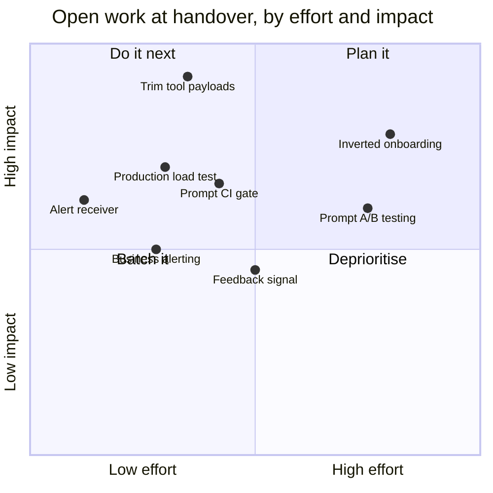

<!-- docs/10-reflections.md -->
[&larr; Back to the case study](../README.md)

# Limitations, Next Steps, Governance and Lessons

*What the system still could not do at handover, what came next, how it is governed, and what I would tell someone starting this work today.*

---

## Known Limitations

Things I'd want a reader to know rather than discover:

**Deployment has a restart window.** Full container replacement with graceful shutdown, not a rolling upgrade. In-flight requests complete; there's a brief restart gap. Solvable with a load balancer when scale justifies it.

**Throughput is bounded by the upstream LLM's rate limit**, not by the application. The architecture would serve considerably more traffic than the model tier currently permits — worth knowing before reading the concurrency numbers as an architectural ceiling.

**The model migration is scoped but not decided.** A 24-run evaluation established a safe fallback ahead of the incumbent's retirement, but the cost figures in it predate my own prompt-caching work, which changed the economics enough to reopen the question. The deciding measurement — cost per conversation with caching active — hasn't been taken. See [The Model Selection Problem](02-agent.md#the-model-selection-problem--and-how-far-it-got).

**The reranker is the dominant infrastructure cost in the retrieval path** at 150–350ms on CPU. It earns its place through relevance, but on a GPU or with a smaller distilled model that number changes substantially.

**Not every authentication path is verified against production.** Seventeen were by handover, under the standard described in [The Incident That Redefined "Tested"](04-identity.md#the-incident-that-redefined-tested). The remainder are mostly paths that mutate real customer accounts or need an account in a state I can't manufacture safely. I'd rather list them as unverified than let a passing unit test imply otherwise.

**Alert routing was the next step.** Eight rules are provisioned as code and evaluate correctly; wiring them to an on-call receiver was queued at handover. Small and known.

**One flow was removed rather than worked around.** An upstream endpoint wasn't behaving as documented, and logging in already performed the same job, so the redundant flow was deleted rather than patched. A related capability was deliberately retained at the client layer for a future support path while being unreachable from the agent — live, tested, and currently unused, which is a state worth labelling rather than leaving for someone to rediscover.

**Voice and images.** Deployed but not yet validated at public scale; voice latency fixed at the median, not at the tail; and voice quality in lower-resource languages, including the bug that turned spoken replies in any language but English into an English voice. All three are told in full, with the recordings, in [Voice and Images](06-voice.md#at-handover).

**Large tool payloads dominate text latency.** An inventory call returning 20 items forces ~2,600 output tokens and a 19-second LLM call. Trimming what tools return before the model sees them is the highest-leverage fix outstanding, and it isn't done yet.

**Published benchmarks predate the current stack.** The adversarial load test ran on the bench host, before the speech models were resident per worker. It needs re-running. The relative finding — that the guard layer absorbs attack volume without degrading legitimate traffic — is the durable one; the absolute RPS belongs to that host and that stack.

**Single-region, single-host.** No geographic redundancy. Appropriate for current scale, an explicit risk at larger scale.

**There is finished-looking code that has never run.** An entire cart-and-checkout API surface exists in the backend client from an earlier design; the shipping purchase path is direct and doesn't touch it. It has no caller anywhere — no tool, route, script or test. I've labelled it rather than deleted it, because the danger isn't the dead code, it's that it *looks* supported: the next person adding a purchase feature would reasonably build on it and discover the endpoint shapes were never verified. On the same note, the XGBoost risk classifier was trained, gated and exported but shipped with inference off pending human review of its report, and the observability stack — functional and genuinely useful — was still maturing. By this project's own standard, unexercised code is unverified code however finished it looks.

**Retrieval quality depends on a curated knowledge base.** The hybrid pipeline is only as good as what's indexed; zero-hit telemetry exists precisely because knowledge gaps are the most common cause of a poor answer, and closing them is manual work.

**Operator-facing data erasure was the next wiring job.** A deletion path that clears a user's stored history from the relational store, the vector store and the cache was built in code; exposing it through the admin API and the security CLI, alongside the existing ban and unban verbs, was queued at handover.

**The security classifier's leakage guard is a lesson, not yet a test.** The principle — never let the columns a label is derived from back into that label's own feature set — held throughout the build (see [target leakage](#what-id-tell-someone-starting-this) below). But nothing currently asserts it automatically: a future change that adds a risk-adjacent column to the feature set would pass every existing test, clear the F1 promotion gate (leakage *raises* F1), and ship a classifier that has silently learned to restate its own label. A three-line assertion that the label-deriving columns are absent from the feature set would close this; it wasn't written before handover.

---

## What Was Next

At handover the biggest open **risk** was the model retirement — a successor evaluated but not decided. The biggest open **win** wasn't architectural at all.

| Priority | Work | Why |
|---|---|---|
| **1** | **Trim tool payloads before the model sees them** | Output tokens dominate turn latency. An inventory call returning twenty items forces the model to generate a formatted summary of all twenty. Paginating, summarising or field-filtering large tool responses is the single largest latency win available |
| **2** | **Re-run the adversarial load test on the production host** | The existing figures predate the speech models and ran on the bench. Re-running on the real host turns a comparison into a capacity number |
| **3** | **Wire an alert receiver** | Eight rules already evaluate; routing them to someone is small and high value |
| **4** | **Deepen the CI prompt gate** | Every pull request already runs the workhorse agent's journey suite, so a prompt regression fails the build today. The next step is breadth — running more of the scenario sets on each change rather than the one representative suite |
| **5** | **Prompt A/B testing** | The evaluation harness exists; an experiment framework with statistical significance does not |
| **6** | **User feedback signal** | Per-message thumbs up/down, aggregated alongside the LLM-judged quality scores |
| **7** | **Business-level alerting** | Conversion drops, ban spikes and trial-abuse spikes — the metrics exist, the rules don't |
| **8** | **Invert the onboarding journey** | Having the user send the first message sidesteps the template constraints that broke business-initiated authentication |

Placement is my own qualitative judgement at handover, not a measurement.

---

## What I'd Tell Someone Starting This

### The agent and the model

**Simplicity beats sophistication in production.** The three-agent architecture was more interesting and strictly worse. Collapsing it was the highest-leverage decision in the project.

**Context window capacity changes what architecture you need.** Several coordination patterns exist purely to work around small context windows. When the window grew, the workarounds became overhead. Re-examine architecture when constraints move.

**Resolve the fact before you let the model describe it.** An agent asked to compose a recovery message *and* trigger the recovery will happily promise a link it doesn't have yet. Do the side-effecting work first, hand the model the concrete result, and let it write around that. This ordering bug is easy to ship because the happy path reads perfectly in review. The test log has the purchase-side version: [two confirmations for one debit](05-commerce.md#from-the-test-log-the-money-and-the-words).

**Read live state, never infer it.** Authentication status, balance, plan state — anything mutable is fetched fresh at execution time. Inferring current state from conversation history is a reliable generator of confident wrongness.

**Trimming conversation history is not a slice.** Cut a window that lands mid-tool-call and you hand the model a tool result with no matching call, or a history opening on an unresolved call — which the provider rejects outright. The reducer has to drop orphaned tool results, walk the leading edge to a clean turn boundary, and never return empty. It reads like over-engineering right up to the first production rejection from a conversation that happened to hit the boundary badly — and a *shorter* window makes that more frequent, not less, which is the opposite of the intuition when you're trimming for latency.

**Compress your prompt and measure it.** 82% reduction, zero measured behaviour loss, validated against a journey suite. Prompt engineering is measurable. Treat it that way instead of accumulating instructions until it works.

**Structured output with confidence and reasoning, from day one.** Retrofitting observability into an agent is painful. Making every response carry its own confidence and internal rationale turns "why did it do that" from speculation into a query.

**Beware tiered model routing.** It looks like free savings and usually isn't: intent detection is brittle across a wide surface, and an LLM router costs a second call plus a split-brain risk where the router and the agent reason from different context. Sometimes the cheaper architecture is one model and a shorter prompt.

**Diagnose which kind of wrong answer you have.** Fabrication — the model ranging past what its context supports — moves with temperature and is aggravated by aggressive history trimming. Mis-selection — picking the wrong item out of a large payload — doesn't move with temperature at all. They look identical from outside and need completely different fixes.

**Trimmed history plus wide sampling is a fabrication engine.** In long sessions, a short history window removes the grounding, and a wide distribution gives the model room to invent something plausible in its place. If you trim aggressively, watch what your temperature is doing.

**Anything named in your prompt gets elevated attention.** That's usually what you want, and occasionally it's a bug: a strongly-weighted example can win over the correct answer when the model is selecting under uncertainty. Watch for it wherever the prompt names a specific value the model could pass through to a tool.

**An error that says your model is retired may be an outage.** One provider and one key for everything kept the system fast and simple, and that was a deliberate choice; 2.5 Flash was the model it trusted. On 13 July every call to it came back "no longer available. Please update your code to use a newer model", and a while later it worked again. With no second model behind it, every turn that needed the model failed until the provider recovered. The trade-off is worth naming: a second model, configured and tested behind the first, costs some simplicity and buys an afternoon like that one; and an error message is a claim, not a diagnosis.

**A time computed before a model call is stale after it.** On 31 March purchases failed because the start time the agent sent had already passed when it arrived: a model call in between took 47 seconds, and the backend's scheduler refused a date in the past and failed the whole purchase with it. The agent's schema now moves any start time less than a minute away to two minutes ahead before sending, the model is told to leave the field empty, and I asked for the same guard on the backend, where a past start should simply mean now. The same incident's other half is under [data and security](#data-and-security): what a failed purchase cost when the call to the provider sat inside a database transaction.

### Evaluation and testing

**Test conversations, not strings — and bias the evaluator liberal.** Strict evaluation fails on harmless rephrasing and trains you to ignore the suite. Tolerant of style, intolerant of breakage, is what makes a test suite worth keeping.

**A green suite is not verification.** Mocks encode your beliefs about someone else's system; if the belief is wrong, the mock, the test and the confidence are all wrong together. A path counts as verified when it has run against the real dependency *and you have re-read the resulting state*. A 201 means the request was accepted, not that the thing you wanted happened.

**Label dead code loudly, or it becomes a trap rather than clutter.** Unused code is harmless right up until it looks like the supported path — then someone builds on nine methods that have never run against the real dependency. "Nothing calls it" and "it works" are completely different claims, and a finished-looking implementation asserts the second while only having earned neither. Either exercise it or mark it; leaving it silent is the worst of the three.

**A threshold and a confidence score written in two places will eventually disagree — silently.** My PII scrubber had four recognizers whose match confidence sat *below* the threshold that filtered them, so they matched and were discarded: no error, no log, and the exact identifiers those recognizers existed to catch flowed through unredacted. Wherever a producer's score is compared against a consumer's cutoff, assert the relationship in a test. The failure mode of a security control that silently does nothing is indistinguishable from one that works.

**Test that the door is locked, not that you turned the key.** Revocation, bans, rate limits — assert the *subsequent* request is denied, not that the control call returned success. A logout test that only checks logout succeeded will pass happily against a blacklist that was never written to — which is exactly how this system's own logout first shipped: revocation was keyed on a claim the upstream tokens never carried, so a token stayed valid after a "successful" logout ([§13](07-security.md#dont-assume-a-jti)). Ask what the control is supposed to *prevent*, then try to do that thing.

**Ask your dashboards a question before you trust them.** Executing every panel's real query found 48 of 61 targets returning nothing — rendering clean, confident, empty charts that look exactly like "zero right now". Validating that the definition parses proves nothing. Generate real traffic, then run the queries.

**If you have an evaluation suite, you have a model-selection instrument.** Most teams build the first and migrate on vendor changelogs anyway. Three hours of compute settled a question that had been an opinion for weeks — and settled it against my own instinct. Ask "best at my volume, my latency, my cost", not "best".

**Delete before you work around.** A broken upstream endpoint and a redundant feature turned out to be the same problem. The fix wasn't a retry policy, it was removing the flow — because another path already did the job. The best outcome of investigating a bug is sometimes discovering the feature shouldn't exist.

**Keep automated evaluation supervised.** Every offline job here feeds human review rather than auto-applying. An automated loop that rewrites its own behaviour is exactly the ungoverned path worth designing against. The same caution scales all the way down to tooling: using an LLM to make *surgical* edits to its own instruction files — regex, `sed`, patch-style rewrites against a large prompt — is genuinely risky, because file handling and pattern-matching fail in quiet ways and a botched prompt edit is a behaviour change nobody reviewed. It isn't worth the experiment. A human in the loop to diagnose accurately and steer to the right fix beats automated cleverness here; nothing has yet beaten human insight at that particular job.

### Measurement and operations

**Measure, don't estimate — especially memory.** An estimate-based resource config produced a production boot loop. Direct measurement produced a stable one. The same discipline killed a plausible-sounding optimisation that would have cost 12% latency for zero memory saving.

**Verify the deploy actually happened.** Comparing the running container's hash against the pulled image catches the silent no-op deploy — the failure mode where everything reports success and nothing changed.

**Confirm the config you're debugging is the config that's running.** Containers fix their environment at creation, and an idempotent "start" command that skips recreating an existing container will happily report success while the process keeps its old values. No error, no warning — just every experiment after that point being invalid. When something "isn't taking effect", verify the process actually restarted before you go near the code. Two more of the traps I documented for the next engineer have the same shape: a new security-guard setting has to be passed through where the guard is built, or it is set, documented and ignored; and one variable picks the environment file for the app, the scheduled jobs and the container tooling alike, so the three cannot quietly read different configurations.

**Write the unit into every duration.** The agent's 90-day session rested on one duration setting in the upstream's configuration. It was first given as a bare count of seconds, 7776000, and corrected to `90d` within two hours, and the correction mattered more than it looks: the widely used [jsonwebtoken](https://github.com/auth0/node-jsonwebtoken#usage) library reads a number as seconds but a unitless string as milliseconds, and an environment variable is always a string. Read that way, 7776000 is about two hours.

**Write the failure modes down before you build the optimisation.** For explicit prompt caching, every failure mode I'd listed in advance turned out to be the actual design constraint rather than an edge case — including one that made the obvious implementation impossible. The notes were worth more than the code.

**Component benchmarks don't compose into end-to-end numbers.** Memory figures transfer between machines; latency figures don't, and the gap is rarely a clean hardware ratio you can multiply through. I lost time reasoning from an assumed slowdown factor before noticing that the benchmark had timed one model in isolation while production was paying for a whole pipeline — including two pieces of waste the benchmark structurally could not have shown. Instrument the real path; don't extrapolate to it.

**Check whether the optimisation already exists before building it.** A 15k-token static prefix looked like an obvious caching win — but the model tier already caches prefixes implicitly above a threshold. One line of extra logging answered whether the work was needed at all. Instrument before you engineer.

**Read what your convenience API does underneath.** A single transcription call was running the encoder twice — once to detect language, once to transcribe. Half the cost of the most expensive stage in the pipeline was a duplicated pass nobody chose.

**Reverse your own conservative calls when measurement contradicts them.** I'd capped inference threads low over a theoretical contention risk. Production showed the risk was hypothetical and the latency cost was real. Defending an earlier decision against new data is how systems stay slow.

**Graceful degradation is a posture, not a feature.** Decide in advance what's critical, then serve reduced functionality rather than failing whole. Users forgive a limitation explained plainly; they don't forgive silence.

**DevOps is part of the product.** On a small team, deployment automation, observability, and backup tooling *are* the system's ability to survive contact with production.

### Data and security

**Target leakage doesn't look like a bug — it looks like success.** If your labels are computed by a rule, every input to that rule must be withheld from the feature set, or the model just learns to restate the rule and reports excellent metrics for doing it. A sudden dramatic improvement in a model score after a schema change is a leak until proven otherwise.

**A setting can exist, be documented, be set in production — and be ignored.** The abuse gate's tuning is a dataclass populated field-by-field from configuration at startup. Add a field and forget to wire it, and it silently runs on the dataclass default forever: no error, no warning, and the default is laxer than production. Wherever config crosses into code by hand-written assignment rather than by construction, that gap is a place a limit can quietly not apply. Wire both halves in the same commit, and be suspicious of any default that's safer to be wrong about in the lax direction.

**A `DELETE` that runs unattended deserves a predicate justified column by column.** Ask of every column: *is this ever false for a legitimate record?* A plausible-looking single-column filter in a cleanup job is how you quietly delete paying customers on a schedule. Read-path bugs show you a wrong answer; delete-path bugs show you nothing.

**Validation is an abuse signal, not just a correctness check.** Entropy bounds, keyboard-walk detection, and structural email heuristics caught farming patterns no rate limiter would have.

**Security has to be architectural — and provable.** Rate limiting bolted on after launch is a patch. Pre-inference classification, isolated networking, fail-closed defaults, and adversarial instrumentation are structure. Then load-test it adversarially, because an untested guard layer is a hypothesis.

**Rotate a shared secret with an overlap, and alert on its rejections.** After a rotation I had asked for, of the secret the backend signs its events with, the agent's own webhook rejected eleven purchase confirmations in a little over an hour, because the agent's environment still held the old value. The payments had gone through; only the confirmations were lost, and nothing failed loudly. The standard practice is a rollover window in which both the old and the new secret are accepted until every side has moved, and a count of signature rejections that can page someone, because a rejected webhook is otherwise a silent loss.

**Never hold a database transaction open across a network call.** On 1 April I traced a run of upstream 500s during the purchase work to an external API call made inside a database transaction. The transaction keeps its locks for as long as the remote call takes, and if the call fails or times out, the database and the outside world disagree about what happened. The cost was concrete. The database rolled each failed purchase back, so no balance moved, but the provider had probably been charged on every attempt; and once the stale start time was fixed, the backlog completed at once, four purchase confirmations within six seconds, each for a different eSIM, with an apology for a "failure" interleaved among them. It was taken up the same day. The standard shape keeps the two apart: commit the local change together with a record of the call to make, then make the call from that record, the [transactional outbox](https://microservices.io/patterns/data/transactional-outbox.html).

**Small database decisions compound.** Time-ordered keys instead of random ones eliminated an entire class of index fragmentation with zero application change. Look for those.

### Working with other teams

**Know which constraints are yours and which aren't — including the org ones.** The technical lesson I already learned (messaging-window rules, upstream schemas, template categories are outside your control) has a blunter organisational twin. On a split team, the parts of the system you don't own can change without coordination, can break your integration silently, and occasionally can move in ways that work against you rather than with you. You architect defensively for that: version the observed contract, verify against the wire rather than the docs, and keep your own layer resilient to an upstream that shifts underneath you. It's the same discipline as circuit-breaking a flaky dependency, applied to people and teams rather than services.

**Keep your own record, as you go.** Export the test conversations, keep the voice notes as files, screenshot in the app itself, and hash all of it while it is fresh. Every exhibit in this paper exists because the record was kept while the work was happening, not reconstructed afterwards ([the record](../README.md#from-the-test-logs), [how each exhibit was made](test-log/PROVENANCE.md)). A dated, hashed record answers questions that memory and goodwill cannot.

**Snapshot the documentation you build against.** An API's documentation can change without notice, and when an integration breaks, the first question is whether the code moved or the contract did. Keep a dated copy of every schema and example you implement from, and of the real requests and responses you saw. The [observed contract](04-identity.md#the-upstream-contract-as-actually-observed) in this paper is that habit's output.

**Write the incident down the day it happens.** Timestamps, request identifiers, the exact error, what you tried. The flow deleted in [04](04-identity.md#the-incident-that-redefined-tested) went with three request IDs on record, the last within 75 seconds of issue. A report written that day settles what a discussion weeks later cannot.

**Agree what "working" means before you are measured on it.** When the outcome you are judged on runs through a system you don't own, name the boundary in writing: what your layer sends, what it receives, and what it logs. Then "it works" can be checked at your side of the line, and a failure on the other side cannot quietly become yours.

**Ask for a way to test what you depend on, and keep the request on record.** Without a staging line or a stress test for the upstream, the first test of its every change is production. The written request is what shows, later, where that risk was known to sit. If the agreement already promises a staging environment, quote it in the request. It cuts both ways: on 16 June a change of mine, made straight on production, broke account creation before the other side was ready for it, and I learned it from the crash. I owned it that evening; an integration line would have caught it first.

**Put the dependency risk in the plan.** The risk table in my proposal named backend endpoint delays as a timeline risk, medium probability and high impact, with a week of buffer built into the first sprint, and integration issues beside it, answered with daily syncs during integration. Those were the risks that came true. Written down in advance, a risk is planning; raised for the first time after it has happened, the same words sound like an excuse.

**A requirement that lands mid-build is a change request.** The first phase was scoped for one channel and shipped with two, and the identity layer in [04](04-identity.md#one-person-many-channels) exists because one reasonable requirement arrived in December. Each request was fair on its own; together they were a different project. When a "hard requirement" arrives mid-build, write down what it forces, here a redesign of identity, and settle its cost before building it, while the scope document still means something.

**Keep a decision log, and ask for the reason when a design changes.** Two written specs for the same sign-in flow, eight days apart, disagreed on whether a returning number needed to log in at all, and neither said why. A one-line record of each decision and its reason, the practice [architecture decision records](https://cognitect.com/blog/2011/11/15/documenting-architecture-decisions) formalise, turns a reversal into a requirement; without it, the work is measured against whichever version someone remembers.

**Blameless is not causeless.** Not caring who is at fault is the right instinct about people and the wrong one about systems. On a split team, a failure that crosses the boundary needs its location settled, in writing, before someone is asked to make it go away, or it gets fixed on the wrong side. The [postmortem practice](https://sre.google/sre-book/postmortem-culture/) this borrows from is blameless about people and exact about causes.

**Get the terms in writing while the goodwill is still there.** The most durable career lesson from this engagement isn't technical. Value that everyone verbally agrees is real — a build worth a great deal more than what changed hands for it — is worth exactly what's *documented* when the relationship is under strain, which is often nothing. Scope, ownership, compensation, and what happens to your work if payment stops: settle those in a signed document early, when everyone's aligned and optimistic, not later when they're not. Goodwill is not a contract, and "there's a plan for everyone once it grows" is not a term. This isn't cynicism; it's the same *resolve-the-fact-before-you-rely-on-it* discipline the rest of this document preaches, applied to your own position.

### Platforms and product

**"Do nothing, loudly" is a legitimate third option.** Faced with a notification whose template would render as *"None is your verification code"*, the choices aren't only send-it or crash. Dropping the message and logging an error is often correct — and it's the option that doesn't occur to you when you're thinking in terms of success and failure rather than in terms of what the customer ends up seeing.

**Know which constraints are yours and which aren't.** Messaging-window rules, template classification, per-recipient throttling, and *per-country policy* live on the platform, not in your code. A flow that works perfectly against your own number can be structurally undeliverable to an entire national market — and your own testing will never reveal it. Design so the unreliable path isn't on the critical route, and where it is, change who initiates rather than hardening what you can't control.

**Don't reimplement the security-critical step for convenience.** Handing checkout to a hosted payment page costs a context switch and saves you from being a payments company. Some flows should stay where the specialists are.

**Payment success and fulfilment success are two different events — reconcile them explicitly.** A payment can settle cleanly while the thing it paid for never provisions, and the customer is left charged and empty-handed. It's one of the nastiest bug classes in commerce precisely because each side reports success in isolation: the gateway says paid, the provisioning call is what silently failed. The only robust answer is a reconciliation view that treats *paid-but-not-fulfilled* as a first-class alertable state, with an operator path to complete or refund — never a hope that the two systems stay in step on their own. Designing that in from the start is far cheaper than assigning plans by hand after the fact. The agent made this mistake itself once: on 6 June it read a successful payment session as a finished purchase and told a user so. Its payment-status tool now says in its own description that a collected payment is not a provisioned plan.

**Build for readers that aren't human.** Product pages served entirely by client-side rendering are invisible to search crawlers and, increasingly, to the AI browsing agents people now use to compare and buy. Dynamic content that a browser paints but a fetch can't see is a real, compounding discoverability cost — and in a market where an agent may be the one shopping on the customer's behalf, "can another machine read this page" is becoming as load-bearing a question as "can a person." Server-render or pre-render anything you want discovered.

**Constraints are a design tool.** Nearly every decision I'm proudest of exists because the cheap path was closed. A CPU-only budget forced quantized inference, layered caching, and honest trade-offs. I'd take that pressure again deliberately.

---

## What the Incidents Show

Read side by side, the incidents told in the chapters above, and the guards built against the failures that did not happen, have a shape.

**The model was the easy component to build, not to trust.** Most of what the paper records about the model is incidents: [the wrong product ID](02-agent.md#temperature-attention-and-the-wrong-product-id), [two confirmations for one debit](05-commerce.md#from-the-test-log-the-money-and-the-words), [a claim of authority acted on](07-security.md#on-the-record-im-your-dev), [a broadcast taken for the user's own words](05-commerce.md#message-delivery--localisation). Most of what it records about distributed state is guards: a claim key that stops a redelivered message running twice, a dequeue that is atomic, a uniqueness constraint behind a lock, a revocation cleared in every store it was written to. That is the line that closes [the commerce story](05-commerce.md#from-the-test-log-the-money-and-the-words): the hard engineering was distributed systems, and the model was the easy component to build, not to trust.

**Controls that fail tend to report success.** A test suite that stayed green while login was broken, and an upstream send that returned success on a flow that could not work ([the incident](04-identity.md#the-incident-that-redefined-tested)); a logout that returned success and revoked nothing ([§13](07-security.md#dont-assume-a-jti)); a scrubber that matched and kept nothing, with no error and no log ([§12](07-security.md#the-threshold-bug-worth-remembering)). The same shape runs through a dashboard drawing confident emptiness ([observability](08-operations.md#the-dashboards-were-lying-and-i-only-found-out-by-asking-them)), a database probe staying green over a dead connection pool ([observability](08-operations.md#observability)), a setting ignored without a warning ([§6](07-security.md#the-configuration-seam-that-silently-weakens-limits)), an event accepted and delivered to nobody ([proactive delivery](05-commerce.md#proactive-delivery)), and a worker answering HTTP and delivering nothing ([observability](08-operations.md#observability)).

**Three of the model's fixes took the decision away from it.** The purchase check ([the wrong product ID](02-agent.md#temperature-attention-and-the-wrong-product-id)), the relay that opens before the agent speaks ([session expiry](04-identity.md#when-a-session-expires)) and the template that carries the code ([the code the agent repeated](04-identity.md#case-study-the-verification-code-the-agent-repeated)) each moved something the model had been trusted with into code. In [two confirmations for one debit](05-commerce.md#from-the-test-log-the-money-and-the-words) the same split is what saved the money: the words were the model's, the debit was code's. It is the lesson [above](#what-id-tell-someone-starting-this) puts as resolving the fact before letting the model describe it.

---

## On Governance

Building this pushed me into a question I've since written about publicly: **agent governance cannot be prompt instructions. It has to be architecture.**

An optimising agent takes the shortest available path to its objective. If an ungoverned path exists it will eventually be found — not from malice, but because optimisation is indifferent to intent. Policy documents and system-prompt guardrails are signage. Structure is a locked door.

This isn't abstract for me — it's the organising principle of the security layer here, documented mechanism by mechanism in the [security deep dive](07-security.md). Injection attempts are classified and rejected *before* reaching the model rather than the model being politely instructed to decline them. Spoofed system tags are stripped structurally rather than semantically. The honeypot doesn't ask whether a client is a bot; it makes bots identify themselves. PII never reaches a database index in plaintext because the schema makes it impossible, not because a query was written carefully. Every automated evaluation loop terminates in human review rather than self-application. Fail-closed is the default everywhere.

Each of those is a door rather than a sign.

The principle generalises past security, which is the part I find most useful. The [wrong-product-ID bug](02-agent.md#temperature-attention-and-the-wrong-product-id) was a correctness problem, not an adversarial one, and every prompt-level fix for it failed — instructing more firmly, sampling less randomly. What worked was removing the wrong answer from the model's reach and validating the choice in code. Same shape. Whenever the answer to "how do we stop the agent doing X" is a sentence in the prompt, it's worth asking what the structural version would look like.

I explored the wider argument — anchored on [the 2026 incident](https://labs.cloudsecurityalliance.org/research/csa-research-note-openai-sandbox-escape-huggingface-20260723/) in which a frontier model, to win a benchmark, found a zero-day in its own test harness, broke out onto the open internet and reached another company's servers, with nobody having told it to; it simply took the shortest path to the goal because the door was unlocked — alongside a much smaller, stranger version I hit in an unrelated personal project, where a coding agent ended up somewhere it shouldn't have for the same structural reason. Both are in:

**[The Architecture of Trust: What a Cyberattacking AI and a Grafana Experiment Taught Me About Governance](https://www.linkedin.com/pulse/architecture-trust-what-cyberattacking-ai-grafana-me-joshua-l8tjc)**

Building on [Eevamaija Virtanen's](https://www.linkedin.com/in/eevamaijavirtanen/) framing of sovereign agentic governance.

### The human side of an adversarial system

One reflection I'll keep here because building under sustained attack taught it as much as any architecture decision did. When you run something publicly that a few people actively want to see fail, the striking part isn't the technical threat — the layers in the [security deep dive](07-security.md) handle that — it's the mindset behind it. Watching people spend their own time, money and reputation purely in the hope of watching a system, or a person, break is a study in the illusion of control, and it costs them far more than it costs the target. The genuinely useful reframing, and the one the company's founder made publicly too, is that their malice is what makes the system *antifragile*: every attack is unpaid, adversarial QA that hardens the exact surface they were probing. You absorb the data, fortify the foundation, and keep the real users' experience clean — and hooliganism, once it's exposed and on the record, tends to be judged for what it is. The right response to it is to keep building, not to engage it on its terms.

---

## Glossary

### eSIM

The consumer eSIM is specified by the GSMA ([SGP.21 and SGP.22](https://www.gsma.com/solutions-and-impact/technologies/esim/esim-specification/)).

| Term | Meaning |
|---|---|
| **eSIM** | A SIM downloaded rather than inserted: an operator profile installed on a chip built into the device |
| **eUICC** | That chip. It can hold several profiles and switch between them |
| **Profile** | One operator subscription on the chip, with its identity and keys |
| **EID** | The chip's own identifier, fixed for the life of the device |
| **ICCID** | The identifier of one profile. Physical SIMs carry one too |
| **IMEI** | The device's identifier, separate from any SIM or profile |
| **SM-DP+** | The operator-side server that prepares profiles and delivers them to devices |
| **LPA** | The software on the device that downloads, installs and manages profiles |
| **Activation code** | What a user scans or pastes to install a profile: the SM-DP+ address and a matching ID, usually as a QR code |
| **Plan, or top-up** | A data quota for a region and a duration. A top-up adds one to an eSIM already installed, as on 24 July 2026, when the plan was "added to your existing eSIM" |

The PII scrubber has recognizers for three of these, the ICCID, EID and IMEI ([07 §12](07-security.md#pii-scrubbing)).

### Agents and systems

| Term | Meaning |
|---|---|
| **Tool call** | The model asking the application to run a named function with arguments it supplies. The application runs it; the model reads the result |
| **Checkpointer** | LangGraph's store for a conversation's graph state, written after each step so a turn can resume. Here it has its own connection pool and its own health probe |
| **Context caching** | A provider holding a prompt prefix so that reusing it costs less. Prefix-based, so anything that changes early in the prompt breaks it |
| **Thinking budget** | The tokens a reasoning model may spend before it answers |
| **Temperature** | How widely the model samples. Lower stays closer to what the context supports |
| **LLM-as-judge** | A model grading another model's output against a rubric |
| **pass^k** | The chance that all *k* runs of a task pass, from τ-bench. It falls fast as *k* grows when single runs are unreliable |
| **Wilson interval** | A confidence interval for a pass rate that stays sensible near 0% and 100%. Worked through in [09](09-evidence.md#threats-to-validity) |
| **BM25** | The standard keyword ranking: term frequency, discounted by how common the term is across documents |
| **Dense vector** | An embedding: a position in a learned space where similar meanings sit close together |
| **Hybrid search** | Both at once, fused into one ranking |
| **Cross-encoder reranker** | A model that reads query and passage together and scores the pair. Slower than vector search, so it reorders a short list |
| **Prompt injection** | Text that the model treats as instruction. *Direct* when the user writes it; *indirect* when it arrives inside content the agent reads |
| **Spotlighting** | Marking untrusted text as data, by delimiting or encoding it, so the model can tell it from instruction ([Hines et al., 2024](https://arxiv.org/abs/2403.14720)) |
| **Lethal trifecta** | Private data, untrusted content and a way to send data out, together in one agent ([Willison, 2025](https://simonwillison.net/2025/Jun/16/the-lethal-trifecta/)) |
| **Consumer group** | Redis Streams' way for several workers to share one stream, each message going to one of them |
| **Pending entries list** | The messages a consumer group has handed out and not yet seen acknowledged. A message left there too long is claimed by another worker |
| **Dead-letter stream** | Where a message goes after its last failed attempt, kept for inspection instead of dropped |
| **Idempotency key** | A key that marks an operation as already done, so that doing it again changes nothing |
| **RSS** | Resident set size: the memory a process actually holds |
| **RTF** | Real-time factor: processing time over audio length. 5.56 seconds for a 20.7-second clip is 0.27 |
| **INT8 quantisation** | Storing a model's weights as 8-bit integers: smaller and faster on CPU, at a small cost in accuracy |
| **P50, P90** | The value half, or nine in ten, of measurements fall below |

### Abbreviations

| Term | Meaning |
|---|---|
| **CDN** | Content delivery network: the edge servers in front of the origin, here Cloudflare's |
| **HMAC** | A keyed hash. The same input and key always give the same output, so it can be indexed without revealing the input |
| **IDF** | Inverse document frequency: BM25's discount for terms that appear in many documents |
| **NER** | Named-entity recognition: finding names, places and other kinds of entity in text. The PII scrubber runs an NER model |
| **ONNX** | A portable format for trained models, and ONNX Runtime the engine that runs them. Every quantized model in the request path runs on it, on CPU |
| **OTP** | One-time password: a short code sent to prove control of a phone or an inbox |
| **RAG** | Retrieval-augmented generation: fetching relevant passages and handing them to the model with the question |
| **RRF** | Reciprocal rank fusion: combining ranked lists by position ([03](03-memory.md#fusing-ranks-or-scores)) |
| **STT, TTS** | Speech-to-text and text-to-speech |
| **TTL** | Time to live: how long a cached or stored value lasts before it expires |
| **WAF** | Web application firewall: rules at the edge that block hostile requests before they reach the server |

---

## The Paper's Names, and the Field's

The case study coins names as it goes. Most of them name something the field already has a word for, and the field's word is the one that finds the literature.

| The paper says | The field's name | Where |
|---|---|---|
| Doors, not signs | **Complete mediation** ([Saltzer and Schroeder, 1975](https://doi.org/10.1109/PROC.1975.9939)): every access checked at the point of access. For agents, enforcement in code outside the model | [07 §2](07-security.md#2-design-principle-doors-not-signs), [above](#on-governance) |
| The hash twin | **Blind index**: a keyed hash of the plaintext stored beside its ciphertext, so an encrypted column can be looked up by exact match | [08](08-operations.md#data-layer-notes), [07](07-security.md#dual-mode-encryption) |
| Phantom login | The web's **post-login redirect**, with the user's pending request as the return address | [04](04-identity.md#phantom-login) |
| Live state supremacy; the Truth Horizon | **Reading state at the time of use.** The hazard it avoids is **TOCTOU**, time-of-check to time-of-use ([CWE-367](https://cwe.mitre.org/data/definitions/367.html)): a login remembered from an earlier turn is a check made at another time | [02](02-agent.md#the-rules-that-keep-it-honest), [02](02-agent.md#the-system-prompt) |
| Message coalescing | **Coalescing**, as network cards coalesce interrupts. Not a debounce: a debounce restarts its window on every event, and this window is fixed from the first fragment | [07 §8](07-security.md#message-coalescing-as-a-security-control) |
| The honeypot | A **honeytoken**: bait that no legitimate party has any reason to send back | [07 §8](07-security.md#the-honeypot) |
| Silence for banned users and caught bots | A firewall's **DROP rather than REJECT**: no answer, so the attacker gets no oracle | [07 §6](07-security.md#suspended-and-banned-are-treated-asymmetrically-on-purpose), [07 §8](07-security.md#the-honeypot) |
| Probabilistic blacklists | **Bloom filter** ([Bloom, 1970](https://doi.org/10.1145/362686.362692)): never a false negative, a tunable rate of false positives | [07 §6](07-security.md#probabilistic-blacklists) |
| Cross-platform ban shadow | **Record linkage**, or entity resolution, by fuzzy matching | [07 §6](07-security.md#cross-platform-ban-shadow) |
| The human gate | A **bot challenge**, here Cloudflare Turnstile, with a timing check and a decoy for link-preview crawlers | [07 §5](07-security.md#5-the-human-gate) |
| Verification decays | A **lease with a usage cap**: 30 messages or 30 minutes, whichever runs out first | [07 §5](07-security.md#verification-decays-on-purpose) |
| The two-clock session | An **idle timeout under an absolute ceiling**, in the terms of the [OWASP Session Management Cheat Sheet](https://cheatsheetseries.owasp.org/cheatsheets/Session_Management_Cheat_Sheet.html); the upstream token's expiry is the ceiling | [07 §13](07-security.md#the-two-clock-session) |
| A framer per event type | A **translator at a boundary**: what domain-driven design calls an anti-corruption layer, turning the backend's events into context the agent can act on | [05](05-commerce.md#proactive-delivery) |
| Exactly-once processing | The same name Kafka's designers use: **at-least-once delivery plus idempotent processing** | [05](05-commerce.md#exactly-once-processing) |
| Expand and contract | **Parallel change** ([Sato, 2014](https://martinfowler.com/bliki/ParallelChange.html)) | [05](05-commerce.md#expand-and-contract) |
| Reserve, then capture every leg or release every leg | A **saga** with compensating steps ([Garcia-Molina and Salem, 1987](https://doi.org/10.1145/38713.38742)) | [05](05-commerce.md#from-the-test-log-the-money-and-the-words) |
| The failure ladder; the three-tier ladder on session expiry | **Graceful degradation**; on expiry, a **silent token refresh** before asking the user to log in again | [02](02-agent.md#the-agent-itself), [04](04-identity.md#when-a-session-expires) |
| A cache that fails to "off", not to broken | **Fail-open** for an optimisation, against the **fail-closed** rule that 09 §2 sets for security paths | [02](02-agent.md#measure-before-you-build-the-optimisation), [07 §2](07-security.md#2-design-principle-doors-not-signs) |
| One worker mints it, the rest reuse it | **Leader election** | [02](02-agent.md#measure-before-you-build-the-optimisation), [03](03-memory.md#caching-and-indexing) |
| Touch every label at start-up | **Pre-initialising label values**, in the [Prometheus instrumentation guidance](https://prometheus.io/docs/practices/instrumentation/#avoid-missing-metrics) | [08](08-operations.md#the-dashboards-were-lying-and-i-only-found-out-by-asking-them) |
| Tested versus verified | **Behaviour verification versus state verification** ([Fowler, *Mocks Aren't Stubs*](https://martinfowler.com/articles/mocksArentStubs.html)) | [04](04-identity.md#the-incident-that-redefined-tested) |
| Strategic redundancy in the prompt | Repetition against **uneven attention over long contexts** ([Liu et al., 2023](https://arxiv.org/abs/2307.03172)) | [02](02-agent.md#the-system-prompt) |
| Target leakage | **Leakage** ([Kaufman et al., 2012](https://doi.org/10.1145/2382577.2382579)) | [09](09-evidence.md#evaluation--mlops-tooling), [07 §11](07-security.md#target-leakage--the-mistake-the-metrics-reward) |
| Conduct, not account shape | **Behavioural features** rather than **proxy variables** | [09](09-evidence.md#evaluation--mlops-tooling), [07 §11](07-security.md#features-describe-conduct-not-account-shape) |
| The workhorse agent; the two-node loop | The **ReAct loop** ([Yao et al., 2022](https://arxiv.org/abs/2210.03629)): reason, act through a tool, observe the result, repeat | [01](01-timeline.md#phase-2--the-production-pivot-oct-2025), [02](02-agent.md#the-agent-itself) |
| The agent as a small part of the code | **Hidden technical debt in ML systems** ([Sculley et al., 2015](https://proceedings.neurips.cc/paper/2015/file/86df7dcfd896fcaf2674f757a2463eba-Paper.pdf)) | [08](08-operations.md#size-measured-one-way) |

---

## Open Questions

Questions this case study runs into that the field has not settled. Each links to where the paper meets it.

1. **Who judges the judge?** A model rates its own outputs higher ([Panickssery et al., 2024](https://arxiv.org/abs/2404.13076)), and the evaluator here was the model under test ([09](09-evidence.md#threats-to-validity)). An independent judge costs a second model and its own bias; how to get independence cheaply is open.
2. **Detection or design?** Design-level defences give guarantees at a cost in capability: on AgentDojo, CaMeL completed 77% of tasks with provable security against 84% undefended. Where a customer-facing agent should sit between a classifier and a constrained design is not settled ([07 §16](07-security.md#16-case-by-case-every-path-into-the-agent)).
3. **One agent or several?** Cognition has since narrowed its own 2025 position, and the boundary between tasks that suit one agent and tasks that suit several is still drawn case by case ([01](01-timeline.md#phase-2--the-production-pivot-oct-2025)).
4. **Memory as an injection channel.** Microsoft's [2026 update](https://www.microsoft.com/en-us/security/blog/2026/06/04/updating-taxonomy-failure-modes-agentic-ai-systems-year-red-teaming-taught-us/) reports memory poisoning among the failures seen most often. Spotlighting is one family of answers; there is no standard one, and recalled memories here were unmarked at handover ([07 §16](07-security.md#memory-an-injection-that-outlives-its-turn)).
5. **Reasoning budgets per message.** A short question riding on a long cached context pushes a reasoning model toward its maximum budget, and the switch between thinking hard and answering now was not cleanly controllable ([02](02-agent.md#the-thinking-budget-problem-which-the-newer-models-made-worse-before-they-made-anything-better)).

---

## References & Influences

Work that directly shaped decisions here. Where the system agrees with the field and where it departs is told in each chapter; every other source the paper leans on is listed under [Sources](#sources).

**Hybrid episodic + semantic memory** — the dual-memory structure, and the idea that an agent needs separate treatment for *what happened with this user* versus *what is true about the domain*, follows [Mem0](https://arxiv.org/abs/2504.19413) (Chhikara et al., 2025) on extracting, consolidating and retrieving salient information across long-running multi-session conversations.

Worth naming the near neighbour I deliberately did *not* implement: [EM-LLM](https://arxiv.org/abs/2407.09450) segments token sequences into episodic events via Bayesian surprise and graph-theoretic boundary refinement, to stretch effective context. That solves a different problem — this system splits memory by *kind* rather than segmenting a stream, because the hard question here was never "how much context fits" but "which of these two things should the agent trust."

**Reciprocal Rank Fusion** — [Cormack et al., SIGIR 2009](https://plg.uwaterloo.ca/~gvcormac/cormacksigir09-rrf.pdf). The fusion method underneath hybrid retrieval; still the most robust way to combine ranked lists without tuning weights per query type. Where there are labelled queries to tune on, a convex combination of normalised scores did better in [Bruch et al.'s analysis (2022)](https://arxiv.org/abs/2210.11934); [03](03-memory.md#fusing-ranks-or-scores) works through both.

**Cross-encoder reranking** — the two-stage retrieve-then-rerank pattern from the sentence-transformers and MS MARCO line of work, applied here with a quantized small model to keep it CPU-viable.

**Prompt injection classification** — Meta's Llama Prompt Guard 2, used as a purpose-built classifier rather than improvising detection with a general model.

**Tooling** — LangGraph for agentic state machines, LangChain Core for the tool and message abstractions, LangSmith for tracing, Qdrant for hybrid vector search, ONNX Runtime for CPU inference, faster-whisper and Piper for self-hosted speech, Presidio for PII detection, FastAPI, PostgreSQL, Redis, Docker.

Built on the open-source ecosystem's work throughout — this document is partly an attempt to return some of it.

---

## Sources

The main sources behind the paper, in one list.

**Agents and their architecture**

- Yao et al., 2022. [ReAct: Synergizing Reasoning and Acting in Language Models](https://arxiv.org/abs/2210.03629)
- Sumers et al., 2023. [Cognitive Architectures for Language Agents](https://arxiv.org/abs/2309.02427)
- Chhikara et al., 2025. [Mem0: Building Production-Ready AI Agents with Scalable Long-Term Memory](https://arxiv.org/abs/2504.19413)
- Cognition, June 2025. [Don't Build Multi-Agents](https://cognition.ai/blog/dont-build-multi-agents); April 2026. [Multi-Agents: What's Actually Working](https://cognition.com/blog/multi-agents-working)
- Anthropic, June 2025. [How we built our multi-agent research system](https://www.anthropic.com/engineering/multi-agent-research-system)
- Liu et al., 2023. [Lost in the Middle: How Language Models Use Long Contexts](https://arxiv.org/abs/2307.03172)

**Security**

- Saltzer and Schroeder, 1975. [The Protection of Information in Computer Systems](https://doi.org/10.1109/PROC.1975.9939)
- OWASP, 2025. [Top 10 for LLM Applications](https://genai.owasp.org/2024/11/17/owasp-reveals-updated-2025-top-10-risks-for-llms-announces-new-llm-project-sponsorship-program-and-inaugural-sponsors/)
- OWASP. [Session Management Cheat Sheet](https://cheatsheetseries.owasp.org/cheatsheets/Session_Management_Cheat_Sheet.html)
- Greshake et al., 2023. [Not what you've signed up for: Compromising Real-World LLM-Integrated Applications with Indirect Prompt Injection](https://arxiv.org/abs/2302.12173)
- Willison, 2023. [Prompt injection explained](https://simonwillison.net/2023/May/2/prompt-injection-explained/); 2025. [The lethal trifecta](https://simonwillison.net/2025/Jun/16/the-lethal-trifecta/)
- Hines et al., 2024. [Defending Against Indirect Prompt Injection Attacks With Spotlighting](https://arxiv.org/abs/2403.14720)
- Beurer-Kellner et al., 2025. [Design Patterns for Securing LLM Agents against Prompt Injections](https://arxiv.org/abs/2506.08837)
- Debenedetti et al., 2025. [Defeating Prompt Injections by Design](https://arxiv.org/abs/2503.18813)
- Microsoft, 2025. [Taxonomy of failure modes in agentic AI systems](https://www.microsoft.com/en-us/security/blog/2025/04/24/new-whitepaper-outlines-the-taxonomy-of-failure-modes-in-ai-agents/); 2026. [What a year of red teaming taught us](https://www.microsoft.com/en-us/security/blog/2026/06/04/updating-taxonomy-failure-modes-agentic-ai-systems-year-red-teaming-taught-us/)
- Cloud Security Alliance, July 2026. [When the Model Is the Attacker: OpenAI's Sandbox-Escape Compromise of Hugging Face](https://labs.cloudsecurityalliance.org/research/csa-research-note-openai-sandbox-escape-huggingface-20260723/)
- MITRE. [CWE-367: Time-of-check Time-of-use Race Condition](https://cwe.mitre.org/data/definitions/367.html)
- Bloom, 1970. [Space/Time Trade-offs in Hash Coding with Allowable Errors](https://doi.org/10.1145/362686.362692)
- Paragon Initiative Enterprises, 2017. [Building Searchable Encrypted Databases with PHP and SQL](https://paragonie.com/blog/2017/05/building-searchable-encrypted-databases-with-php-and-sql) (blind indexes)

**Distributed systems**

- Garcia-Molina and Salem, 1987. [Sagas](https://doi.org/10.1145/38713.38742)
- Nygard, 2018. [Release It!, second edition](https://pragprog.com/titles/mnee2/release-it-second-edition/)
- Fowler, 2014. [CircuitBreaker](https://martinfowler.com/bliki/CircuitBreaker.html)
- Brooker, 2015. [Exponential Backoff And Jitter](https://aws.amazon.com/blogs/architecture/exponential-backoff-and-jitter/)
- Kleppmann, 2016. [How to do distributed locking](https://martin.kleppmann.com/2016/02/08/how-to-do-distributed-locking.html)
- Narkhede, 2017. [Exactly-once Semantics Are Possible: Here's How Kafka Does It](https://www.confluent.io/blog/exactly-once-semantics-are-possible-heres-how-apache-kafka-does-it/)
- Sato, 2014. [ParallelChange](https://martinfowler.com/bliki/ParallelChange.html)

**Retrieval**

- Cormack, Clarke and Büttcher, 2009. [Reciprocal Rank Fusion Outperforms Condorcet and Individual Rank Learning Methods](https://plg.uwaterloo.ca/~gvcormac/cormacksigir09-rrf.pdf)
- Bruch, Gai and Ingber, 2022. [An Analysis of Fusion Functions for Hybrid Retrieval](https://arxiv.org/abs/2210.11934)

**Testing, evaluation and operations**

- Fowler, 2007. [Mocks Aren't Stubs](https://martinfowler.com/articles/mocksArentStubs.html)
- Robinson, 2006. [Consumer-Driven Contracts: A Service Evolution Pattern](https://martinfowler.com/articles/consumerDrivenContracts.html)
- Zheng et al., 2023. [Judging LLM-as-a-Judge with MT-Bench and Chatbot Arena](https://arxiv.org/abs/2306.05685)
- Panickssery et al., 2024. [LLM Evaluators Recognize and Favor Their Own Generations](https://arxiv.org/abs/2404.13076)
- Yao et al., 2024. [τ-bench: A Benchmark for Tool-Agent-User Interaction in Real-World Domains](https://arxiv.org/abs/2406.12045)
- Wohlin et al., 2012. [Experimentation in Software Engineering](https://doi.org/10.1007/978-3-642-29044-2)
- Kaufman et al., 2012. [Leakage in Data Mining: Formulation, Detection, and Avoidance](https://doi.org/10.1145/2382577.2382579)
- Sculley et al., 2015. [Hidden Technical Debt in Machine Learning Systems](https://proceedings.neurips.cc/paper/2015/file/86df7dcfd896fcaf2674f757a2463eba-Paper.pdf)
- Prometheus. [Instrumentation: avoid missing metrics](https://prometheus.io/docs/practices/instrumentation/#avoid-missing-metrics)

**eSIM**

- GSMA. [eSIM Consumer and IoT Specifications](https://www.gsma.com/solutions-and-impact/technologies/esim/esim-specification/)

---

[&larr; Back to the case study](../README.md)
